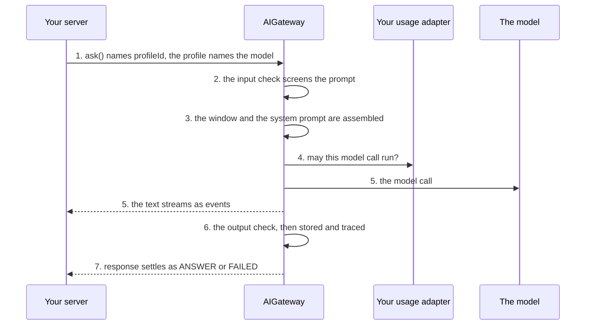

# Answer a question

**This path is complete for its goal.** Its chapters, its examples and the pages it links are all you need; no other page
of the documentation is required. It starts from four pages of Getting started:
[What is the AI gateway](../10-getting-started/10-what-is-the-ai-gateway.md),
[Installation](../10-getting-started/20-installation.md), [Example: ask](../10-getting-started/30-example-ask.md),
[Example: run](../10-getting-started/40-example-run.md).

**Prerequisites:** the setup of [Installation](../10-getting-started/20-installation.md) and an OpenAI API key in
`OPENAI_API_KEY`: the configuration of [8.0](#80-the-configuration) reads it for the two OpenAI models of
Installation, `gpt-5-mini` and `text-embedding-3-small`. Examples [8.8](#88-the-next-question-goes-to-another-model) and [8.9](#89-the-call-sets-a-sampling-temperature) also call
the Claude model that [8.7](#87-an-admin-adds-a-model-and-a-profile-while-the-server-runs) adds: an Anthropic API key in `ANTHROPIC_API_KEY`.

## 1. About

One call, one answer: `ask()` with a profile, a prompt and what the screen knows. The answer is text, or a typed object
validated against a zod schema.

## 2. Description

The base of every other path. A question about an invoice, a help text for a field, a check of a form: the model answers
from the prompt and the call's `context`, calls no tool and never pauses. The answer is stored on a thread, so the next
call can continue the conversation.

Where it ends: a model that must read or change your data needs [Let the model act](020-let-the-model-act.md).

## 3. What you will be able to do

- Register a model and a profile, and name the profile on each call. Examples: [8.0](#80-the-configuration), [8.7](#87-an-admin-adds-a-model-and-a-profile-while-the-server-runs).
- Ask with a `prompt`, a `context` and per-call `instructions`. Example: [8.3](#83-the-screen-passes-the-open-record-and-its-own-instructions).
- Get a typed `structured` answer from an `outputSchema`, or text in the `outputFormat` your screen renders. Examples: [8.4](#84-the-answer-comes-back-as-typed-data), [8.5](#85-the-answer-is-plain-text-for-an-sms).
- Stream the answer as it is written. Example: [8.2](#82-the-answer-streams-to-the-screen-as-the-model-writes-it).
- Continue a conversation with the `threadId` of the last answer. Example: [8.6](#86-the-user-asks-a-follow-up-on-the-same-thread).
- Read why a call failed from its `issues`. Example: [8.10](#810-the-call-fails-or-is-rejected).

## 4. The parts

| # | Read                                                                                            | For                                                           |
|---|-------------------------------------------------------------------------------------------------|---------------------------------------------------------------|
| 1 | [Models and profiles](../20-learn-the-gateway/010-models-and-profiles.md)                       | the model a profile names, its caps and its price             |
| 2 | [Example: ask](../10-getting-started/30-example-ask.md#the-parts-of-the-call)                   | the fields of a call                                          |
| 3 | [System prompt layers](../60-architecture/40-system-prompt-production-layers.md)                | where the profile's addendum, `instructions` and `context` go |
| 4 | [Guardrails: Structured output](../20-learn-the-gateway/050-guardrails.md#24-structured-output) | how the answer is checked against `outputSchema`              |
| 5 | [Thread memory: About](../20-learn-the-gateway/080-thread-memory.md#1-about)                    | what a follow-up on the same thread sees                      |
| 6 | [Token control with the Usage Guard: About](../20-learn-the-gateway/060-usage-guard.md#1-about) | the adapter that is asked before the model call               |

## 5. How the parts connect



1. The call names `profileId`; the profile names the model ([One call](../20-learn-the-gateway/010-models-and-profiles.md#24-one-call)).
2. The input check screens the prompt ([The input check](../20-learn-the-gateway/050-guardrails.md#21-the-input-check)).
3. The thread's window and the system prompt are assembled: template, addendum, `instructions`, `context`
   ([The layers](../60-architecture/40-system-prompt-production-layers.md#the-layers-in-the-order-the-model-reads-them)).
4. Your usage adapter allows the model call ([Every model call is asked and reported](../20-learn-the-gateway/060-usage-guard.md#21-every-model-call-is-asked-and-reported)).
5. The model answers; the text streams as events ([D38](../60-architecture/90-decisions.md#d38-a-call-returns-its-stream-and-its-response)).
6. The output check validates the answer, then it is stored and traced
   ([The output check](../20-learn-the-gateway/050-guardrails.md#22-the-output-check)).
7. `response` settles as `ANSWER` or `FAILED`.

The whole sequence, with the classes behind each step: [Execution](../60-architecture/10-architecture-and-trade-offs.md#3-execution).

## 6. API you should know

Grouped by the step of your code where you meet them, in the order of the examples.

### 6.1 Set up

Examples: [8.0](#80-the-configuration), [8.7](#87-an-admin-adds-a-model-and-a-profile-while-the-server-runs).

| Symbol                                                                                                             | What you use it for          |
|--------------------------------------------------------------------------------------------------------------------|------------------------------|
| [`IAIGatewayConfig`](../30-api/index/interfaces/IAIGatewayConfig.md)                                               | the configuration            |
| [`IAIProfile`](../30-api/index/interfaces/IAIProfile.md)                                                           | the profile                  |
| [`IModelInfo`](../30-api/index/interfaces/IModelInfo.md), [`IModelCaps`](../30-api/index/interfaces/IModelCaps.md) | the model and what it can do |

### 6.2 Make the call

Examples: [8.1](#81-the-user-asks-a-question-and-gets-one-answer), [8.2](#82-the-answer-streams-to-the-screen-as-the-model-writes-it), [8.3](#83-the-screen-passes-the-open-record-and-its-own-instructions), [8.4](#84-the-answer-comes-back-as-typed-data), [8.5](#85-the-answer-is-plain-text-for-an-sms), [8.6](#86-the-user-asks-a-follow-up-on-the-same-thread), [8.8](#88-the-next-question-goes-to-another-model), [8.9](#89-the-call-sets-a-sampling-temperature), [8.10](#810-the-call-fails-or-is-rejected).

| Symbol                                                               | What you use it for                                                                         |
|----------------------------------------------------------------------|---------------------------------------------------------------------------------------------|
| [`AIGateway.ask`](../30-api/index/classes/AIGateway.md#ask)          | the call                                                                                    |
| [`IGatewayAskInput`](../30-api/index/interfaces/IGatewayAskInput.md) | its fields: `prompt`, `context`, `instructions`, `outputSchema`, `outputFormat`, `threadId` |
| [`IUserContext`](../30-api/index/interfaces/IUserContext.md)         | who calls                                                                                   |
| [`EOutputFormat`](../30-api/index/enumerations/EOutputFormat.md)     | `MARKDOWN` or `PLAIN`                                                                       |

### 6.3 Read the result

Examples: [8.1](#81-the-user-asks-a-question-and-gets-one-answer), [8.2](#82-the-answer-streams-to-the-screen-as-the-model-writes-it), [8.3](#83-the-screen-passes-the-open-record-and-its-own-instructions), [8.4](#84-the-answer-comes-back-as-typed-data), [8.6](#86-the-user-asks-a-follow-up-on-the-same-thread), [8.10](#810-the-call-fails-or-is-rejected).

| Symbol                                                                         | What you use it for                                 |
|--------------------------------------------------------------------------------|-----------------------------------------------------|
| [`ELLMClientEventKind`](../30-api/index/enumerations/ELLMClientEventKind.md)   | the events of the stream                            |
| [`TGatewayResponse`](../30-api/index/type-aliases/TGatewayResponse.md)         | what `response` settles to                          |
| [`EGatewayResponseKind`](../30-api/index/enumerations/EGatewayResponseKind.md) | `ANSWER`, `FAILED`                                  |
| [`IAnswerResponse`](../30-api/index/interfaces/IAnswerResponse.md)             | `text`, `structured`, `threadId`, `usage`, `issues` |
| [`IFailedResponse`](../30-api/index/interfaces/IFailedResponse.md)             | the `issues` of a failed call                       |
| [`IIssue`](../30-api/index/interfaces/IIssue.md)                               | one issue: `code`, `severity`, the message          |

## 7. Advanced API

Grouped by the part of the gateway you replace.

### 7.1 The model call

| Symbol                                                   | Replace it when                        |
|----------------------------------------------------------|----------------------------------------|
| [`ILLMClient`](../30-api/index/interfaces/ILLMClient.md) | another SDK, a proxy, a fake for tests |

### 7.2 The system prompt

| Symbol                                                                       | Replace it when                                          |
|------------------------------------------------------------------------------|----------------------------------------------------------|
| [`IContextAssembler`](../30-api/index/interfaces/IContextAssembler.md)       | the system prompt and the history are assembled your way |
| [`IPromptTemplateStore`](../30-api/index/interfaces/IPromptTemplateStore.md) | the template is versioned your way                       |

### 7.3 The models and the profiles

| Symbol                                                                                                                               | Replace it when                                                                        |
|--------------------------------------------------------------------------------------------------------------------------------------|----------------------------------------------------------------------------------------|
| [`IModelRegistry`](../30-api/index/interfaces/IModelRegistry.md), [`IAIProfileStore`](../30-api/index/interfaces/IAIProfileStore.md) | the catalog and the profiles come from elsewhere; a repository is enough in most cases |

### 7.4 Plugging your class in

| Symbol                                                                     | What it is                                               |
|----------------------------------------------------------------------------|----------------------------------------------------------|
| [`IAIGatewayOverrides`](../30-api/index/interfaces/IAIGatewayOverrides.md) | the second argument of `AIGateway`: one factory per part |

The pattern: [What can be injected](../60-architecture/50-live-adjustment-and-dependency-injection.md#23-what-can-be-injected).

## 8. Examples

The examples run on the `gateway` of 8.0 and the `userContext` of [Example: ask](../10-getting-started/30-example-ask.md). Names such as `invoices` or `ledger` stand for your application's code.

### 8.0 The configuration

The examples ask on one profile; 8.7 adds a model and a second profile while the server runs. The keys this path uses come first, each with why; the others are required by `IAIGatewayConfig` and keep the values of [Installation](../10-getting-started/20-installation.md), with the features this path does not need switched off. `gpt5Mini` and `textEmbedding3Small` are the models of Installation.

> **The bigger picture:** Your server builds this gateway once at startup, with the providers, the models and the profile of the tenant; every question of every user goes through it.

```ts
import {
  AIGateway,
  IAIGatewayConfig,
  IAIProfile,
  EModelProvider,
  InMemoryAIProfileRepository,
  InMemoryBlobAdapter,
  InMemoryModelRegistryRepository,
  InMemoryPromptTemplateRepository,
  InMemoryRunRepository,
  InMemoryThreadRepository,
  InMemoryTraceRepository,
  InMemoryUsageAdapter,
  InMemoryUserMemoryRepository,
  InMemoryVectorIndexAdapter,
} from "dyna-ai-gateway";

const accounting: IAIProfile = {
  id: "accounting",
  tenantId: "acme",
  name: "Accounting assistant",
  modelId: "gpt-5-mini",
  promptAddendum: "You assist the accounting team of a Norwegian company. Amounts are in NOK.",
  allowedTools: [],
  approvals: [],
  limits: {maxStepsPerRun: 6, maxOutputTokens: 2_000},
};

const config: IAIGatewayConfig = {
  // What this path uses
  // the credentials of each provider; 8.7 adds a Claude model
  llmClient: {providers: {
    [EModelProvider.OPENAI]: {apiKey: process.env.OPENAI_API_KEY ?? ""},
    [EModelProvider.ANTHROPIC]: {apiKey: process.env.ANTHROPIC_API_KEY ?? ""},
  }},
  // the models a profile may name, with their caps and prices
  modelRegistry: {repository: new InMemoryModelRegistryRepository({models: [gpt5Mini, textEmbedding3Small]})},
  // the profile every call names
  aiProfileStore: {repository: new InMemoryAIProfileRepository({profiles: [accounting]})},
  threadStore: {repository: new InMemoryThreadRepository()}, // the threads a follow-up continues (8.6)
  workingMemory: {enabled: true}, // what a follow-up sees of the thread

  // Required by IAIGatewayConfig, nothing specific to this path: the in-memory stores of Installation,
  // and the features this path does not need switched off
  promptTemplateStore: {repository: new InMemoryPromptTemplateRepository()},
  fileStore: {adapter: new InMemoryBlobAdapter(), path: "ai-files"},
  userMemoryStore: {repository: new InMemoryUserMemoryRepository(), enabled: false}, // user facts off
  embedder: {embeddingModelId: "text-embedding-3-small", dimensions: 1536},
  vectorStore: {adapter: new InMemoryVectorIndexAdapter({embeddingModelId: "text-embedding-3-small", dimensions: 1536})},
  queryRewriter: {enabled: false}, // no follow-up rewrite
  runStore: {repository: new InMemoryRunRepository()},
  humanGate: {userQuestions: {enabled: false}}, // the model asks no questions
  usageGuard: {adapter: new InMemoryUsageAdapter()},
  contextAssembler: {promptCaching: true, sharePromptCacheAcrossTenants: false},
  trace: {repository: new InMemoryTraceRepository()},
  defaultCheapModelId: "gpt-5-mini",
};

const gateway = new AIGateway(config);
```

### 8.1 The user asks a question and gets one answer

One `ask()` on the `accounting` profile, with no knowledge base. `response` settles once, and an `ANSWER` carries the text, in Markdown by default.

> **The bigger picture:** A help box or a "?" button: the user types a question, your server calls `ask()` and shows the text when it is complete.

```ts
import {EGatewayResponseKind} from "dyna-ai-gateway";

const result = await gateway.ask({
  userContext,
  profileId: "accounting",
  prompt: "What does reverse charge mean on an invoice?",
  kbFilters: {libraryIds: [], bookIds: []}, // no knowledge base
}).response;

if (result.kind === EGatewayResponseKind.ANSWER) console.log(result.text); // Markdown by default
```

### 8.2 The answer streams to the screen as the model writes it

The same call, read through `events`: each `TEXT_DELTA` adds text as it arrives. `ANSWER_WITHDRAWN` tells the screen to drop what it rendered, because an output check did not keep the answer.

> **The bigger picture:** The chat window, where the user sees the answer grow word by word instead of waiting for the whole of it.

```ts
import {ELLMClientEventKind} from "dyna-ai-gateway";

const {events, response} = gateway.ask({
  userContext,
  profileId: "accounting",
  prompt: "Explain the VAT codes of Norway in three lines.",
  kbFilters: {libraryIds: [], bookIds: []},
});

for await (const event of events) {
  if (event.kind === ELLMClientEventKind.TEXT_DELTA) process.stdout.write(event.text ?? "");
  if (event.kind === ELLMClientEventKind.ANSWER_WITHDRAWN) process.stdout.write("\n[withdrawn]\n"); // an output rule blocked it
}
const result = await response; // the stream ended because the response settled
```

### 8.3 The screen passes the open record and its own instructions

`context` shows the model the invoice the user is looking at, as data and not as instructions; `instructions` adds a rule for this call only. Neither is stored: the next call passes them again if it needs them.

> **The bigger picture:** The invoice screen: the user clicks "check this invoice", and your code sends the invoice on screen and the format that screen wants.

```ts
const result = await gateway.ask({
  userContext,
  profileId: "accounting",
  prompt: "Is anything wrong with this invoice?",
  context: JSON.stringify(invoice),                               // data, not instructions; not kept on the thread
  instructions: "Answer in at most five bullet points. Name the line numbers.", // this call only
  kbFilters: {libraryIds: [], bookIds: []},
}).response;
```

### 8.4 The answer comes back as typed data

With an `outputSchema`, the answer carries `structured`, an object of the schema's shape, which your code reads without parsing text.

> **The bigger picture:** A check whose result your code acts on: the screen marks the invoice lines the model lists, instead of showing a paragraph.

```ts
import {z} from "zod";
import {EGatewayResponseKind} from "dyna-ai-gateway";

const result = await gateway.ask({
  userContext,
  profileId: "accounting",
  prompt: "Which lines of this invoice are missing a VAT code?",
  context: JSON.stringify(invoice),
  outputSchema: z.object({lines: z.array(z.object({lineNo: z.number(), reason: z.string()}))}),
  kbFilters: {libraryIds: [], bookIds: []},
}).response;

if (result.kind === EGatewayResponseKind.ANSWER && result.structured) {
  for (const line of result.structured.lines) console.log(line.lineNo, line.reason); // typed by the schema
}
```

### 8.5 The answer is plain text, for an SMS

`outputFormat: EOutputFormat.PLAIN` asks for text with no Markdown at all. The caller chooses the format per call, because it knows where the text goes.

> **The bigger picture:** A notification job: the text goes to an SMS or a voice message, where Markdown symbols would show as they are.

```ts
import {EOutputFormat} from "dyna-ai-gateway";

const {response} = gateway.ask({
  userContext,
  profileId: "accounting",
  prompt: "Tell the customer that invoice 2024-1187 is paid.",
  outputFormat: EOutputFormat.PLAIN, // no Markdown at all
  kbFilters: {libraryIds: [], bookIds: []},
});
```

### 8.6 The user asks a follow-up on the same thread

The second call passes the `threadId` of the first answer, so the model reads the earlier turns and understands "so" and "next".

> **The bigger picture:** The second message of a chat: the user does not repeat what was said, and your server keeps the `threadId` of the conversation.

```ts
import {EGatewayResponseKind} from "dyna-ai-gateway";

const first = await gateway.ask({
  userContext,
  profileId: "accounting",
  prompt: "Our VAT period is two months.",
  kbFilters: {libraryIds: [], bookIds: []},
}).response;
if (first.kind !== EGatewayResponseKind.ANSWER) throw new Error("No answer");

const second = await gateway.ask({
  userContext,
  profileId: "accounting",
  threadId: first.threadId, // the model reads the earlier turns
  prompt: "So when is the next filing due?",
  kbFilters: {libraryIds: [], bookIds: []},
}).response;
```

### 8.7 An admin adds a model and a profile while the server runs

`upsertModel` registers a Claude model and `upsertProfile` saves a second profile on it, with no restart. A profile is stored whole, so the code reads the existing one, spreads it and saves the copy.

> **The bigger picture:** The admin screen of your product: a new model is offered to a tenant, and the next call can name the new profile.

```ts
import {EModelProvider} from "dyna-ai-gateway";

await gateway.modelRegistry.upsertModel({
  model: {
    id: "claude-haiku-4-5",
    provider: EModelProvider.ANTHROPIC, // needs credentials in llmClient.providers
    providerModelId: "claude-haiku-4-5-20251001",
    label: "Claude Haiku 4.5",
    caps: {
      tools: true, images: true, pdf: true, structuredOutput: true, reasoning: true, temperature: true, embeddings: false,
      contextTokens: 200_000, maxOutputTokens: 64_000, costInPerMTokUsd: 1, costOutPerMTokUsd: 5,
    },
    enabled: true,
    deprecatedAt: null,
  },
});

const accounting = await gateway.aiProfileStore.getProfile({tenantId: "acme", profileId: "accounting"});
await gateway.aiProfileStore.upsertProfile({
  tenantId: "acme",
  profile: {
    ...accounting, // the profile is stored whole: read, spread, save
    id: "accounting-claude",
    name: "Accounting on Claude",
    modelId: "claude-haiku-4-5",
    allowedTools: [], // every name here must be a registered tool
    approvals: [],
  },
});
```

### 8.8 The next question goes to another model

A thread is bound to no profile. The call names `accounting-claude`, the profile of 8.7, on the same thread: the answer comes from another model, with the earlier turns in view.

> **The bigger picture:** A "try another model" button in the chat, or a second opinion on an answer the user doubts.

```ts
const {response} = gateway.ask({
  userContext,
  profileId: "accounting-claude", // a second profile of the tenant, on another model
  threadId,
  prompt: "Check your previous answer once more.",
  kbFilters: {libraryIds: [], bookIds: []},
});
```

### 8.9 The call sets a sampling temperature

`temperature` makes the answer more or less varied. It is accepted only on a profile whose model has `caps.temperature: true`; on another, the call is refused with a 400 before anything is stored.

> **The bigger picture:** A drafting button such as "suggest subject lines", where varied answers are wanted, on a profile whose model accepts a temperature.

```ts
const {response} = gateway.ask({
  userContext,
  profileId: "accounting-claude", // its model has caps.temperature: true; otherwise the call is a 400
  prompt: "Suggest three subject lines for the payment reminder.",
  temperature: 0.9,
  kbFilters: {libraryIds: [], bookIds: []},
});
```

### 8.10 The call fails, or is rejected

`response` settles as `FAILED` when the call ran and was refused, blocked or stopped; its `issues` say why, with a `userMessage` to show. It rejects when the call itself is wrong: an unknown profile, another user's thread, a busy thread.

> **The bigger picture:** The error handling around every call: a message in the chat for a failed answer, and a log or a 4xx of your own API for a call your code built wrong.

```ts
import {EGatewayResponseKind} from "dyna-ai-gateway";

try {
  const result = await gateway.ask({
    userContext,
    profileId: "accounting",
    prompt: "Summarise this invoice.",
    context: JSON.stringify(invoice),
    kbFilters: {libraryIds: [], bookIds: []},
  }).response;

  if (result.kind === EGatewayResponseKind.FAILED) {
    // e.g. usage_denied, a guardrail's code, call_timed_out
    showToUser(result.issues.map(issue => issue.userMessage).filter(Boolean).join(" "));
  }
} catch (error) {
  // a dynaError with a status: 400 (the input), 404 (the profile, the thread), 409 (a call already runs on the thread)
}
```

## 9. Pitfalls

- [Models and profiles: Pitfalls](../20-learn-the-gateway/010-models-and-profiles.md#4-pitfalls): no default profile, a
  temperature on a model without the cap, a provider without credentials.
- [Guardrails: Pitfalls](../20-learn-the-gateway/050-guardrails.md#4-pitfalls): what a failed output check does.
- `kbFilters` is required. A call without a knowledge base passes empty lists
  ([Example: ask](../10-getting-started/30-example-ask.md#the-parts-of-the-call)).
- `context` is not kept on the thread. A follow-up that needs it passes it again
  ([Example: ask](../10-getting-started/30-example-ask.md#the-parts-of-the-call)).

## 10. Summary

- A profile names the model; a call names the profile.
- `ask()` returns `events` and `response`; reading `events` is optional.
- `outputSchema` makes the answer `structured`, validated before it is stored.
- `threadId` continues the conversation; `context` and `instructions` are this call's only.

## 11. FAQ

- [How can the user change the model?](../10-getting-started/90-faq.md#how-can-the-user-change-the-model)
- [Is the system prompt cached, and what does it cost?](../10-getting-started/90-faq.md#is-the-system-prompt-cached-and-what-does-it-cost)
- [How much of the conversation does the model see, and how do I choose?](../10-getting-started/90-faq.md#how-much-of-the-conversation-does-the-model-see-and-how-do-i-choose)
- [Can one thread use two models?](../20-learn-the-gateway/010-models-and-profiles.md#6-faq)
