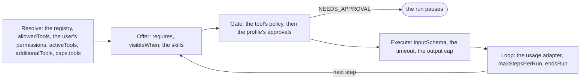

# Let the model act

**This path is complete for its goal.** Its chapters, its examples and the pages it links are all you need; no other page
of the documentation is required. It starts from four pages of Getting started:
[What is the AI gateway](../10-getting-started/10-what-is-the-ai-gateway.md),
[Installation](../10-getting-started/20-installation.md), [Example: ask](../10-getting-started/30-example-ask.md),
[Example: run](../10-getting-started/40-example-run.md).

## 1. About

`run()` is an agent loop: the model calls your tools, reads their results and calls again until it answers. Your code
defines the tools and decides which ones a profile, a user and a call may use; the gateway runs the loop.

## 2. Description

For every request the model cannot answer from the prompt alone: look up an order, check a balance, post a credit note.
A tool is data plus one function, and its `policy` decides each call before it runs. Skills give the model long
instructions it loads only when the task needs them.

Where it ends: a call that must wait for a person is [Keep a human in control](030-keep-a-human-in-control.md).

## 3. What you will be able to do

- Write a tool with `defineTool`, register it, and allow it on a profile. Examples: [8.0](#80-the-configuration), [8.1](#81-a-tool-that-reads-data-and-a-run-that-calls-it).
- Narrow the tools per user (permissions), per call (`activeTools`) and per step (`requires`, `visibleWhen`). Examples: [8.0](#80-the-configuration), [8.3](#83-a-tool-offered-only-on-the-first-step-and-a-tool-that-ends-the-run), [8.4](#84-one-call-offers-fewer-tools-than-the-profile-allows).
- Give one call a tool of its own (`additionalTools`). Example: [8.5](#85-one-call-brings-a-tool-of-its-own).
- Allow, deny or hold a tool call with its `policy`. Example: [8.2](#82-a-tool-that-changes-data-with-a-policy-that-decides-each-call).
- End the run from a tool (`endsRun`). Example: [8.3](#83-a-tool-offered-only-on-the-first-step-and-a-tool-that-ends-the-run).
- Know what the model reads when a tool fails, and get told yourself. Example: [8.0](#80-the-configuration).
- Give the model skills it loads on demand. Example: [8.6](#86-the-model-loads-a-skill-when-the-task-needs-it).

## 4. The parts

| # | Read                                                                                                                       | For                                                        |
|---|----------------------------------------------------------------------------------------------------------------------------|------------------------------------------------------------|
| 1 | [Example: run](../10-getting-started/40-example-run.md)                                                                    | one tool, one run                                          |
| 2 | [Tools](../20-learn-the-gateway/030-tools.md)                                                                              | the tool, its path through a run, its failures             |
| 3 | [Models and profiles: About](../20-learn-the-gateway/010-models-and-profiles.md#1-about)                                   | `allowedTools`, `approvals`, `parallelToolCalls`, `limits` |
| 4 | [Example: a human in the loop](../10-getting-started/45-example-HITL.md#the-verdicts-of-a-policy)                          | the three verdicts of a `policy`                           |
| 5 | [Skills](../20-learn-the-gateway/020-skills.md)                                                                            | instructions the model loads on demand                     |
| 6 | [Token control with the Usage Guard](../20-learn-the-gateway/060-usage-guard.md#21-every-model-call-is-asked-and-reported) | every step is a model call your adapter allows             |

## 5. How the parts connect



The path of one tool call is [Tools: The path of a tool call](../20-learn-the-gateway/030-tools.md#21-the-path-of-a-tool-call).
The parts of this path meet there:

| Step    | Part that decides                                                                                                                            |
|---------|----------------------------------------------------------------------------------------------------------------------------------------------|
| Resolve | the registry, the profile's `allowedTools`, the user's permissions, the call's `activeTools` and `additionalTools`, the model's `caps.tools` |
| Offer   | `requires` and `visibleWhen`, before every step; the skills' `dyna_aigw_load_skill`                                                          |
| Gate    | the tool's `policy`, then the profile's `approvals`; `NEEDS_APPROVAL` pauses the run                                                         |
| Execute | `inputSchema`, the timeout, the output cap; a failure becomes the tool's result                                                              |
| Loop    | the usage adapter before every step; `maxStepsPerRun`; a tool with `endsRun`                                                                 |

The layers only narrow: [Narrow, never widen](../20-learn-the-gateway/030-tools.md#23-narrow-never-widen). The loop is the
gateway's own, so a run can pause and continue in another process
([The agent loop is the gateway's own](../60-architecture/90-decisions.md#the-agent-loop-is-the-gateways-own)).

## 6. API you should know

Grouped by the step of your code where you meet them, in the order of the examples.

### 6.1 Write a tool

Examples: [8.1](#81-a-tool-that-reads-data-and-a-run-that-calls-it), [8.2](#82-a-tool-that-changes-data-with-a-policy-that-decides-each-call), [8.3](#83-a-tool-offered-only-on-the-first-step-and-a-tool-that-ends-the-run), [8.5](#85-one-call-brings-a-tool-of-its-own).

| Symbol                                                                                                                                                               | What you use it for                |
|----------------------------------------------------------------------------------------------------------------------------------------------------------------------|------------------------------------|
| [`defineTool`](../30-api/index/functions/defineTool.md)                                                                                                              | writes a tool with a typed input   |
| [`IToolDef`](../30-api/index/interfaces/IToolDef.md)                                                                                                                 | the fields of a tool               |
| [`IToolCallContext`](../30-api/index/interfaces/IToolCallContext.md)                                                                                                 | what `execute` receives            |
| [`EToolCallVerdict`](../30-api/index/enumerations/EToolCallVerdict.md)                                                                                               | `ALLOW`, `DENY`, `NEEDS_APPROVAL`  |
| [`TToolCallPolicyHandler`](../30-api/index/type-aliases/TToolCallPolicyHandler.md), [`TToolCallPolicyResult`](../30-api/index/type-aliases/TToolCallPolicyResult.md) | a `policy` that decides per call   |
| [`TToolEndsRunHandler`](../30-api/index/type-aliases/TToolEndsRunHandler.md)                                                                                         | an `endsRun` that decides per call |
| [`TToolVisibleWhenHandler`](../30-api/index/type-aliases/TToolVisibleWhenHandler.md)                                                                                 | the steps a tool is offered in     |

### 6.2 Register the tools and decide who sees them

Examples: [8.0](#80-the-configuration), [8.6](#86-the-model-loads-a-skill-when-the-task-needs-it).

| Symbol                                                                                                                         | What you use it for                                       |
|--------------------------------------------------------------------------------------------------------------------------------|-----------------------------------------------------------|
| [`IToolRegistryConfig`](../30-api/index/interfaces/IToolRegistryConfig.md)                                                     | `tools`, `toolTimeoutMs`, `maxOutputChars`, `onToolError` |
| [`IToolPolicyConfig`](../30-api/index/interfaces/IToolPolicyConfig.md)                                                         | `permissionsToTools`, `requires`                          |
| [`IAIProfileLimits`](../30-api/index/interfaces/IAIProfileLimits.md)                                                           | `maxStepsPerRun`                                          |
| [`ISkill`](../30-api/index/interfaces/ISkill.md), [`ISkillRegistryConfig`](../30-api/index/interfaces/ISkillRegistryConfig.md) | a skill and the caps of all skills                        |
| [`BUILT_IN_TOOL_NAMES`](../30-api/index/variables/BUILT_IN_TOOL_NAMES.md)                                                      | the gateway's own tools                                   |

### 6.3 Make the call

Examples: [8.1](#81-a-tool-that-reads-data-and-a-run-that-calls-it), [8.4](#84-one-call-offers-fewer-tools-than-the-profile-allows), [8.5](#85-one-call-brings-a-tool-of-its-own), [8.6](#86-the-model-loads-a-skill-when-the-task-needs-it), [8.7](#87-the-ui-shows-the-tool-calls-and-reads-how-the-run-ended).

| Symbol                                                               | What you use it for                                                   |
|----------------------------------------------------------------------|-----------------------------------------------------------------------|
| [`AIGateway.run`](../30-api/index/classes/AIGateway.md#run)          | the call                                                              |
| [`IGatewayRunInput`](../30-api/index/interfaces/IGatewayRunInput.md) | `activeTools`, `additionalTools`, `skills`, and the fields of `ask()` |

### 6.4 Follow the run

Example: [8.7](#87-the-ui-shows-the-tool-calls-and-reads-how-the-run-ended).

| Symbol                                                                                                                                             | What you use it for                                            |
|----------------------------------------------------------------------------------------------------------------------------------------------------|----------------------------------------------------------------|
| [`ELLMClientEventKind`](../30-api/index/enumerations/ELLMClientEventKind.md)                                                                       | `TOOL_REQUEST`, `TOOL_RESULT`, `STEP_END`, `RUN_ENDED_BY_TOOL` |
| [`TOnToolErrorHandler`](../30-api/index/type-aliases/TOnToolErrorHandler.md), [`IToolErrorReport`](../30-api/index/interfaces/IToolErrorReport.md) | being told that a tool failed                                  |

## 7. Advanced API

Grouped by the part of the gateway you replace.

### 7.1 The tools and the skills

| Symbol                                                           | Replace it when                             |
|------------------------------------------------------------------|---------------------------------------------|
| [`IToolRegistry`](../30-api/index/interfaces/IToolRegistry.md)   | the tools are offered and executed your way |
| [`ISkillRegistry`](../30-api/index/interfaces/ISkillRegistry.md) | the skills are resolved your way            |

### 7.2 Who may call a tool

| Symbol                                                     | Replace it when                                   |
|------------------------------------------------------------|---------------------------------------------------|
| [`IToolPolicy`](../30-api/index/interfaces/IToolPolicy.md) | allow, deny and approval follow rules of your own |

### 7.3 The hooks of the loop (read only)

| Symbol                                                             | Replace it when                                       |
|--------------------------------------------------------------------|-------------------------------------------------------|
| [`ILLMClientHooks`](../30-api/index/interfaces/ILLMClientHooks.md) | read only: the points where the loop asks the gateway |

### 7.4 Plugging your class in

| Symbol                                                                     | What it is                                                                                                 |
|----------------------------------------------------------------------------|------------------------------------------------------------------------------------------------------------|
| [`IAIGatewayOverrides`](../30-api/index/interfaces/IAIGatewayOverrides.md) | the second argument of `AIGateway`; the keys of 7.1 and 7.2: `toolRegistry`, `toolPolicy`, `skillRegistry` |

## 8. Examples

The examples run on the `gateway` of 8.0 and the `userContext` of [Example: ask](../10-getting-started/30-example-ask.md). Names such as `invoices` or `ledger` stand for your application's code.

### 8.0 The configuration

The tools are those of 8.1, 8.2 and 8.3; 8.5 adds one for a single call. The keys this path uses come first, each with why; the others are required by `IAIGatewayConfig` and keep the values of [Installation](../10-getting-started/20-installation.md), with the features this path does not need switched off. `gpt5Mini` and `textEmbedding3Small` are the models of Installation.

> **The bigger picture:** Your server builds this gateway once at startup: the tools are registered here and fixed for its lifetime, and each profile lists in `allowedTools` which of them its model may see.

```ts
import {
  AIGateway,
  IAIGatewayConfig,
  IAIProfile,
  EModelProvider,
  InMemoryAIProfileRepository,
  InMemoryBlobAdapter,
  InMemoryModelRegistryRepository,
  InMemoryPromptTemplateRepository,
  InMemoryRunRepository,
  InMemoryThreadRepository,
  InMemoryTraceRepository,
  InMemoryUsageAdapter,
  InMemoryUserMemoryRepository,
  InMemoryVectorIndexAdapter,
} from "dyna-ai-gateway";

const accounting: IAIProfile = {
  id: "accounting",
  tenantId: "acme",
  name: "Accounting assistant",
  modelId: "gpt-5-mini",
  promptAddendum: "You assist the accounting team of a Norwegian company. Amounts are in NOK.",
  allowedTools: ["get_invoice", "post_credit_note", "classify_intent", "handover_to_agent"],
  approvals: [],
  limits: {maxStepsPerRun: 6, maxOutputTokens: 2_000},
};

const config: IAIGatewayConfig = {
  // What this path uses
  toolRegistry: {
    tools: [getInvoice, postCreditNote, classifyIntent, handOver], // 8.1, 8.2, 8.3: fixed at construction
    toolTimeoutMs: 15_000,  // each tool without its own timeoutMs
    maxOutputChars: 20_000, // a larger result is a 413 the model reads
    onToolError: (report): void => console.warn("tool failed", report.toolName, report.modelText), // you are told; the model reads modelText
  },
  toolPolicy: {
    permissionsToTools: {"billing.credit": ["post_credit_note"]}, // only users with this permission see the tool
    requires: {post_credit_note: ["get_invoice"]},               // offered once get_invoice ran in this run
  },
  // the profile lists the tools the model may see in allowedTools
  aiProfileStore: {repository: new InMemoryAIProfileRepository({profiles: [accounting]})},
  // gpt-5-mini has caps.tools: a model without it is offered no tool
  modelRegistry: {repository: new InMemoryModelRegistryRepository({models: [gpt5Mini, textEmbedding3Small]})},
  runStore: {repository: new InMemoryRunRepository()}, // a run that pauses for an approval is stored here

  // Required by IAIGatewayConfig, nothing specific to this path: the in-memory stores of Installation,
  // and the features this path does not need switched off
  llmClient: {providers: {[EModelProvider.OPENAI]: {apiKey: process.env.OPENAI_API_KEY ?? ""}}},
  promptTemplateStore: {repository: new InMemoryPromptTemplateRepository()},
  threadStore: {repository: new InMemoryThreadRepository()},
  fileStore: {adapter: new InMemoryBlobAdapter(), path: "ai-files"},
  workingMemory: {enabled: true},
  userMemoryStore: {repository: new InMemoryUserMemoryRepository(), enabled: false}, // user facts off
  embedder: {embeddingModelId: "text-embedding-3-small", dimensions: 1536},
  vectorStore: {adapter: new InMemoryVectorIndexAdapter({embeddingModelId: "text-embedding-3-small", dimensions: 1536})},
  queryRewriter: {enabled: false}, // no follow-up rewrite
  humanGate: {userQuestions: {enabled: false}}, // the model asks no questions
  usageGuard: {adapter: new InMemoryUsageAdapter()},
  contextAssembler: {promptCaching: true, sharePromptCacheAcrossTenants: false},
  trace: {repository: new InMemoryTraceRepository()},
  defaultCheapModelId: "gpt-5-mini",
};

const gateway = new AIGateway(config);
```

### 8.1 A tool that reads data, and a run that calls it

`get_invoice` is a tool with no `policy`, so every call of it is allowed. The `run()` on `accounting` lets the model call it and answers with what it returned.

> **The bigger picture:** The user asks in the chat about an invoice; the model looks it up in your system instead of guessing, and the answer quotes the real data.

```ts
import {z} from "zod";
import {EGatewayResponseKind, defineTool} from "dyna-ai-gateway";

const getInvoice = defineTool({
  name: "get_invoice",
  description: "Returns one invoice by its number: customer, totalCents (integer, cents), currency, paid.",
  inputSchema: z.object({invoiceNo: z.string()}),
  tags: ["billing"],
  execute: async ({input, userContext}) => invoices.load(userContext.tenantId, input.invoiceNo),
});

const result = await gateway.run({
  userContext,
  profileId: "accounting", // its allowedTools lists get_invoice
  prompt: "Is invoice 2024-1187 paid?",
  kbFilters: {libraryIds: [], bookIds: []},
}).response;
if (result.kind === EGatewayResponseKind.ANSWER) console.log(result.text);
```

### 8.2 A tool that changes data, with a policy that decides each call

The `policy` of `post_credit_note` runs on every call, before the tool: it denies a call on a closed period, asks for an approval above 5 000 and allows the rest.

> **The bigger picture:** The rules of your accounting, written once with the tool at startup: the model can propose a credit note, but your code decides whether it is posted.

```ts
import {z} from "zod";
import {EToolCallVerdict, TToolCallPolicyResult, defineTool} from "dyna-ai-gateway";

const postCreditNote = defineTool({
  name: "post_credit_note",
  description: "Posts a credit note against an invoice. Call get_invoice first. Returns {creditNoteNo}.",
  inputSchema: z.object({invoiceNo: z.string(), amount: z.number().positive(), reason: z.string()}),
  tags: ["billing"],
  policy: async ({input}): Promise<TToolCallPolicyResult> =>
    (await ledger.isPeriodClosed({invoiceNo: input.invoiceNo}))
      ? {verdict: EToolCallVerdict.DENY, reason: "The accounting period is closed. Tell the user to contact finance."}
      : {verdict: input.amount > 5_000 ? EToolCallVerdict.NEEDS_APPROVAL : EToolCallVerdict.ALLOW},
  execute: async ({input, userContext}) => ledger.postCreditNote(userContext.tenantId, input),
});
```

`DENY` gives the model the reason; `NEEDS_APPROVAL` pauses the run ([Keep a human in control](030-keep-a-human-in-control.md)).

### 8.3 A tool offered only on the first step, and a tool that ends the run

`visibleWhen` offers `classify_intent` on the first step only, so the model can state the intent before it picks other tools. `endsRun` ends the run after a hand-over that `execute` reports as accepted; the model then phrases a last answer without tools.

> **The bigger picture:** A support agent with many tools: it sorts the request first, and the conversation stops when a human agent takes the case.

```ts
import {z} from "zod";
import {defineTool} from "dyna-ai-gateway";

const classifyIntent = defineTool({
  name: "classify_intent",
  description: "Classifies the customer's request. Call it first.",
  inputSchema: z.object({intent: z.enum(["order", "refund", "other"])}),
  tags: ["routing"],
  visibleWhen: ({stepIndex}) => stepIndex === 0,
  execute: async ({input}) => ({intent: input.intent}),
});

const handOver = defineTool({
  name: "handover_to_agent",
  description: "Hands the conversation to a human agent. Call it when the customer asks for a human.",
  inputSchema: z.object({reason: z.string()}),
  tags: ["support"],
  execute: async ({input}) => tickets.open(input.reason),
  endsRun: ({output}) => output.accepted, // after execute: output is typed from its return type
});
```

### 8.4 One call offers fewer tools than the profile allows

`activeTools` narrows the tools of this call to `get_invoice`. It never widens what the profile and the user's permissions allow: a name outside that set is a 400.

> **The bigger picture:** A read-only screen: the same profile serves it, but a question asked there can never post a credit note.

```ts
const {response} = gateway.run({
  userContext,
  profileId: "accounting",
  prompt: "What is the total of invoice 2024-1187?",
  activeTools: ["get_invoice"], // the read-only screen: post_credit_note is not offered
  kbFilters: {libraryIds: [], bookIds: []},
});
```

### 8.5 One call brings a tool of its own

`additionalTools` adds `replace_draft_text` to this call only, with no entry in `allowedTools`. Permissions, the tool's `policy`, approvals, timeout and output cap apply to it as to every tool.

> **The bigger picture:** The letter editor: the tool writes into the draft open on the screen, so it exists only for the calls made from that screen.

```ts
import {z} from "zod";
import {defineTool} from "dyna-ai-gateway";

const replaceDraft = defineTool({
  name: "replace_draft_text",
  description: "Replaces the whole text of the letter the user is editing. Returns {saved}.",
  inputSchema: z.object({text: z.string().max(20_000)}),
  tags: ["drafts"],
  execute: async ({input, userContext}) => drafts.replaceText({tenantId: userContext.tenantId, draftId: "draft-981", text: input.text}),
});

const {response} = gateway.run({
  userContext,
  profileId: "accounting",
  prompt: "Make the letter shorter.",
  additionalTools: [replaceDraft], // needs no entry in allowedTools
  kbFilters: {libraryIds: [], bookIds: []},
});
```

### 8.6 The model loads a skill when the task needs it

`skills` lists instructions by name and description; on `run()` the model loads the body of `refund_policy` only when the request is about a refund. `IAIProfile.skills` does the same for every call of a profile.

> **The bigger picture:** The rulebooks of your company that are too long to put in every prompt: the model reads the refund rules only when a customer asks for a refund.

```ts
import {ISkill} from "dyna-ai-gateway";

const refundPolicy: ISkill = {
  name: "refund_policy",
  description: "The refund rules: deadlines, amounts, who approves. Load it before you promise or refuse a refund.",
  body: "# Refund policy\n\n- Within 14 days of delivery.\n- Above 500 EUR a team lead approves.",
};

const {response} = gateway.run({
  userContext,
  profileId: "accounting",
  prompt: "Order 88231 arrived broken. I want my 640 EUR back.",
  skills: [refundPolicy], // or IAIProfile.skills for every call of the profile
  kbFilters: {libraryIds: [], bookIds: []},
});
```

### 8.7 The UI shows the tool calls, and reads how the run ended

Each `TOOL_REQUEST` event names the tool being called, so the screen can show progress; tools whose name starts with `BUILT_IN_TOOL_NAME_PREFIX` are the gateway's own. The response says whether a tool ended the run (`endedByTool`), whether the answer was cut (`output_truncated`), or whether a call waits for a human (`PAUSED`).

> **The bigger picture:** The chat screen while the agent works: "Working: get_invoice" under the question, then the answer, a hand-over notice, or a "waiting for approval" card.

```ts
import {BUILT_IN_TOOL_NAME_PREFIX, EGatewayResponseKind, ELLMClientEventKind} from "dyna-ai-gateway";

const {events, response} = gateway.run({
  userContext,
  profileId: "accounting",
  prompt: "Credit 300 NOK on invoice 2024-1187.",
  kbFilters: {libraryIds: [], bookIds: []},
});

for await (const event of events) {
  const call = event.toolCall;
  if (event.kind === ELLMClientEventKind.TOOL_REQUEST && call && !call.toolName.startsWith(BUILT_IN_TOOL_NAME_PREFIX)) {
    showProgress(`Working: ${call.toolName}`);
  }
}

const result = await response;
if (result.kind === EGatewayResponseKind.ANSWER) {
  result.endedByTool;                                                  // the tool with endsRun, if one ended it
  result.issues.some(issue => issue.code === "output_truncated");      // maxStepsPerRun or a refused step cut it
}
if (result.kind === EGatewayResponseKind.PAUSED) {
  // a call waits for a human: Keep a human in control
}
```

## 9. Pitfalls

- [Tools: Pitfalls](../20-learn-the-gateway/030-tools.md#4-pitfalls)
- [Skills: Pitfalls](../20-learn-the-gateway/020-skills.md#4-pitfalls)
- A tool the profile does not list in `allowedTools` never reaches the model
  ([Narrow, never widen](../20-learn-the-gateway/030-tools.md#23-narrow-never-widen)).
- A model without `caps.tools` behind a `run()` profile answers without calling a tool
  ([Models and profiles: Pitfalls](../20-learn-the-gateway/010-models-and-profiles.md#4-pitfalls)).
- A resume needs the same `additionalTools` again ([A paused run](../20-learn-the-gateway/030-tools.md#27-a-paused-run)).

## 10. Summary

- A tool is an `IToolDef` from `defineTool`; the model sees its name, description and input schema only.
- The run's tools come from the registry through `allowedTools`, or from the call through `additionalTools`; every layer
  after that narrows.
- `policy` decides each call; a failure is the tool's result and the run goes on.
- The run ends on an answer, `maxStepsPerRun`, a refused step or a tool with `endsRun`.
- Skills are listed in a `run()` and loaded with `dyna_aigw_load_skill`.

## 11. FAQ

- [How do I control whether a tool call runs?](../10-getting-started/90-faq.md#how-do-i-control-whether-a-tool-call-runs)
- [Do the tools of a step run in parallel? How do I switch it off?](../10-getting-started/90-faq.md#do-the-tools-of-a-step-run-in-parallel-how-do-i-switch-it-off)
- [What does the model read when my tool fails, and how do I get told?](../10-getting-started/90-faq.md#what-does-the-model-read-when-my-tool-fails-and-how-do-i-get-told)
- [How does a run end, and can a tool end it?](../10-getting-started/90-faq.md#how-does-a-run-end-and-can-a-tool-end-it)
- [Can a tool be offered only in some steps of a run?](../10-getting-started/90-faq.md#can-a-tool-be-offered-only-in-some-steps-of-a-run)
- [How do I give the model instructions it loads only when it needs them?](../10-getting-started/90-faq.md#how-do-i-give-the-model-instructions-it-loads-only-when-it-needs-them)
- [Tools: FAQ](../20-learn-the-gateway/030-tools.md#6-faq), [Skills: FAQ](../20-learn-the-gateway/020-skills.md#6-faq)
