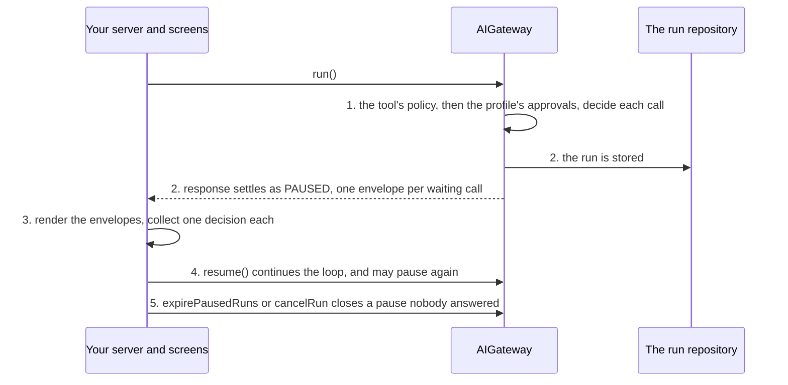

# Keep a human in control

**This path is complete for its goal.** Its chapters, its examples and the pages it links are all you need; no other page
of the documentation is required. It starts from four pages of Getting started:
[What is the AI gateway](../10-getting-started/10-what-is-the-ai-gateway.md),
[Installation](../10-getting-started/20-installation.md), [Example: ask](../10-getting-started/30-example-ask.md),
[Example: run](../10-getting-started/40-example-run.md).

**Prerequisites:** the setup of [Installation](../10-getting-started/20-installation.md) and an OpenAI API key in
`OPENAI_API_KEY`: the configuration of [8.0](#80-the-configuration) reads it for the two OpenAI models of
Installation, `gpt-5-mini` and `text-embedding-3-small`.

## 1. About

A `run()` stops and waits for a person: before a tool call runs, when the model asks the user a question, or before the
user sees the answer. The paused run is stored; `resume()` continues it with the person's decision, from another request,
hours later, on any instance.

## 2. Description

For every action with a cost or a side effect: a refund above a threshold, an email to a customer, a change of master data.
The tool's `policy` and the profile's `approvals` decide which calls wait. The model can also ask the user for a
missing detail, and a profile can send every answer to a reviewer.

Only a `run()` pauses. The tools it pauses on are in this path too: chapter 4 links how a tool is defined and gated, and
chapter 8 writes them.

## 3. What you will be able to do

- Make a tool call wait for an approver, always or per input. Example: [8.1](#81-a-tool-whose-every-call-waits-for-an-approver).
- Require approval per tenant with the profile's `approvals`. Example: [8.2](#82-one-tenant-requires-approval-where-the-tools-policy-allows-the-call).
- Render the cards of a `PAUSED` response and resume with `APPROVE`, `EDIT`, `REJECT` or `ANSWER`. Examples: [8.3](#83-the-run-pauses-and-the-approver-approves), [8.4](#84-the-approver-edits-or-rejects-the-call).
- Let the model ask the user questions and continue with the answers. Example: [8.6](#86-the-model-asks-the-user-a-question).
- Send every answer of a profile to a reviewer. Example: [8.7](#87-a-reviewer-checks-the-answer-before-the-user-sees-it).
- List, cancel and expire the paused runs. Example: [8.9](#89-the-pending-approvals-inbox-the-cancel-button-the-expiry-job).

## 4. The parts

| # | Read                                                                                                                          | For                                                  |
|---|-------------------------------------------------------------------------------------------------------------------------------|------------------------------------------------------|
| 1 | [Example: a human in the loop](../10-getting-started/45-example-HITL.md)                                                      | one approval, end to end                             |
| 2 | [Human in the loop](../20-learn-the-gateway/040-human-in-the-loop.md)                                                         | the three pause kinds, the decisions, resume, expiry |
| 3 | [Tools: The path of a tool call](../20-learn-the-gateway/030-tools.md#21-the-path-of-a-tool-call)                             | where the gate sits in a run                         |
| 4 | [Guardrails: Answers a user types on a resume](../20-learn-the-gateway/050-guardrails.md#29-answers-a-user-types-on-a-resume) | a free-text answer is screened like a prompt         |
| 5 | [Vercel chat client: Approvals](../10-getting-started/50-vercel-chat-client.md#4-approvals-and-the-other-decisions)           | the cards in a `useChat` screen                      |

## 5. How the parts connect



1. The tool's `policy`, then the profile's `approvals`, decide each call
   ([Who decides an approval](../20-learn-the-gateway/040-human-in-the-loop.md#21-who-decides-an-approval)). The model's
   question is a built-in tool that always waits ([The model asks the user](../20-learn-the-gateway/040-human-in-the-loop.md#22-the-model-asks-the-user));
   `reviewAnswers` holds the answer after the output check ([The review of the answer](../20-learn-the-gateway/040-human-in-the-loop.md#23-the-review-of-the-answer)).
2. The run is stored in the run repository and `response` settles as `PAUSED`, one envelope per waiting call
   ([The PAUSED response](../20-learn-the-gateway/040-human-in-the-loop.md#24-the-paused-response)).
3. Your application renders the envelopes and collects one decision each
   ([The decisions](../20-learn-the-gateway/040-human-in-the-loop.md#25-the-decisions)).
4. `resume()` continues the loop, and may pause again
   ([Resume](../20-learn-the-gateway/040-human-in-the-loop.md#26-resume),
   [A resume may pause again](../20-learn-the-gateway/040-human-in-the-loop.md#27-a-resume-may-pause-again)).
5. A pause nobody answers is closed by `expirePausedRuns` or `cancelRun`
   ([Expiry and cancel](../20-learn-the-gateway/040-human-in-the-loop.md#28-expiry-and-cancel)).

## 6. API you should know

Grouped by the step of your code where you meet them, in the order of the examples.

### 6.1 Decide what waits

Examples: [8.0](#80-the-configuration), [8.2](#82-one-tenant-requires-approval-where-the-tools-policy-allows-the-call).

| Symbol                                                                 | What you use it for          |
|------------------------------------------------------------------------|------------------------------|
| [`EToolCallVerdict`](../30-api/index/enumerations/EToolCallVerdict.md) | `NEEDS_APPROVAL`             |
| [`IAIProfile`](../30-api/index/interfaces/IAIProfile.md)               | `approvals`, `reviewAnswers` |
| [`IHumanGateConfig`](../30-api/index/interfaces/IHumanGateConfig.md)   | `timeoutMs`, `userQuestions` |

### 6.2 Read the pause

Examples: [8.1](#81-a-tool-whose-every-call-waits-for-an-approver), [8.3](#83-the-run-pauses-and-the-approver-approves), [8.6](#86-the-model-asks-the-user-a-question), [8.7](#87-a-reviewer-checks-the-answer-before-the-user-sees-it), [8.8](#88-resume-until-the-run-stops-pausing).

| Symbol                                                                                                                                                                                                                                                                 | What you use it for                               |
|------------------------------------------------------------------------------------------------------------------------------------------------------------------------------------------------------------------------------------------------------------------------|---------------------------------------------------|
| [`IPausedResponse`](../30-api/index/interfaces/IPausedResponse.md)                                                                                                                                                                                                     | `pauseId` and `envelopes`                         |
| [`TPauseEnvelope`](../30-api/index/type-aliases/TPauseEnvelope.md)                                                                                                                                                                                                     | one card                                          |
| [`IToolApprovalEnvelope`](../30-api/index/interfaces/IToolApprovalEnvelope.md)                                                                                                                                                                                         | a tool call that waits                            |
| [`IUserQuestionEnvelope`](../30-api/index/interfaces/IUserQuestionEnvelope.md)                                                                                                                                                                                         | the model's questions                             |
| [`IResultReviewEnvelope`](../30-api/index/interfaces/IResultReviewEnvelope.md)                                                                                                                                                                                         | an answer that waits for a reviewer               |
| [`EPauseKind`](../30-api/index/enumerations/EPauseKind.md)                                                                                                                                                                                                             | `TOOL_APPROVAL`, `USER_QUESTION`, `RESULT_REVIEW` |
| [`IUserQuestions`](../30-api/index/interfaces/IUserQuestions.md), [`IUserQuestion`](../30-api/index/interfaces/IUserQuestion.md), [`EUserQuestionMode`](../30-api/index/enumerations/EUserQuestionMode.md), [`IUserAnswer`](../30-api/index/interfaces/IUserAnswer.md) | the questions and the answers                     |

### 6.3 Decide and resume

Examples: [8.3](#83-the-run-pauses-and-the-approver-approves), [8.4](#84-the-approver-edits-or-rejects-the-call), [8.5](#85-the-approver-hands-the-run-to-a-senior-profile), [8.6](#86-the-model-asks-the-user-a-question), [8.7](#87-a-reviewer-checks-the-answer-before-the-user-sees-it), [8.8](#88-resume-until-the-run-stops-pausing).

| Symbol                                                                                                                               | What you use it for       |
|--------------------------------------------------------------------------------------------------------------------------------------|---------------------------|
| [`AIGateway.resume`](../30-api/index/classes/AIGateway.md#resume)                                                                    | continues a paused run    |
| [`IResumeDecision`](../30-api/index/interfaces/IResumeDecision.md), [`EResumeAction`](../30-api/index/enumerations/EResumeAction.md) | one decision per envelope |

### 6.4 The paused runs afterwards

Examples: [8.0](#80-the-configuration), [8.7](#87-a-reviewer-checks-the-answer-before-the-user-sees-it), [8.9](#89-the-pending-approvals-inbox-the-cancel-button-the-expiry-job).

| Symbol                                                                                                                                                                                                                         | What you use it for                |
|--------------------------------------------------------------------------------------------------------------------------------------------------------------------------------------------------------------------------------|------------------------------------|
| [`AIGateway.getPausedRun`](../30-api/index/classes/AIGateway.md#getpausedrun), [`listPausedRuns`](../30-api/index/classes/AIGateway.md#listpausedruns), [`IPausedRunSummary`](../30-api/index/interfaces/IPausedRunSummary.md) | the approval inbox                 |
| [`AIGateway.cancelRun`](../30-api/index/classes/AIGateway.md#cancelrun), [`expirePausedRuns`](../30-api/index/classes/AIGateway.md#expirepausedruns)                                                                           | closing a pause without a decision |
| [`IRunRepository`](../30-api/index/interfaces/IRunRepository.md), [`InMemoryRunRepository`](../30-api/index/classes/InMemoryRunRepository.md)                                                                                  | where paused runs are kept         |

## 7. Advanced API

Grouped by the part of the gateway you replace.

### 7.1 The pause and the resume

| Symbol                                                   | Replace it when                                   |
|----------------------------------------------------------|---------------------------------------------------|
| [`IHumanGate`](../30-api/index/interfaces/IHumanGate.md) | pause, resume and expiry follow rules of your own |

### 7.2 Where the runs are kept

| Symbol                                                 | Replace it when                                                |
|--------------------------------------------------------|----------------------------------------------------------------|
| [`IRunStore`](../30-api/index/interfaces/IRunStore.md) | runs are stored your way; a repository is enough in most cases |

### 7.3 Plugging your class in

| Symbol                                                                     | What it is                                                                               |
|----------------------------------------------------------------------------|------------------------------------------------------------------------------------------|
| [`IAIGatewayOverrides`](../30-api/index/interfaces/IAIGatewayOverrides.md) | the second argument of `AIGateway`; the keys of the parts above: `humanGate`, `runStore` |

## 8. Examples

Each example runs on the `gateway` and the `userContext` of 8.0: paste 8.0 and the example into one file. What comes from your application, such as `invoices` or `ledger`, is a `declare` line at the top of the example.

### 8.0 The configuration

`getInvoice` and `postCreditNote` are the tools of [Example: a human in the loop](../10-getting-started/45-example-HITL.md) and `sendEmail` the one 8.1 explains, all three defined here; the profiles are those the examples run and resume on. The keys this path uses come with why. The others are required by `IAIGatewayConfig` and keep the values of [Installation](../10-getting-started/20-installation.md), with the features this path does not need switched off; most of them are `baseConfig`, collapsed above the configuration, which spreads it first: a key the path sets wins over it. `gpt5Mini` and `textEmbedding3Small` are the models of Installation, in the same collapsed block.

> **The bigger picture:** Your server builds this gateway once at startup and serves every tenant and every user with it. The tools and the policies are the same for all tenants; what one tenant changes lives in its own profiles.

<details>
<summary>The models of Installation, and <code>baseConfig</code>: the keys <code>IAIGatewayConfig</code> requires that this path does not use</summary>

```ts
import {
  IAIGatewayConfig,
  IModelInfo,
  EModelProvider,
  InMemoryBlobAdapter,
  InMemoryPromptTemplateRepository,
  InMemoryThreadRepository,
  InMemoryTraceRepository,
  InMemoryUsageAdapter,
  InMemoryUserMemoryRepository,
  InMemoryVectorIndexAdapter,
} from "dyna-ai-gateway";

// The two models of Installation
const gpt5Mini: IModelInfo = {
  id: "gpt-5-mini",
  provider: EModelProvider.OPENAI,
  providerModelId: "gpt-5-mini",
  label: "GPT-5 mini",
  caps: {
    tools: true, images: true, pdf: true, structuredOutput: true, reasoning: true, temperature: false, embeddings: false,
    contextTokens: 400_000, maxOutputTokens: 128_000, costInPerMTokUsd: 0.25, costOutPerMTokUsd: 2,
  },
  enabled: true,
  deprecatedAt: null,
};

const textEmbedding3Small: IModelInfo = {
  id: "text-embedding-3-small",
  provider: EModelProvider.OPENAI,
  providerModelId: "text-embedding-3-small",
  label: "text-embedding-3-small",
  caps: {
    tools: false, images: false, pdf: false, structuredOutput: false, reasoning: false, temperature: false, embeddings: true,
    contextTokens: 8_191, maxOutputTokens: 0, costInPerMTokUsd: 0.02, costOutPerMTokUsd: 0,
  },
  enabled: true,
  deprecatedAt: null,
};

// Required by IAIGatewayConfig, nothing specific to this path: the in-memory stores of Installation,
// and the features this path does not need switched off
const baseConfig = {
  promptTemplateStore: {repository: new InMemoryPromptTemplateRepository()},
  threadStore: {repository: new InMemoryThreadRepository()},
  fileStore: {adapter: new InMemoryBlobAdapter(), path: "ai-files"},
  workingMemory: {enabled: true},
  userMemoryStore: {repository: new InMemoryUserMemoryRepository(), enabled: false}, // user facts off
  embedder: {embeddingModelId: "text-embedding-3-small", dimensions: 1536},
  vectorStore: {adapter: new InMemoryVectorIndexAdapter({embeddingModelId: "text-embedding-3-small", dimensions: 1536})},
  queryRewriter: {enabled: false}, // no follow-up rewrite
  usageGuard: {adapter: new InMemoryUsageAdapter()},
  contextAssembler: {promptCaching: true, sharePromptCacheAcrossTenants: false},
  trace: {repository: new InMemoryTraceRepository()},
  defaultCheapModelId: "gpt-5-mini",
} satisfies Partial<IAIGatewayConfig>;
```

</details>

```ts
import {z} from "zod";
import {
  AIGateway,
  IAIProfile,
  IUserContext,
  EToolCallVerdict,
  InMemoryAIProfileRepository,
  InMemoryModelRegistryRepository,
  InMemoryRunRepository,
  defineTool,
} from "dyna-ai-gateway";

// your application's own code
declare const invoices: {load(tenantId: string, invoiceNo: string): Promise<object | null>};
declare const ledger: {postCreditNote(tenantId: string, input: {invoiceNo: string; amount: number; reason: string}): Promise<{creditNoteNo: string}>};
declare const mailer: {send(tenantId: string, email: {invoiceNo: string; subject: string; body: string}): Promise<{messageId: string}>};

// the tools every example runs on
const getInvoice = defineTool({
  name: "get_invoice",
  description: "Returns one invoice by its number: customer, totalCents (integer, cents), currency, paid.",
  inputSchema: z.object({invoiceNo: z.string()}),
  tags: ["billing"],
  execute: async ({input, userContext}) => invoices.load(userContext.tenantId, input.invoiceNo),
});

const postCreditNote = defineTool({
  name: "post_credit_note",
  description: "Posts a credit note against an invoice. Call get_invoice first. Returns {creditNoteNo}.",
  inputSchema: z.object({invoiceNo: z.string(), amount: z.number().positive(), reason: z.string()}),
  tags: ["billing"],
  execute: async ({input, userContext}) => ledger.postCreditNote(userContext.tenantId, input), // no policy: allowed, unless a profile lists it in approvals (8.2)
});

const sendEmail = defineTool({
  name: "send_customer_email",
  description: "Sends an email to the customer of an invoice. Returns {messageId}.",
  inputSchema: z.object({invoiceNo: z.string(), subject: z.string(), body: z.string()}),
  tags: ["email"],
  policy: EToolCallVerdict.NEEDS_APPROVAL, // a human approves every email
  execute: async ({input, userContext}) => mailer.send(userContext.tenantId, input),
});


const accounting: IAIProfile = {
  id: "accounting",
  tenantId: "acme",
  name: "Accounting assistant",
  modelId: "gpt-5-mini",
  promptAddendum: "You assist the accounting team of a Norwegian company. Amounts are in NOK.",
  allowedTools: ["get_invoice", "post_credit_note", "send_customer_email"],
  approvals: [],
  limits: {maxStepsPerRun: 6, maxOutputTokens: 2_000},
};

const accountingSenior: IAIProfile = {
  id: "accounting-senior",
  tenantId: "acme",
  name: "Accounting, senior approver",
  modelId: "gpt-5-mini",
  promptAddendum: "You assist the accounting team of a Norwegian company. Amounts are in NOK.",
  allowedTools: ["get_invoice", "post_credit_note", "send_customer_email"],
  approvals: [],
  limits: {maxStepsPerRun: 6, maxOutputTokens: 2_000},
};

const accountingReviewed: IAIProfile = {
  id: "accounting-reviewed",
  tenantId: "acme",
  name: "Accounting, every answer reviewed",
  modelId: "gpt-5-mini",
  promptAddendum: "You assist the accounting team of a Norwegian company. Amounts are in NOK.",
  allowedTools: ["get_invoice"],
  approvals: [],
  limits: {maxStepsPerRun: 6, maxOutputTokens: 2_000},
  reviewAnswers: true, // 8.7: every run() answer waits for a reviewer
};

const config: IAIGatewayConfig = {
  ...baseConfig, // the required keys this path does not use, collapsed above; a key below wins over it

  // What this path uses
  toolRegistry: {tools: [getInvoice, postCreditNote, sendEmail]}, // each tool's policy decides which calls wait
  // approvals and reviewAnswers are profile fields
  aiProfileStore: {repository: new InMemoryAIProfileRepository({profiles: [accounting, accountingSenior, accountingReviewed]})},
  // how long a pause waits; the model may ask the user (8.6)
  humanGate: {timeoutMs: 24 * 60 * 60_000, userQuestions: {enabled: true}},
  // the paused runs; your IRunRepository keeps them across restarts and instances
  runStore: {repository: new InMemoryRunRepository()},

  // required too, and kept in view: the provider key, the models
  llmClient: {providers: {[EModelProvider.OPENAI]: {apiKey: process.env.OPENAI_API_KEY ?? ""}}},
  modelRegistry: {repository: new InMemoryModelRegistryRepository({models: [gpt5Mini, textEmbedding3Small]})},
};

const gateway = new AIGateway(config);

// Per request, from your authentication: who asks, in which tenant (Example: ask)
const userContext: IUserContext = {
  tenantId: "acme",
  userId: "u-17",
  permissions: [],
  locale: "en-GB",
  timezone: "Europe/Oslo",
  now: new Date(),
};

// The approver: per request too, from the approver's own session
const approverContext: IUserContext = {...userContext, userId: "u-42"};
```

### 8.1 A tool whose every call waits for an approver

The own `policy` of `send_customer_email` (8.0) is `NEEDS_APPROVAL`, so no call of it runs before a human approves it, on every profile and for every tenant.

> **The bigger picture:** A rule of the product itself: no email reaches a customer without a human, whoever the tenant is. It is written once, with the tool, at startup.

```ts
import {EGatewayResponseKind, EPauseKind} from "dyna-ai-gateway";

const result = await gateway.run({
  userContext,
  profileId: "accounting",
  prompt: "Email the customer of invoice 2024-1187 that the payment is ten days late.",
  kbFilters: {libraryIds: [], bookIds: []},
}).response;
if (result.kind === EGatewayResponseKind.PAUSED) {
  for (const envelope of result.envelopes) {
    if (envelope.kind === EPauseKind.TOOL_APPROVAL) console.log("waits for an approver:", envelope.toolCall.toolName);
  }
}
```

### 8.2 One tenant requires approval where the tool's policy allows the call

The tools are shared by every tenant; a profile belongs to one. `approvals` on the profile of `acme` makes every `post_credit_note` call wait in the runs on that profile, while the other tenants keep the tool's own policy. It only adds waits: a call the policy denies stays denied.

> **The bigger picture:** The settings screen of one customer company: its admin decides that, in their company, every credit note needs a second person. The other companies on the same server are not affected.

```ts
const strictAccounting: IAIProfile = {
  id: "accounting-strict",
  tenantId: "acme",
  name: "Accounting, every credit note approved",
  modelId: "gpt-5-mini",
  promptAddendum: "You assist the accounting team. Amounts are in NOK.",
  allowedTools: ["get_invoice", "post_credit_note"],
  approvals: ["post_credit_note"], // the floor: an ALLOW becomes NEEDS_APPROVAL; a DENY stays a DENY
  limits: {maxStepsPerRun: 6, maxOutputTokens: 2_000},
};

await gateway.aiProfileStore.upsertProfile({tenantId: "acme", profile: strictAccounting});

const paused = await gateway.run({
  userContext,
  profileId: "accounting-strict",
  prompt: "Credit 300 NOK on invoice 2024-1187: the shipping fee was charged twice.",
  kbFilters: {libraryIds: [], bookIds: []},
}).response; // PAUSED: the post_credit_note call waits for the approver (8.4)
```

### 8.3 The run pauses, and the approver approves

The `run()` stops before the tool call and settles as `PAUSED`, one envelope per waiting call. The approver's `resume()` carries one decision per envelope; the run then goes on and ends with the answer.

> **The bigger picture:** The accountant asks in the chat and sees "waiting for approval"; the approver opens the card in their own screen, approves, and the accountant's chat receives the answer.

```ts
import {
  EGatewayResponseKind,
  EPauseKind,
  EResumeAction,
  IResumeDecision,
  IUserAnswer,
  IUserQuestions,
} from "dyna-ai-gateway";

declare function answersFrom(form: IUserQuestions): IUserAnswer[]; // your question card (8.6)

const paused = await gateway.run({
  userContext,
  profileId: "accounting",
  prompt: "Email the customer of invoice 2024-1187 that the payment is ten days late.", // send_customer_email waits (8.1)
  kbFilters: {libraryIds: [], bookIds: []},
}).response;

if (paused.kind === EGatewayResponseKind.PAUSED) {
  // One envelope per waiting call: render each as a card, collect one decision each
  const decisions = paused.envelopes.map((envelope): IResumeDecision => {
    switch (envelope.kind) {
      case EPauseKind.TOOL_APPROVAL:
        return {callId: envelope.callId, action: EResumeAction.APPROVE}; // envelope.toolCall: the name and the input
      case EPauseKind.USER_QUESTION:
        return {callId: envelope.callId, action: EResumeAction.ANSWER, answers: answersFrom(envelope.userQuestions)}; // 8.6
      case EPauseKind.RESULT_REVIEW:
        return {action: EResumeAction.APPROVE}; // always the only card, no callId (8.7)
    }
  });

  const done = await gateway.resume({
    userContext: approverContext, // the tool runs with the approver's context; the run stays the asker's
    runId: paused.envelopes[0].runId,
    pauseId: paused.pauseId,
    decisions,
  }).response;
}
```

### 8.4 The approver edits or rejects the call

Instead of approving, the approver changes the input of the call (the policy decides again on it) or rejects it with a text the model reads before it answers without the tool.

> **The bigger picture:** The approval card has three buttons: approve, edit, reject. These are the other two.

```ts
import {EResumeAction} from "dyna-ai-gateway";

// the ids of a post_credit_note card the approver opened: from the PAUSED response of 8.2 or listPausedRuns (8.9)
declare const runId: string;
declare const pauseId: string;

// The approver lowers the amount: the policy decides again on the edited input
await gateway.resume({
  userContext: approverContext,
  runId,
  pauseId,
  decisions: [{action: EResumeAction.EDIT, editedInput: {invoiceNo: "2024-1187", amount: 150, reason: "Double shipping fee"}}],
}).response;

// Or refuses it: the tool does not run, the model reads the text and answers without it
await gateway.resume({
  userContext: approverContext,
  runId,
  pauseId,
  decisions: [{action: EResumeAction.REJECT, text: "Shipping was charged once; check the bank statement."}],
}).response;
```

A pause with one card takes its decision without `callId`.

### 8.5 The approver hands the run to a senior profile

The decision names another `profileId`: the run continues on that profile, and the approvals of both profiles stay in force.

> **The bigger picture:** An escalation: the amount is above what the junior team may credit, so the approver lets the run go on with the senior accounting profile.

```ts
import {EResumeAction} from "dyna-ai-gateway";

// the ids of the card the approver opened: from the PAUSED response or listPausedRuns (8.9)
declare const runId: string;
declare const pauseId: string;

await gateway.resume({
  userContext: approverContext,
  runId,
  pauseId,
  decisions: [{action: EResumeAction.APPROVE}],
  profileId: "accounting-senior", // the run goes on on this profile; the approvals of both stay in force
}).response;
```

### 8.6 The model asks the user a question

With `humanGate.userQuestions` enabled, the model can pause the run with a card of questions. The asker answers with `EResumeAction.ANSWER`, and the run goes on with the answers.

> **The bigger picture:** The chat shows a small form ("which invoice do you mean?") instead of a guessed answer; the user picks an option and the conversation continues.

```ts
import {
  EGatewayResponseKind,
  EPauseKind,
  EResumeAction,
  EUserQuestionMode,
  IUserAnswer,
} from "dyna-ai-gateway";

const paused = await gateway.run({
  userContext,
  profileId: "accounting",
  prompt: "Is my invoice paid?", // which one: the model asks instead of guessing
  kbFilters: {libraryIds: [], bookIds: []},
}).response;

if (paused.kind === EGatewayResponseKind.PAUSED) {
  const [card] = paused.envelopes;
  if (card.kind === EPauseKind.USER_QUESTION) {
    // card.userQuestions: a title and the questions, each RADIO, CHECK or FREE_TEXT
    const answers = card.userQuestions.questions.map((question): IUserAnswer =>
      question.mode === EUserQuestionMode.FREE_TEXT
        ? {question: question.text, selected: [], freeText: "The one from March"}
        : {question: question.text, selected: question.options?.slice(0, 1) ?? []});

    await gateway.resume({
      userContext, // the asker answers
      runId: card.runId,
      pauseId: paused.pauseId,
      decisions: [{action: EResumeAction.ANSWER, answers}],
    }).response;
  }
}
```

### 8.7 A reviewer checks the answer before the user sees it

On a profile with `reviewAnswers: true`, the finished answer of every `run()` waits for a reviewer. The asker's card carries no draft; the reviewer reads it with `getPausedRun`.

> **The bigger picture:** A regulated reply: the answer to a customer is written by the model, but a team lead reads and corrects it in a review queue before it is sent.

```ts
import {EGatewayResponseKind, EPauseKind, EResumeAction} from "dyna-ai-gateway";

declare function showToUser(text: string): void; // your UI

const asked = await gateway.run({
  userContext,
  profileId: "accounting-reviewed", // reviewAnswers: true
  prompt: "Is invoice 2024-1187 paid?",
  kbFilters: {libraryIds: [], bookIds: []},
}).response; // PAUSED with one RESULT_REVIEW card; the asker's card carries no draft

if (asked.kind === EGatewayResponseKind.PAUSED) {
  const {runId} = asked.envelopes[0];
  const {pauseId} = asked; // or both from listPausedRuns (8.9)

  const run = await gateway.getPausedRun({tenantId: "acme", runId}); // raw ids: your host decides who may review
  for (const envelope of run.pending ?? []) {
    if (envelope.kind === EPauseKind.RESULT_REVIEW) showToUser(envelope.result?.text ?? ""); // the draft
  }

  await gateway.resume({
    userContext: approverContext,
    runId,
    pauseId,
    decisions: [{action: EResumeAction.EDIT, editedInput: "The corrected answer the user will read."}], // or APPROVE, or REJECT
  }).response;
}
```

### 8.8 Resume until the run stops pausing

A resumed run can pause again, with a new `pauseId` each time. A loop that resumes until the response is `ANSWER` or `FAILED` handles every case.

> **The bigger picture:** A run that needs two approvals in a row, or an approval and then a question: your server code drives it to the end with one helper.

```ts
import {EGatewayResponseKind, IPausedResponse, IResumeDecision, TGatewayResponse} from "dyna-ai-gateway";

const settle = async (
  first: TGatewayResponse,
  decide: (pause: IPausedResponse) => Promise<IResumeDecision[]>,
): Promise<TGatewayResponse> => {
  let response = first;
  while (response.kind === EGatewayResponseKind.PAUSED) {
    response = await gateway.resume({
      userContext: approverContext,
      runId: response.envelopes[0].runId,
      pauseId: response.pauseId, // a new pauseId on every pause of the run
      decisions: await decide(response),
    }).response;
  }
  return response; // ANSWER or FAILED
};
```

### 8.9 The pending-approvals inbox, the cancel button, the expiry job

`listPausedRuns` lists the calling user's paused runs, `cancelRun` closes one, and `expirePausedRuns` closes those that waited longer than `humanGate.timeoutMs`.

> **The bigger picture:** What happens after the pause: the user's "waiting" list in the UI, the button to give up, and the scheduled job on the server that cleans up what nobody decided.

```ts
declare const tenantIds: string[]; // your tenants

const inbox = await gateway.listPausedRuns({userContext}); // the calling user's paused runs
for (const summary of inbox) {
  // summary.runId, summary.pauseId, summary.envelopes, summary.expiresAt
}

const [oldest] = inbox;
if (oldest) await gateway.cancelRun({userContext, runId: oldest.runId}); // the user gives up

setInterval(async () => {
  for (const tenantId of tenantIds) await gateway.expirePausedRuns({tenantId}); // after humanGate.timeoutMs
}, 60_000);
```

## 9. Pitfalls

- [Human in the loop: Pitfalls](../20-learn-the-gateway/040-human-in-the-loop.md#4-pitfalls)
- `resume()` answers a pause and nothing else; a follow-up message is a new call
  ([Resume is only for a paused run](../60-architecture/90-decisions.md#resume-is-only-for-a-paused-run)).
- An `ask()` never pauses, and on a profile with `reviewAnswers` it is a 400
  ([Human in the loop: About](../20-learn-the-gateway/040-human-in-the-loop.md#1-about)).
- With `InMemoryRunRepository` a paused run is lost on a restart
  ([Storage and restarts](../20-learn-the-gateway/040-human-in-the-loop.md#211-storage-and-restarts)).

## 10. Summary

- A tool call waits when its `policy` or the profile's `approvals` say so; `DENY` wins.
- The model's questions and the answer review are pauses too.
- A `PAUSED` response carries one envelope per waiting call; `resume()` takes one decision per envelope.
- Paused runs live in your `IRunRepository`; `expirePausedRuns` closes the ones nobody answered.

## 11. FAQ

- [The run paused with several cards. How do I answer them?](../10-getting-started/90-faq.md#the-run-paused-with-several-cards-how-do-i-answer-them)
- [How do I have a human review the answer before the user sees it?](../10-getting-started/90-faq.md#how-do-i-have-a-human-review-the-answer-before-the-user-sees-it)
- [Who may read a thread, a file or a paused run?](../10-getting-started/90-faq.md#who-may-read-a-thread-a-file-or-a-paused-run)
- [Can a paused run continue on another model?](../20-learn-the-gateway/010-models-and-profiles.md#6-faq)
- [Human in the loop: FAQ](../20-learn-the-gateway/040-human-in-the-loop.md#6-faq)
