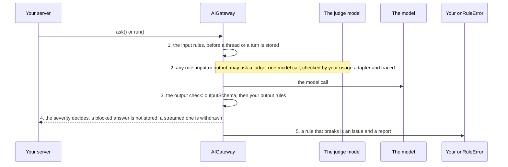

# Protect the conversation

**This path is complete for its goal.** Its chapters, its examples and the pages it links are all you need; no other page
of the documentation is required. It starts from four pages of Getting started:
[What is the AI gateway](../10-getting-started/10-what-is-the-ai-gateway.md),
[Installation](../10-getting-started/20-installation.md), [Example: ask](../10-getting-started/30-example-ask.md),
[Example: run](../10-getting-started/40-example-run.md).

## 1. About

Guardrails are rules on the prompt before the model sees it and on the answer before the user sees it. A rule is your
code: a regex, a moderation endpoint, or a judge call on the cheap model.

## 2. Description

For what must never pass: a card number in a prompt, a question outside the product's scope, an answer that is not
grounded in the documents or reveals the system prompt. A rule returns issues; the severity decides whether the call fails,
the answer is blocked, or the issue only travels on the answer.

Guardrails are one layer. What an injected prompt can do is limited by the tools a profile allows and the approvals it
requires (example 8.6, [How do I protect against prompt injection?](../10-getting-started/90-faq.md#how-do-i-protect-against-prompt-injection)).

## 3. What you will be able to do

- Write input rules and output rules, deterministic or with a judge. Examples: [8.1](#81-an-input-rule-blocks-a-prompt-that-carries-an-iban), [8.2](#82-a-judge-on-the-cheap-model-keeps-one-profile-on-its-topic), [8.3](#83-an-input-rule-screens-the-images-before-the-model-sees-them), [8.4](#84-an-output-rule-blocks-an-answer-that-leaks-the-system-prompt), [8.5](#85-a-grounding-judge-marks-unsupported-claims-without-blocking-the-answer).
- Choose the severity of each issue: fail, block, or warn. Examples: [8.1](#81-an-input-rule-blocks-a-prompt-that-carries-an-iban), [8.4](#84-an-output-rule-blocks-an-answer-that-leaks-the-system-prompt), [8.5](#85-a-grounding-judge-marks-unsupported-claims-without-blocking-the-answer).
- Read the verdict of a call from its `issues`. Example: [8.7](#87-the-screen-reads-the-verdict-and-removes-a-withdrawn-answer).
- Handle a streamed answer that is withdrawn. Example: [8.7](#87-the-screen-reads-the-verdict-and-removes-a-withdrawn-answer).
- Be told when a rule throws or times out. Example: [8.0](#80-the-configuration).

## 4. The parts

| # | Read                                                                                                                                            | For                                          |
|---|-------------------------------------------------------------------------------------------------------------------------------------------------|----------------------------------------------|
| 1 | [Guardrails](../20-learn-the-gateway/050-guardrails.md)                                                                                         | the rules, the stages, the judge, the errors |
| 2 | [Models and profiles: Main model and cheap model](../20-learn-the-gateway/010-models-and-profiles.md#23-main-model-and-cheap-model)             | the model a judge runs on                    |
| 3 | [Chat files: The files in the guardrails](../20-learn-the-gateway/092-chat-files.md#25-the-files-in-the-guardrails)                             | rules on images and PDFs                     |
| 4 | [What the gateway checks and what it trusts](../60-architecture/10-architecture-and-trade-offs.md#5-what-the-gateway-checks-and-what-it-trusts) | what no rule covers                          |

## 5. How the parts connect



1. The input rules run before a thread is created or a turn is stored: built-in first, then yours in parallel
   ([The input check](../20-learn-the-gateway/050-guardrails.md#21-the-input-check)).
2. A judge is one model call, on the profile's cheap model unless the rule picks the main one, checked by your usage adapter and traced
   ([The judge](../20-learn-the-gateway/050-guardrails.md#25-the-judge)).
3. After the model answered, the output check validates `outputSchema`, then your output rules run
   ([The output check](../20-learn-the-gateway/050-guardrails.md#22-the-output-check)).
4. The severity decides ([Issues and severity](../20-learn-the-gateway/050-guardrails.md#23-issues-and-severity)); a
   blocked answer is not stored and a streamed one is withdrawn
   ([A streamed answer that is blocked](../20-learn-the-gateway/050-guardrails.md#27-a-streamed-answer-that-is-blocked)).
5. A rule that breaks is an issue of its own and a report to `onRuleError`
   ([Rule errors](../20-learn-the-gateway/050-guardrails.md#26-rule-errors)).

## 6. API you should know

Grouped by the step of your code where you meet them, in the order of the examples.

### 6.1 Configure the checks

Example: [8.0](#80-the-configuration).

| Symbol                                                                 | What you use it for                                                           |
|------------------------------------------------------------------------|-------------------------------------------------------------------------------|
| [`IGuardrailsConfig`](../30-api/index/interfaces/IGuardrailsConfig.md) | `inputRules`, `outputRules`, `maxPromptChars`, `ruleTimeoutMs`, `onRuleError` |

### 6.2 Write a rule

Examples: [8.1](#81-an-input-rule-blocks-a-prompt-that-carries-an-iban), [8.2](#82-a-judge-on-the-cheap-model-keeps-one-profile-on-its-topic), [8.3](#83-an-input-rule-screens-the-images-before-the-model-sees-them), [8.4](#84-an-output-rule-blocks-an-answer-that-leaks-the-system-prompt), [8.5](#85-a-grounding-judge-marks-unsupported-claims-without-blocking-the-answer).

| Symbol                                                                                                                         | What you use it for                    |
|--------------------------------------------------------------------------------------------------------------------------------|----------------------------------------|
| [`IInputRule`](../30-api/index/interfaces/IInputRule.md), [`IInputEvidence`](../30-api/index/interfaces/IInputEvidence.md)     | a rule on the prompt and what it reads |
| [`IOutputRule`](../30-api/index/interfaces/IOutputRule.md), [`IOutputEvidence`](../30-api/index/interfaces/IOutputEvidence.md) | a rule on the answer and what it reads |
| [`IIssue`](../30-api/index/interfaces/IIssue.md), [`EIssueSeverity`](../30-api/index/enumerations/EIssueSeverity.md)           | what a rule returns                    |

### 6.3 Ask a judge inside a rule

Example: [8.2](#82-a-judge-on-the-cheap-model-keeps-one-profile-on-its-topic).

| Symbol                                                                                                                                                                                             | What you use it for               |
|----------------------------------------------------------------------------------------------------------------------------------------------------------------------------------------------------|-----------------------------------|
| [`IJudgeArgs`](../30-api/index/interfaces/IJudgeArgs.md), [`IInputJudgeArgs`](../30-api/index/interfaces/IInputJudgeArgs.md), [`IOutputJudgeArgs`](../30-api/index/interfaces/IOutputJudgeArgs.md) | a judge call                      |
| [`TInputJudgeHandler`](../30-api/index/type-aliases/TInputJudgeHandler.md), [`TOutputJudgeHandler`](../30-api/index/type-aliases/TOutputJudgeHandler.md)                                           | the `judge` a rule receives       |
| [`EJudgeModel`](../30-api/index/enumerations/EJudgeModel.md)                                                                                                                                       | the profile's cheap or main model |

### 6.4 Be told when a rule breaks

Example: [8.0](#80-the-configuration).

| Symbol                                                                                                                                             | What you use it for          |
|----------------------------------------------------------------------------------------------------------------------------------------------------|------------------------------|
| [`TOnRuleErrorHandler`](../30-api/index/type-aliases/TOnRuleErrorHandler.md), [`IRuleErrorReport`](../30-api/index/interfaces/IRuleErrorReport.md) | being told that a rule broke |
| [`ERuleStage`](../30-api/index/enumerations/ERuleStage.md), [`ERuleFailure`](../30-api/index/enumerations/ERuleFailure.md)                         | what the report says         |

## 7. Advanced API

Grouped by the part of the gateway you replace.

### 7.1 The checks

| Symbol                                                     | Replace it when         |
|------------------------------------------------------------|-------------------------|
| [`IGuardrails`](../30-api/index/interfaces/IGuardrails.md) | the checks run your way |

### 7.2 Plugging your class in

| Symbol                                                                     | What it is                                                                    |
|----------------------------------------------------------------------------|-------------------------------------------------------------------------------|
| [`IAIGatewayOverrides`](../30-api/index/interfaces/IAIGatewayOverrides.md) | the second argument of `AIGateway`; the keys of the parts above: `guardrails` |

## 8. Examples

The examples run on the `gateway` of 8.0 and the `userContext` of [Example: ask](../10-getting-started/30-example-ask.md). Names such as `invoices` or `ledger` stand for your application's code.

### 8.0 The configuration

The rules are those of 8.1 to 8.5. They are fixed at construction and apply to every profile: a rule picks its use case through `evidence.profile`. The keys this path uses come first, each with why; the others are required by `IAIGatewayConfig` and keep the values of [Installation](../10-getting-started/20-installation.md), with the features this path does not need switched off. `gpt5Mini` and `textEmbedding3Small` are the models of Installation.

> **The bigger picture:** Your server builds this gateway once at startup with every rule of every use case; from then on, each `ask()` and `run()` of every tenant passes through the same input and output checks.

```ts
import {
  AIGateway,
  IAIGatewayConfig,
  IAIProfile,
  EModelProvider,
  InMemoryAIProfileRepository,
  InMemoryBlobAdapter,
  InMemoryModelRegistryRepository,
  InMemoryPromptTemplateRepository,
  InMemoryRunRepository,
  InMemoryThreadRepository,
  InMemoryTraceRepository,
  InMemoryUsageAdapter,
  InMemoryUserMemoryRepository,
  InMemoryVectorIndexAdapter,
} from "dyna-ai-gateway";

const accounting: IAIProfile = {
  id: "accounting",
  tenantId: "acme",
  name: "Accounting assistant",
  modelId: "gpt-5-mini",
  promptAddendum: "You assist the accounting team of a Norwegian company. Amounts are in NOK.",
  allowedTools: [],
  approvals: [],
  limits: {maxStepsPerRun: 6, maxOutputTokens: 2_000},
};

const config: IAIGatewayConfig = {
  // What this path uses
  guardrails: {
    inputRules: [noPaymentData, accountingScope, imageModeration], // 8.1 to 8.3: before anything is stored
    outputRules: [noSystemPrompt, grounding],                      // 8.4, 8.5: before the answer is stored
    maxPromptChars: 8_000, // the built-in length rule
    ruleTimeoutMs: 8_000,  // a rule's own timeoutMs wins
    onRuleError: (report): void => console.error("rule failed", report.ruleName, report.stage, report.failure),
  },
  defaultCheapModelId: "gpt-5-mini", // the helper model; a judge runs on the profile's cheapModelId, else its modelId
  usageGuard: {adapter: new InMemoryUsageAdapter()}, // a judge is a model call: asked and reported like any other
  trace: {repository: new InMemoryTraceRepository()}, // a judge's issues are on its trace entry

  // Required by IAIGatewayConfig, nothing specific to this path: the in-memory stores of Installation,
  // and the features this path does not need switched off
  llmClient: {providers: {[EModelProvider.OPENAI]: {apiKey: process.env.OPENAI_API_KEY ?? ""}}},
  modelRegistry: {repository: new InMemoryModelRegistryRepository({models: [gpt5Mini, textEmbedding3Small]})},
  aiProfileStore: {repository: new InMemoryAIProfileRepository({profiles: [accounting]})},
  promptTemplateStore: {repository: new InMemoryPromptTemplateRepository()},
  threadStore: {repository: new InMemoryThreadRepository()},
  fileStore: {adapter: new InMemoryBlobAdapter(), path: "ai-files"},
  workingMemory: {enabled: true},
  userMemoryStore: {repository: new InMemoryUserMemoryRepository(), enabled: false}, // user facts off
  embedder: {embeddingModelId: "text-embedding-3-small", dimensions: 1536},
  vectorStore: {adapter: new InMemoryVectorIndexAdapter({embeddingModelId: "text-embedding-3-small", dimensions: 1536})},
  queryRewriter: {enabled: false}, // no follow-up rewrite
  runStore: {repository: new InMemoryRunRepository()},
  humanGate: {userQuestions: {enabled: false}}, // the model asks no questions
  contextAssembler: {promptCaching: true, sharePromptCacheAcrossTenants: false},
};

const gateway = new AIGateway(config);
```

### 8.1 An input rule blocks a prompt that carries an IBAN

`no_payment_data` tests the prompt with a regular expression, with no model call. An issue of severity `ERROR` fails the call before anything is stored, and its `userMessage` is the text the user sees.

> **The bigger picture:** A user pastes a bank account number into the chat; the message never reaches the model or the thread, and the chat asks them not to send it.

```ts
import {EIssueSeverity, IIssue, IInputRule} from "dyna-ai-gateway";

const IBAN = /\b[A-Z]{2}\d{2}(?:[ ]?[A-Z0-9]){11,30}\b/;

const noPaymentData: IInputRule = {
  name: "no_payment_data",
  check: async ({evidence}): Promise<IIssue[]> => IBAN.test(evidence.prompt)
    ? [{
      code: "payment_data",
      message: "The prompt contains an IBAN",
      severity: EIssueSeverity.ERROR, // the call fails before anything is stored
      field: "prompt",
      userMessage: "Please do not send account numbers in the chat.",
    }]
    : [],
};
```

### 8.2 A judge on the cheap model keeps one profile on its topic

`accounting_scope` returns no issue on any profile but `accounting`, and asks a judge on the profile's `cheapModelId`, or its `modelId` when it has none, whether the prompt is about accounting. `fileFilter: () => false` sends no file to the judge.

> **The bigger picture:** The accounting assistant refuses a question about the weather or a poem, while the other profiles of the same server answer what they are for.

```ts
import {EJudgeModel, IIssue, IInputRule} from "dyna-ai-gateway";

const accountingScope: IInputRule = {
  name: "accounting_scope",
  timeoutMs: 5_000,
  check: async ({evidence, judge}): Promise<IIssue[]> => {
    if (evidence.profile.id !== "accounting") return []; // the rules are global; a rule picks its use case
    return judge({
      instruction: "Report one issue with code `out_of_scope` and severity `ERROR` when the prompt is not about invoices, payments or bookkeeping.",
      model: EJudgeModel.CHEAP,
      fileFilter: () => false, // send no file to the judge
    });
  },
};
```

### 8.3 An input rule screens the images before the model sees them

`image_moderation` asks a judge only when the prompt has images, and sends only those images with it. A prompt without images costs no judge call.

> **The bigger picture:** The user attaches a photo to a question; an image that shows an identity document or violence fails the call before the main model reads it.

```ts
import {IInputRule} from "dyna-ai-gateway";

const imageModeration: IInputRule = {
  name: "image_moderation",
  check: async ({evidence, judge}) => evidence.files.some(file => file.mime.startsWith("image/"))
    ? judge({
      instruction: "Report an ERROR issue `unsafe_image` when an image shows violence, nudity or an identity document.",
      fileFilter: file => file.mime.startsWith("image/"),
    })
    : [], // a question without images costs no judge call
};
```

### 8.4 An output rule blocks an answer that leaks the system prompt

`no_system_prompt` checks the answer before it is stored. An `ERROR` issue fails the call, and an answer already streamed is withdrawn.

> **The bigger picture:** A user tries to make the assistant repeat its instructions; the answer that quotes them never stays in the chat or on the thread.

```ts
import {EIssueSeverity, IIssue, IOutputRule} from "dyna-ai-gateway";

const noSystemPrompt: IOutputRule = {
  name: "no_system_prompt",
  check: async ({evidence}): Promise<IIssue[]> => /you are an? (assistant|ai)/i.test(typeof evidence.output === "string" ? evidence.output : JSON.stringify(evidence.output))
    ? [{code: "prompt_leak", message: "The answer quotes the system prompt", severity: EIssueSeverity.ERROR}]
    : [],
};
```

### 8.5 A grounding judge marks unsupported claims without blocking the answer

`grounding` sends the knowledge-base chunks of the call to a judge, and turns each issue it finds into a `WARNING`. A warning travels on the answer and blocks nothing; a call with no chunks skips the judge.

> **The bigger picture:** An answer from your documents that the screen shows with a "check this" mark next to the claims no document supports.

```ts
import {EIssueSeverity, IIssue, IOutputRule} from "dyna-ai-gateway";

const grounding: IOutputRule = {
  name: "grounding",
  check: async ({evidence, judge}): Promise<IIssue[]> => {
    if (evidence.chunks.length === 0) return []; // no knowledge base in this call
    const issues = await judge({
      instruction: "Report one issue with code `ungrounded` for every claim the knowledge-base chunks do not support.",
      chunks: true,
      toolResults: false,
    });
    return issues.map(issue => ({...issue, severity: EIssueSeverity.WARNING})); // travels on the answer, blocks nothing
  },
};
```

### 8.6 A profile limits what an injected prompt can make the model do

The rules are one layer. A prompt injection that passes them can still only reach what the profile allows: two tools, a refund that waits for a human, four steps at most.

> **The bigger picture:** The profile of a public support chat, where anyone can type anything: it is set up once, with only the tools that use case needs.

```ts
import {IAIProfile} from "dyna-ai-gateway";

const supportProfile: IAIProfile = {
  id: "support",
  tenantId: "acme",
  name: "Customer support",
  modelId: "gpt-5-mini",
  promptAddendum: "You answer the customers of the web shop.",
  allowedTools: ["get_order", "refund_order"], // only what the use case needs
  approvals: ["refund_order"],                 // the side effect waits for a human
  limits: {maxStepsPerRun: 4, maxOutputTokens: 1_000},
};
```

### 8.7 The screen reads the verdict and removes a withdrawn answer

The streamed text is cleared on `ANSWER_WITHDRAWN`. A `FAILED` response carries the issues and their `userMessage`; an `ANSWER` carries the warnings, such as `ungrounded`.

> **The bigger picture:** The chat screen of every call that passed through the rules: it shows the answer, the blocked message, or the answer with its warnings.

```ts
import {EGatewayResponseKind, ELLMClientEventKind} from "dyna-ai-gateway";

const {events, response} = gateway.ask({
  userContext,
  profileId: "accounting",
  prompt: "Which VAT code applies to a hotel night in Oslo?",
  kbFilters: {libraryIds: ["tax"], bookIds: []},
});

let shown = "";
for await (const event of events) {
  if (event.kind === ELLMClientEventKind.TEXT_DELTA) shown += event.text ?? "";
  if (event.kind === ELLMClientEventKind.ANSWER_WITHDRAWN) shown = ""; // an output rule blocked it: remove what was shown
}

const result = await response;
if (result.kind === EGatewayResponseKind.FAILED) {
  showToUser(result.issues.map(issue => issue.userMessage).filter(Boolean).join(" ")); // the rule's userMessage
}
if (result.kind === EGatewayResponseKind.ANSWER) {
  const warnings = result.issues.filter(issue => issue.code === "ungrounded");
}
```

## 9. Pitfalls

- [Guardrails: Pitfalls](../20-learn-the-gateway/050-guardrails.md#4-pitfalls)
- The rules are fixed at construction; a rule acts per use case by reading `evidence.profile`
  ([Guardrails: About](../20-learn-the-gateway/050-guardrails.md#1-about)).
- The built-in `prompt_injection` rule is a regex, easy to get around
  ([How do I protect against prompt injection?](../10-getting-started/90-faq.md#how-do-i-protect-against-prompt-injection)).

## 10. Summary

- Input rules screen the prompt before anything is stored; output rules screen the answer before it is stored.
- `ERROR` fails the call or blocks the answer; `WARNING` and `INFO` travel on it.
- A judge is a usage-checked, traced call on the cheap model.
- Guardrails are one layer; tools, approvals and step limits bound what a prompt can do.

## 11. FAQ

- [How do I add moderation or other safety checks?](../10-getting-started/90-faq.md#how-do-i-add-moderation-or-other-safety-checks)
- [How do I protect against prompt injection?](../10-getting-started/90-faq.md#how-do-i-protect-against-prompt-injection)
- [Guardrails: FAQ](../20-learn-the-gateway/050-guardrails.md#6-faq)
