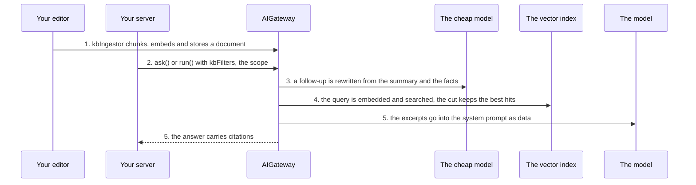

# Answer from your documents

**This path is complete for its goal.** Its chapters, its examples and the pages it links are all you need; no other page
of the documentation is required. It starts from four pages of Getting started:
[What is the AI gateway](../10-getting-started/10-what-is-the-ai-gateway.md),
[Installation](../10-getting-started/20-installation.md), [Example: ask](../10-getting-started/30-example-ask.md),
[Example: run](../10-getting-started/40-example-run.md).

**Prerequisites:** the setup of [Installation](../10-getting-started/20-installation.md) and an OpenAI API key in
`OPENAI_API_KEY`: the configuration of [8.0](#80-the-configuration) reads it for the two OpenAI models of
Installation, `gpt-5-mini` and `text-embedding-3-small`.

## 1. About

A knowledge base: your Markdown documents, split, embedded and searched on every call that names a scope. The excerpts
reach the model as documents, and the answer lists the chunks it was given.

## 2. Description

For assistants that answer from the tenant's own content: a handbook, product sheets, the terms of service. The
application ingests a document when it is saved and names, on every call, the libraries and books the call may search.
The gateway does not know who may read what; the scope is the application's decision.

## 3. What you will be able to do

- Ingest, remove and re-index documents, and move a book between libraries. Examples: [8.1](#81-a-document-is-ingested-when-the-editor-saves-it), [8.7](#87-the-index-follows-the-moves-deletions-and-rebuilds-of-the-editor).
- Scope a call to libraries, books, tags and a language. Examples: [8.2](#82-the-user-asks-within-a-library-and-the-answer-shows-its-citations), [8.3](#83-the-search-is-narrowed-to-one-book-or-opened-to-every-library).
- Tune how many excerpts reach the model and how close they must be. Examples: [8.0](#80-the-configuration), [8.5](#85-one-call-retrieves-more-excerpts-than-the-default).
- Ask a follow-up that is rewritten before the search. Example: [8.6](#86-a-follow-up-question-is-rewritten-before-the-search).
- Show the citations of an answer. Example: [8.2](#82-the-user-asks-within-a-library-and-the-answer-shows-its-citations).
- Plug in the vector index of your database. Example: [8.0](#80-the-configuration).

## 4. The parts

| # | Read                                                                                                  | For                                     |
|---|-------------------------------------------------------------------------------------------------------|-----------------------------------------|
| 1 | [Add a knowledge base to the LLM](../20-learn-the-gateway/070-knowledge-base.md)                      | ingestion, scope, retrieval, citations  |
| 2 | [Models and profiles](../20-learn-the-gateway/010-models-and-profiles.md#1-about)                     | the embedding model in the registry     |
| 3 | [Thread memory: About](../20-learn-the-gateway/080-thread-memory.md#1-about)                          | the summary the follow-up rewrite reads |
| 4 | [Usage Guard: A refused ingestion](../20-learn-the-gateway/060-usage-guard.md#34-a-refused-ingestion) | an embedding is a model call too        |
| 5 | [System prompt layers](../60-architecture/40-system-prompt-production-layers.md)                      | where the excerpts sit in the prompt    |

## 5. How the parts connect



1. Write side: `gateway.kbIngestor` chunks, embeds and stores a document
   ([Ingesting a document](../20-learn-the-gateway/070-knowledge-base.md#21-ingesting-a-document)).
2. Read side: the call's `kbFilters` names the scope
   ([The scope of a call](../20-learn-the-gateway/070-knowledge-base.md#23-the-scope-of-a-call-kbfilters)).
3. A follow-up is rewritten from the thread's summary and facts on the cheap model
   ([The follow-up is rewritten](../20-learn-the-gateway/070-knowledge-base.md#25-the-follow-up-is-rewritten)).
4. The query is embedded and searched; the cut keeps the best hits
   ([Retrieval](../20-learn-the-gateway/070-knowledge-base.md#24-retrieval)).
5. The excerpts go into the system prompt as data, and the answer carries `citations`
   ([The excerpts in the system prompt](../20-learn-the-gateway/070-knowledge-base.md#26-the-excerpts-in-the-system-prompt),
   [Citations](../20-learn-the-gateway/070-knowledge-base.md#27-citations)).

Every embedding and every rewrite is a model call your usage adapter allows.

## 6. API you should know

Grouped by the step of your code where you meet them, in the order of the examples.

### 6.1 Configure the knowledge base

Example: [8.0](#80-the-configuration).

| Symbol                                                                                                                                                                                                                     | What you use it for               |
|----------------------------------------------------------------------------------------------------------------------------------------------------------------------------------------------------------------------------|-----------------------------------|
| [`IEmbedderConfig`](../30-api/index/interfaces/IEmbedderConfig.md), [`IVectorStoreConfig`](../30-api/index/interfaces/IVectorStoreConfig.md), [`IQueryRewriterConfig`](../30-api/index/interfaces/IQueryRewriterConfig.md) | the three required config keys    |
| [`IKbRetrieverConfig`](../30-api/index/interfaces/IKbRetrieverConfig.md), [`IMdChunkerConfig`](../30-api/index/interfaces/IMdChunkerConfig.md), [`IKbIngestorConfig`](../30-api/index/interfaces/IKbIngestorConfig.md)     | the optional tuning               |
| [`IVectorIndexAdapter`](../30-api/index/interfaces/IVectorIndexAdapter.md), [`InMemoryVectorIndexAdapter`](../30-api/index/classes/InMemoryVectorIndexAdapter.md)                                                          | the index                         |
| [`IChunkRecord`](../30-api/index/interfaces/IChunkRecord.md), [`IChunkHit`](../30-api/index/interfaces/IChunkHit.md)                                                                                                       | what the index stores and returns |

### 6.2 Ingest the documents

Examples: [8.1](#81-a-document-is-ingested-when-the-editor-saves-it), [8.7](#87-the-index-follows-the-moves-deletions-and-rebuilds-of-the-editor), [8.8](#88-the-usage-adapter-refuses-an-ingestion).

| Symbol                                                                                                                                | What you use it for                                           |
|---------------------------------------------------------------------------------------------------------------------------------------|---------------------------------------------------------------|
| [`AIGateway.kbIngestor`](../30-api/index/classes/AIGateway.md#kbingestor), [`IKbIngestor`](../30-api/index/interfaces/IKbIngestor.md) | `ingestDocument`, `removeDocument`, `moveBook`, `reindexBook` |
| [`IKbDocument`](../30-api/index/interfaces/IKbDocument.md), [`IIngestReport`](../30-api/index/interfaces/IIngestReport.md)            | a document and the report of its ingestion                    |
| [`isUsageDeniedError`](../30-api/index/functions/isUsageDeniedError.md)                                                               | a refused ingestion                                           |

### 6.3 Ask within the documents

Examples: [8.0](#80-the-configuration), [8.2](#82-the-user-asks-within-a-library-and-the-answer-shows-its-citations), [8.3](#83-the-search-is-narrowed-to-one-book-or-opened-to-every-library), [8.4](#84-a-call-that-searches-no-document), [8.5](#85-one-call-retrieves-more-excerpts-than-the-default), [8.6](#86-a-follow-up-question-is-rewritten-before-the-search).

| Symbol                                                                     | What you use it for                           |
|----------------------------------------------------------------------------|-----------------------------------------------|
| [`IChunkFilters`](../30-api/index/interfaces/IChunkFilters.md)             | `kbFilters` of a call                         |
| [`IKbRetrievalOptions`](../30-api/index/interfaces/IKbRetrievalOptions.md) | `kbRetrieval`: `k` and `minScore` of one call |
| [`IAnswerResponse`](../30-api/index/interfaces/IAnswerResponse.md)         | `citations`                                   |

## 7. Advanced API

Grouped by the part of the gateway you replace.

### 7.1 The ingestion

| Symbol                                                     | Replace it when                |
|------------------------------------------------------------|--------------------------------|
| [`IMdChunker`](../30-api/index/interfaces/IMdChunker.md)   | documents are split your way   |
| [`IEmbedder`](../30-api/index/interfaces/IEmbedder.md)     | embeddings come from elsewhere |
| [`IKbIngestor`](../30-api/index/interfaces/IKbIngestor.md) | ingestion runs your way        |

### 7.2 The search

| Symbol                                                           | Replace it when                                                             |
|------------------------------------------------------------------|-----------------------------------------------------------------------------|
| [`IVectorStore`](../30-api/index/interfaces/IVectorStore.md)     | chunks are stored and searched your way; an adapter is enough in most cases |
| [`IQueryRewriter`](../30-api/index/interfaces/IQueryRewriter.md) | the follow-up is rewritten your way                                         |
| [`IKbRetriever`](../30-api/index/interfaces/IKbRetriever.md)     | you decide which chunks reach the model                                     |

### 7.3 Plugging your class in

| Symbol                                                                     | What it is                                                                                                                                            |
|----------------------------------------------------------------------------|-------------------------------------------------------------------------------------------------------------------------------------------------------|
| [`IAIGatewayOverrides`](../30-api/index/interfaces/IAIGatewayOverrides.md) | the second argument of `AIGateway`; the keys of the parts above: `mdChunker`, `embedder`, `vectorStore`, `queryRewriter`, `kbRetriever`, `kbIngestor` |

## 8. Examples

Each example runs on the `gateway` and the `userContext` of 8.0: paste 8.0 and the example into one file. What comes from your application, such as `invoices` or `ledger`, is a `declare` line at the top of the example.

### 8.0 The configuration

The examples ingest documents and ask within their scope. The keys this path uses come with why. The others are required by `IAIGatewayConfig` and keep the values of [Installation](../10-getting-started/20-installation.md), with the features this path does not need switched off; most of them are `baseConfig`, collapsed above the configuration, which spreads it first: a key the path sets wins over it. `gpt5Mini` and `textEmbedding3Small` are the models of Installation, in the same collapsed block.

> **The bigger picture:** Your server builds this gateway once at startup. The index is shared by the whole server; the documents of each tenant are kept apart in it, by `tenantId`.

<details>
<summary>The models of Installation, and <code>baseConfig</code>: the keys <code>IAIGatewayConfig</code> requires that this path does not use</summary>

```ts
import {
  IAIGatewayConfig,
  IModelInfo,
  EModelProvider,
  InMemoryBlobAdapter,
  InMemoryPromptTemplateRepository,
  InMemoryRunRepository,
  InMemoryThreadRepository,
  InMemoryTraceRepository,
  InMemoryUsageAdapter,
  InMemoryUserMemoryRepository,
} from "dyna-ai-gateway";

// The two models of Installation
const gpt5Mini: IModelInfo = {
  id: "gpt-5-mini",
  provider: EModelProvider.OPENAI,
  providerModelId: "gpt-5-mini",
  label: "GPT-5 mini",
  caps: {
    tools: true, images: true, pdf: true, structuredOutput: true, reasoning: true, temperature: false, embeddings: false,
    contextTokens: 400_000, maxOutputTokens: 128_000, costInPerMTokUsd: 0.25, costOutPerMTokUsd: 2,
  },
  enabled: true,
  deprecatedAt: null,
};

const textEmbedding3Small: IModelInfo = {
  id: "text-embedding-3-small",
  provider: EModelProvider.OPENAI,
  providerModelId: "text-embedding-3-small",
  label: "text-embedding-3-small",
  caps: {
    tools: false, images: false, pdf: false, structuredOutput: false, reasoning: false, temperature: false, embeddings: true,
    contextTokens: 8_191, maxOutputTokens: 0, costInPerMTokUsd: 0.02, costOutPerMTokUsd: 0,
  },
  enabled: true,
  deprecatedAt: null,
};

// Required by IAIGatewayConfig, nothing specific to this path: the in-memory stores of Installation,
// and the features this path does not need switched off
const baseConfig = {
  promptTemplateStore: {repository: new InMemoryPromptTemplateRepository()},
  threadStore: {repository: new InMemoryThreadRepository()},
  fileStore: {adapter: new InMemoryBlobAdapter(), path: "ai-files"},
  userMemoryStore: {repository: new InMemoryUserMemoryRepository(), enabled: false}, // user facts off
  runStore: {repository: new InMemoryRunRepository()},
  humanGate: {userQuestions: {enabled: false}}, // the model asks no questions
  usageGuard: {adapter: new InMemoryUsageAdapter()},
  contextAssembler: {promptCaching: true, sharePromptCacheAcrossTenants: false},
  trace: {repository: new InMemoryTraceRepository()},
} satisfies Partial<IAIGatewayConfig>;
```

</details>

```ts
import {
  AIGateway,
  IAIGatewayConfig,
  IAIProfile,
  IUserContext,
  EModelProvider,
  InMemoryAIProfileRepository,
  InMemoryModelRegistryRepository,
  InMemoryVectorIndexAdapter,
} from "dyna-ai-gateway";

const accounting: IAIProfile = {
  id: "accounting",
  tenantId: "acme",
  name: "Accounting assistant",
  modelId: "gpt-5-mini",
  promptAddendum: "You assist the accounting team of a Norwegian company. Amounts are in NOK.",
  allowedTools: [],
  approvals: [],
  limits: {maxStepsPerRun: 6, maxOutputTokens: 2_000},
};

const config: IAIGatewayConfig = {
  ...baseConfig, // the required keys this path does not use, collapsed above; a key below wins over it

  // What this path uses
  // text-embedding-3-small has caps.embeddings: the chunks and the queries are embedded with it
  modelRegistry: {repository: new InMemoryModelRegistryRepository({models: [gpt5Mini, textEmbedding3Small]})},
  // the same model and size for writing and searching
  embedder: {embeddingModelId: "text-embedding-3-small", dimensions: 1536},
  // the index; your IVectorIndexAdapter (pgvector, OpenSearch, …) in production
  vectorStore: {adapter: new InMemoryVectorIndexAdapter({embeddingModelId: "text-embedding-3-small", dimensions: 1536})},
  queryRewriter: {enabled: true}, // a follow-up is rewritten before the search (8.6)
  kbRetriever: {k: 5, minScore: 0.6}, // the defaults: at most k excerpts, each at least minScore
  mdChunker: {maxTokens: 300}, // short chunks for FAQ-style documents; applies to documents ingested after it
  workingMemory: {enabled: true}, // the rewrite reads the thread's summary, which SUMMARY_BUFFER writes
  defaultCheapModelId: "gpt-5-mini", // the rewrite runs on the cheap model

  // required too, and kept in view: the provider key, the profiles
  llmClient: {providers: {[EModelProvider.OPENAI]: {apiKey: process.env.OPENAI_API_KEY ?? ""}}},
  aiProfileStore: {repository: new InMemoryAIProfileRepository({profiles: [accounting]})},
};

const gateway = new AIGateway(config);

// Per request, from your authentication: who asks, in which tenant (Example: ask)
const userContext: IUserContext = {
  tenantId: "acme",
  userId: "u-17",
  permissions: [],
  locale: "en-GB",
  timezone: "Europe/Oslo",
  now: new Date(),
};
```

### 8.1 A document is ingested when the editor saves it

`ingestDocument` splits the Markdown into chunks, embeds them and writes them to the index under your document, library and book ids. Saving the same document again replaces its chunks.

> **The bigger picture:** The save endpoint of your documents editor: an admin saves a page, and from then on the answers can quote it.

```ts
import {IKbDocument} from "dyna-ai-gateway";

const refunds: IKbDocument = {
  id: "doc-refunds",   // your ids: document, library, book
  libraryId: "tax",
  bookId: "vat-2026",
  title: "Refunds",
  markdown: "# Paid invoices\n\n## Time limits\n\nA refund of a paid invoice is possible within 12 months of the payment date.",
  tags: ["b2b"],
  language: "en",
};

const report = await gateway.kbIngestor.ingestDocument({tenantId: "acme", doc: refunds, userId: "admin-3"});
// {docId, chunksWritten, chunksDeleted, tokens, durationMs}; saving it again replaces its chunks
```

### 8.2 The user asks within a library, and the answer shows its citations

`kbFilters.libraryIds` limits the search to the libraries the user may read. The answer's `citations` lists the ids (`docId#order`) of the chunks the model was given.

> **The bigger picture:** The help chat of your application: the user asks a question and the screen shows the answer with links to the documents behind it.

```ts
import {EGatewayResponseKind} from "dyna-ai-gateway";

const result = await gateway.ask({
  userContext,
  profileId: "accounting",
  prompt: "How long can a customer ask for a refund of a paid invoice?",
  kbFilters: {libraryIds: ["tax"], bookIds: []}, // the libraries this user may read
}).response;

if (result.kind === EGatewayResponseKind.ANSWER) {
  result.text;      // "Within 12 months of the payment date."
  result.citations; // ["doc-refunds#0"]: docId#order of the chunks the model was given
}
```

### 8.3 The search is narrowed to one book, or opened to every library

`bookIds`, `tags` and `language` narrow the search inside the libraries; `libraryIds: "all"` searches every library of the tenant.

> **The bigger picture:** The filters of the chat screen, or the rights of the user: a German-speaking user in one book's context, or an admin who may read everything.

```ts
const oneBook = gateway.ask({
  userContext,
  profileId: "accounting",
  prompt: "Wie lange ist eine Rückerstattung möglich?",
  kbFilters: {libraryIds: ["tax"], bookIds: ["vat-2026"], tags: ["b2b"], language: "de"},
});

const everyLibrary = gateway.ask({
  userContext,
  profileId: "accounting",
  prompt: "Where is the travel expense policy?",
  kbFilters: {libraryIds: "all", bookIds: []}, // every library of the tenant
});
```

### 8.4 A call that searches no document

With empty `libraryIds` and `bookIds` the call runs no search: the model gets no excerpts and the answer has no citations.

> **The bigger picture:** A feature of the same application that has nothing to do with the documents, such as writing a newsletter greeting, on the same profile.

```ts
const {response} = gateway.ask({
  userContext,
  profileId: "accounting",
  prompt: "Write a friendly greeting for the newsletter.",
  kbFilters: {libraryIds: [], bookIds: []}, // no search, no excerpts, no citations
});
```

### 8.5 One call retrieves more excerpts than the default

One call asks for more excerpts than the default, here 10, and the other calls keep the values of the configuration.

> **The bigger picture:** A summary button that needs a wider view than a single question, while the chat keeps the defaults.

`kbRetriever` of 8.0 sets `k` and `minScore` for every call; `kbRetrieval` overrides them for one.

```ts
const overview = gateway.ask({
  userContext,
  profileId: "accounting",
  prompt: "Summarise every rule about refunds.",
  kbFilters: {libraryIds: ["tax"], bookIds: []},
  kbRetrieval: {k: 10}, // this call only
});
```

### 8.6 A follow-up question is rewritten before the search

With `queryRewriter` enabled, a follow-up on the same thread is rewritten on the cheap model into one standalone line, from the thread's memory, and that line is searched. The `kbFilters` are passed again on every call.

> **The bigger picture:** The second message of a chat conversation ("and how is it booked?"): without the rewrite, the search would look for those words alone.

```ts
import {EGatewayResponseKind} from "dyna-ai-gateway";

const scope = {libraryIds: ["tax"], bookIds: []};
const first = await gateway.ask({userContext, profileId: "accounting", prompt: "How long can a customer ask for a refund?", kbFilters: scope}).response;
if (first.kind !== EGatewayResponseKind.ANSWER) throw new Error(first.kind);
await gateway.whenIdle(); // only in a script: the rewrite reads the summary the background update writes after the answer

const followUp = await gateway.ask({
  userContext,
  profileId: "accounting",
  threadId: first.threadId,
  prompt: "And how is it booked?", // searched as a standalone line, e.g. "refund paid invoice booking"
  kbFilters: scope,               // passed again: a thread keeps no scope
}).response;
```

### 8.7 The index follows the moves, deletions and rebuilds of the editor

`moveBook` changes the library of a book's chunks without embedding them again, `removeDocument` deletes a document's chunks, and `reindexBook` ingests every document you pass, with one report per document; a failed one keeps its old chunks.

> **The bigger picture:** The other endpoints of your documents editor (move a book, delete a page) and a maintenance job that rebuilds a book, for example after the embedding model changed.

```ts
import {IKbDocument} from "dyna-ai-gateway";

declare const bookDocs: IKbDocument[]; // the documents of the book, loaded by your application

await gateway.kbIngestor.moveBook({tenantId: "acme", bookId: "vat-2026", libraryId: "tax-archive"}); // no re-embedding
await gateway.kbIngestor.removeDocument({tenantId: "acme", docId: "doc-refunds"});

const reports = await gateway.kbIngestor.reindexBook({tenantId: "acme", bookId: "vat-2026", docs: bookDocs, userId: "admin-3"});
const failed = reports.filter(entry => entry.error);
```

### 8.8 The usage adapter refuses an ingestion

Each embedding call of an ingestion is checked by your usage adapter. A refusal makes `ingestDocument` throw an error that `isUsageDeniedError` recognises: a 429 with your `denyCode`.

> **The bigger picture:** The save endpoint of the editor, when the tenant has used up its budget: the admin sees that the document was not indexed, instead of a silent gap in the answers.

```ts
import {isUsageDeniedError, IKbDocument} from "dyna-ai-gateway";

declare const refunds: IKbDocument; // the document of 8.1, edited by your editor

try {
  await gateway.kbIngestor.ingestDocument({tenantId: "acme", doc: refunds, userId: "admin-3"});
} catch (error) {
  if (!isUsageDeniedError(error)) throw error;
  // a 429 with your denyCode: nothing was embedded
}
```

## 9. Pitfalls

- [Add a knowledge base to the LLM: Pitfalls](../20-learn-the-gateway/070-knowledge-base.md#4-pitfalls)
- Under `SLIDING_WINDOW` a follow-up is searched as typed: the rewrite reads the summary that strategy never writes
  ([The follow-up is rewritten](../20-learn-the-gateway/070-knowledge-base.md#25-the-follow-up-is-rewritten)).
- `InMemoryVectorIndexAdapter` is for tests and the sandbox
  ([The host's vector index](../20-learn-the-gateway/070-knowledge-base.md#37-the-hosts-vector-index)).

## 10. Summary

- `gateway.kbIngestor` writes; every call names its scope in `kbFilters`.
- A follow-up is rewritten, embedded, searched; at most `k` hits of at least `minScore` reach the model.
- The excerpts are data in the system prompt; `citations` lists the chunks the model was given.
- The index is your `IVectorIndexAdapter`.

## 11. FAQ

- [Add a knowledge base to the LLM: FAQ](../20-learn-the-gateway/070-knowledge-base.md#6-faq)
- [How do I protect against prompt injection?](../10-getting-started/90-faq.md#how-do-i-protect-against-prompt-injection)
