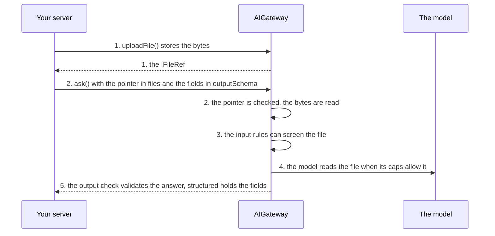

# Extract data from files

**This path is complete for its goal.** Its chapters, its examples and the pages it links are all you need; no other page
of the documentation is required. It starts from four pages of Getting started:
[What is the AI gateway](../10-getting-started/10-what-is-the-ai-gateway.md),
[Installation](../10-getting-started/20-installation.md), [Example: ask](../10-getting-started/30-example-ask.md),
[Example: run](../10-getting-started/40-example-run.md).

**Prerequisites:** the setup of [Installation](../10-getting-started/20-installation.md) and an OpenAI API key in
`OPENAI_API_KEY`: the configuration of [8.0](#80-the-configuration) reads it for the two OpenAI models of
Installation, `gpt-5-mini` and `text-embedding-3-small`.

## 1. About

The user uploads a PDF or an image; one `ask()` with the file and an `outputSchema` returns the fields as a typed object,
validated before your code reads it.

## 2. Description

For invoices, receipts, delivery notes, ID documents: the fields of a document typed into your data model. The file is
stored through your blob storage; the question passes its pointer. The model reads it when its caps allow, and the
output check rejects an answer that does not match the schema.

## 3. What you will be able to do

- Upload a file and pass it to a question. Examples: [8.2](#82-the-upload-route-stores-the-file-and-returns-its-pointer), [8.3](#83-the-fields-of-an-invoice-pdf-are-extracted-into-a-typed-object).
- Choose a model that reads images or PDFs. Example: [8.0](#80-the-configuration).
- Define the fields as a zod schema and read them from `structured`. Examples: [8.3](#83-the-fields-of-an-invoice-pdf-are-extracted-into-a-typed-object), [8.4](#84-the-rows-of-a-photographed-receipt-are-extracted).
- Detect a file the model could not read. Example: [8.6](#86-the-extraction-drops-the-file-or-fails-the-schema).
- Screen the file before the model sees it. Example: [8.1](#81-an-input-rule-screens-every-file-before-the-model-sees-it).

## 4. The parts

| # | Read                                                                                                                                              | For                                             |
|---|---------------------------------------------------------------------------------------------------------------------------------------------------|-------------------------------------------------|
| 1 | [Chat files and their storage](../20-learn-the-gateway/092-chat-files.md)                                                                         | upload, a question with files, the blob adapter |
| 2 | [Example: ask](../10-getting-started/30-example-ask.md)                                                                                           | `outputSchema` and `structured`                 |
| 3 | [Guardrails: Structured output](../20-learn-the-gateway/050-guardrails.md#24-structured-output)                                                   | how the answer is validated                     |
| 4 | [Models and profiles: What the gateway reads from `caps`](../20-learn-the-gateway/010-models-and-profiles.md#21-what-the-gateway-reads-from-caps) | `images`, `pdf`, `structuredOutput`             |
| 5 | [Chat files: Tokens and cost](../20-learn-the-gateway/092-chat-files.md#24-tokens-and-cost)                                                       | what a page or an image costs                   |

## 5. How the parts connect



1. `uploadFile` stores the bytes and returns an `IFileRef` ([Upload](../20-learn-the-gateway/092-chat-files.md#21-upload)).
2. `ask()` passes the pointer in `files` and the fields in `outputSchema`; the gateway checks the pointer and reads the
   bytes ([A question with files](../20-learn-the-gateway/092-chat-files.md#22-a-question-with-files)).
3. The input rules can screen the file ([The files in the guardrails](../20-learn-the-gateway/092-chat-files.md#25-the-files-in-the-guardrails)).
4. The model reads the file when its caps allow it ([Which models read which files](../20-learn-the-gateway/092-chat-files.md#23-which-models-read-which-files)).
5. The output check validates the answer against the schema; `structured` holds the fields
   ([Structured output](../20-learn-the-gateway/050-guardrails.md#24-structured-output)).

## 6. API you should know

Grouped by the step of your code where you meet them, in the order of the examples.

### 6.1 Configure the file store and the model

Example: [8.0](#80-the-configuration).

| Symbol                                                                                                                                | What you use it for                      |
|---------------------------------------------------------------------------------------------------------------------------------------|------------------------------------------|
| [`IFileStoreConfig`](../30-api/index/interfaces/IFileStoreConfig.md)                                                                  | `adapter`, `path`, the caps of the store |
| [`IBlobAdapter`](../30-api/index/interfaces/IBlobAdapter.md), [`InMemoryBlobAdapter`](../30-api/index/classes/InMemoryBlobAdapter.md) | the storage of the bytes                 |
| [`IModelCaps`](../30-api/index/interfaces/IModelCaps.md)                                                                              | `images`, `pdf`                          |

### 6.2 Upload the file

Example: [8.2](#82-the-upload-route-stores-the-file-and-returns-its-pointer).

| Symbol                                                                    | What you use it for           |
|---------------------------------------------------------------------------|-------------------------------|
| [`AIGateway.uploadFile`](../30-api/index/classes/AIGateway.md#uploadfile) | stores the upload             |
| [`IFileRef`](../30-api/index/interfaces/IFileRef.md)                      | the pointer a question passes |

### 6.3 Ask about it

Examples: [8.1](#81-an-input-rule-screens-every-file-before-the-model-sees-it), [8.3](#83-the-fields-of-an-invoice-pdf-are-extracted-into-a-typed-object), [8.4](#84-the-rows-of-a-photographed-receipt-are-extracted), [8.5](#85-one-question-compares-several-files), [8.6](#86-the-extraction-drops-the-file-or-fails-the-schema).

| Symbol                                                                                                                            | What you use it for     |
|-----------------------------------------------------------------------------------------------------------------------------------|-------------------------|
| [`AIGateway.ask`](../30-api/index/classes/AIGateway.md#ask), [`IGatewayAskInput`](../30-api/index/interfaces/IGatewayAskInput.md) | `files`, `outputSchema` |
| [`IAnswerResponse`](../30-api/index/interfaces/IAnswerResponse.md)                                                                | `structured`, `issues`  |

### 6.4 Remove it

Example: [8.7](#87-the-file-is-deleted-when-the-extraction-is-done).

| Symbol                                                                    | What you use it for                          |
|---------------------------------------------------------------------------|----------------------------------------------|
| [`AIGateway.deleteFile`](../30-api/index/classes/AIGateway.md#deletefile) | removes the file when the extraction is done |

## 7. Advanced API

Grouped by the part of the gateway you replace.

### 7.1 The file store

| Symbol                                                   | Replace it when                                                          |
|----------------------------------------------------------|--------------------------------------------------------------------------|
| [`IFileStore`](../30-api/index/interfaces/IFileStore.md) | files are stored and signed your way; an adapter is enough in most cases |

### 7.2 Plugging your class in

| Symbol                                                                     | What it is                                                                   |
|----------------------------------------------------------------------------|------------------------------------------------------------------------------|
| [`IAIGatewayOverrides`](../30-api/index/interfaces/IAIGatewayOverrides.md) | the second argument of `AIGateway`; the keys of the parts above: `fileStore` |

## 8. Examples

Each example runs on the `gateway` and the `userContext` of 8.0: paste 8.0 and the example into one file. What comes from your application, such as `invoices` or `ledger`, is a `declare` line at the top of the example.

### 8.0 The configuration

The profile runs on `gpt-5-mini`, whose caps have `images: true` and `pdf: true`; 8.1 builds it with an input rule. The keys this path uses come first, each with why. The others are required by `IAIGatewayConfig` and keep the values of [Installation](../10-getting-started/20-installation.md), with the features this path does not need switched off; most of them are `baseConfig`, collapsed above the configuration that spreads it. `gpt5Mini` and `textEmbedding3Small` are the models of Installation, in the same collapsed block.

> **The bigger picture:** Your server builds this gateway once at startup. The file store and its limits are the same for every tenant; each file is kept under its tenant and its user.

<details>
<summary>The models of Installation, and <code>baseConfig</code>: the keys <code>IAIGatewayConfig</code> requires that this path does not use</summary>

```ts
import {
  IAIGatewayConfig,
  IModelInfo,
  EModelProvider,
  InMemoryPromptTemplateRepository,
  InMemoryRunRepository,
  InMemoryThreadRepository,
  InMemoryTraceRepository,
  InMemoryUsageAdapter,
  InMemoryUserMemoryRepository,
  InMemoryVectorIndexAdapter,
} from "dyna-ai-gateway";

// The two models of Installation
const gpt5Mini: IModelInfo = {
  id: "gpt-5-mini",
  provider: EModelProvider.OPENAI,
  providerModelId: "gpt-5-mini",
  label: "GPT-5 mini",
  caps: {
    tools: true, images: true, pdf: true, structuredOutput: true, reasoning: true, temperature: false, embeddings: false,
    contextTokens: 400_000, maxOutputTokens: 128_000, costInPerMTokUsd: 0.25, costOutPerMTokUsd: 2,
  },
  enabled: true,
  deprecatedAt: null,
};

const textEmbedding3Small: IModelInfo = {
  id: "text-embedding-3-small",
  provider: EModelProvider.OPENAI,
  providerModelId: "text-embedding-3-small",
  label: "text-embedding-3-small",
  caps: {
    tools: false, images: false, pdf: false, structuredOutput: false, reasoning: false, temperature: false, embeddings: true,
    contextTokens: 8_191, maxOutputTokens: 0, costInPerMTokUsd: 0.02, costOutPerMTokUsd: 0,
  },
  enabled: true,
  deprecatedAt: null,
};

// Required by IAIGatewayConfig, nothing specific to this path: the in-memory stores of Installation,
// and the features this path does not need switched off
const baseConfig = {
  promptTemplateStore: {repository: new InMemoryPromptTemplateRepository()},
  threadStore: {repository: new InMemoryThreadRepository()},
  workingMemory: {enabled: true},
  userMemoryStore: {repository: new InMemoryUserMemoryRepository(), enabled: false}, // user facts off
  embedder: {embeddingModelId: "text-embedding-3-small", dimensions: 1536},
  vectorStore: {adapter: new InMemoryVectorIndexAdapter({embeddingModelId: "text-embedding-3-small", dimensions: 1536})},
  queryRewriter: {enabled: false}, // no follow-up rewrite
  runStore: {repository: new InMemoryRunRepository()},
  humanGate: {userQuestions: {enabled: false}}, // the model asks no questions
  usageGuard: {adapter: new InMemoryUsageAdapter()},
  contextAssembler: {promptCaching: true, sharePromptCacheAcrossTenants: false},
  trace: {repository: new InMemoryTraceRepository()},
  defaultCheapModelId: "gpt-5-mini",
} satisfies Partial<IAIGatewayConfig>;
```

</details>

```ts
import {
  AIGateway,
  IAIGatewayConfig,
  IAIProfile,
  IUserContext,
  EModelProvider,
  InMemoryAIProfileRepository,
  InMemoryBlobAdapter,
  InMemoryModelRegistryRepository,
} from "dyna-ai-gateway";

const accounting: IAIProfile = {
  id: "accounting",
  tenantId: "acme",
  name: "Accounting assistant",
  modelId: "gpt-5-mini",
  promptAddendum: "You assist the accounting team of a Norwegian company. Amounts are in NOK.",
  allowedTools: [],
  approvals: [],
  limits: {maxStepsPerRun: 6, maxOutputTokens: 4_000},
};

const config: IAIGatewayConfig = {
  // What this path uses
  fileStore: {
    adapter: new InMemoryBlobAdapter(), // your IBlobAdapter (S3, Azure Blob, GCS) in production
    path: "ai-files",                   // keys: <tenantId>/ai-files/<userId>/<fileId>
    maxBytes: 10 * 1024 * 1024,         // a larger upload is a 413
    allowedMime: ["application/pdf", "image/jpeg", "image/png"], // another type is a 400
  },
  // caps.images and caps.pdf decide which files reach the model
  modelRegistry: {repository: new InMemoryModelRegistryRepository({models: [gpt5Mini, textEmbedding3Small]})},

  // required too, and kept in view: the provider key, the profiles
  llmClient: {providers: {[EModelProvider.OPENAI]: {apiKey: process.env.OPENAI_API_KEY ?? ""}}},
  aiProfileStore: {repository: new InMemoryAIProfileRepository({profiles: [accounting]})},
  ...baseConfig, // the other required keys, collapsed above
};

const gateway = new AIGateway(config);

// Per request, from your authentication: who asks, in which tenant (Example: ask)
const userContext: IUserContext = {
  tenantId: "acme",
  userId: "u-17",
  permissions: [],
  locale: "en-GB",
  timezone: "Europe/Oslo",
  now: new Date(),
};
```

### 8.1 An input rule screens every file before the model sees it

An `IInputRule` in `guardrails.inputRules` runs before the model call. This one asks the `judge` to read the files of the question and to report an ERROR issue for an ID document, which returns `FAILED`.

> **The bigger picture:** A rule of your product, written once at startup: passports and ID cards are never sent to the model, whatever the user uploads.

```ts
import {IInputRule, AIGateway} from "dyna-ai-gateway";

const noIdDocuments: IInputRule = {
  name: "no_id_documents",
  check: async ({evidence, judge}) => evidence.files.length === 0
    ? []
    : judge({
      instruction: "Report an ERROR issue `id_document` when a file is a passport, an ID card or a driving licence.",
      fileFilter: () => true, // the judge reads every file of the question
    }),
};

// the gateway of 8.0 with this rule, in place of the gateway line of 8.0
const gateway = new AIGateway({...config, guardrails: {...config.guardrails, inputRules: [noIdDocuments]}});
```

### 8.2 The upload route stores the file and returns its pointer

`uploadFile` stores the bytes in the file store as the calling user's and returns an `IFileRef`. A type outside `allowedMime` is a 400, a file over `maxBytes` a 413.

> **The bigger picture:** The endpoint your file picker posts to, before the chat call: the browser keeps the pointer and sends it with the question.

```ts
import {IFileRef} from "dyna-ai-gateway";

const uploadRoute = async (request: Request): Promise<IFileRef> => {
  const form = await request.formData();
  const upload = form.get("file");
  if (!(upload instanceof File)) throw new Error("No file in the request");
  return gateway.uploadFile({userContext, bytes: new Uint8Array(await upload.arrayBuffer()), mime: upload.type, name: upload.name});
};
```

### 8.3 The fields of an invoice PDF are extracted into a typed object

The uploaded file goes into `files` and a zod schema into `outputSchema`. The answer's `structured` is the parsed object, typed by the schema.

> **The bigger picture:** The "read this invoice" button of a bookkeeping screen: the user uploads a PDF and gets a draft entry to check, instead of typing the fields.

```ts
import {z} from "zod";
import {EGatewayResponseKind, IFileRef} from "dyna-ai-gateway";

declare const request: Request; // the upload request
declare function uploadRoute(request: Request): Promise<IFileRef>; // the route of 8.2
declare const bookkeeping: {saveDraft(fields: object): Promise<void>}; // your bookkeeping

const invoiceFields = z.object({
  invoiceNo: z.string(),
  issueDate: z.string().describe("ISO date, YYYY-MM-DD"),
  supplier: z.string(),
  totalCents: z.number().int(),
  currency: z.string().length(3),
  vatNumber: z.string().nullable(),
});

const file = await uploadRoute(request);
const result = await gateway.ask({
  userContext,
  profileId: "accounting",
  prompt: "Extract the fields of this invoice.",
  files: [file],
  outputSchema: invoiceFields,
  kbFilters: {libraryIds: [], bookIds: []},
}).response;

if (result.kind === EGatewayResponseKind.ANSWER && result.structured) {
  await bookkeeping.saveDraft(result.structured); // typed as z.infer<typeof invoiceFields>
}
```

### 8.4 The rows of a photographed receipt are extracted

The same call reads an image: the schema here is a list of rows and a total.

> **The bigger picture:** An expense app on a phone: the user takes a picture of a receipt and the rows appear in the expense form.

```ts
import {IFileRef} from "dyna-ai-gateway";
import {z} from "zod";

declare const photo: IFileRef; // the receipt photo the user uploaded (8.2)

const receipt = z.object({
  rows: z.array(z.object({description: z.string(), quantity: z.number(), amountCents: z.number().int()})),
  totalCents: z.number().int(),
});

const {response} = gateway.ask({
  userContext,
  profileId: "accounting",
  prompt: "List every row of this receipt.",
  files: [photo], // an image/jpeg the user uploaded
  outputSchema: receipt,
  kbFilters: {libraryIds: [], bookIds: []},
});
```

### 8.5 One question compares several files

`files` carries more than one pointer; the model reads them in that order, so the prompt names them in the same order.

> **The bigger picture:** A check before a payment: the accountant uploads the invoice and the delivery note and gets the rows that differ.

```ts
import {z} from "zod";
import {IFileRef} from "dyna-ai-gateway";

// the two files the user uploaded (8.2)
declare const invoicePdf: IFileRef;
declare const deliveryNotePdf: IFileRef;

const {response} = gateway.ask({
  userContext,
  profileId: "accounting",
  prompt: "Does the delivery note match the invoice? List the rows that differ.",
  files: [invoicePdf, deliveryNotePdf], // in the order the prompt names them
  outputSchema: z.object({differences: z.array(z.object({row: z.string(), invoice: z.string(), deliveryNote: z.string()}))}),
  kbFilters: {libraryIds: [], bookIds: []},
});
```

### 8.6 The extraction drops the file or fails the schema

A file the model cannot read (its caps have no `pdf` or `images`) is left out with the WARNING `file_dropped`, and the answer comes from the prompt alone. An answer that does not match the schema returns `FAILED` with the issue `output_schema`, whose `field` names the first failing path.

> **The bigger picture:** The error handling of the extraction screen: the user is told to check the fields or to try again, never shown fields the model did not read.

```ts
import {z} from "zod";
import {EGatewayResponseKind, IFileRef} from "dyna-ai-gateway";

declare const pdf: IFileRef; // the PDF the user uploaded (8.2)

const result = await gateway.ask({
  userContext,
  profileId: "accounting",
  prompt: "Extract the fields of this invoice.",
  files: [pdf],
  outputSchema: z.object({invoiceNo: z.string(), totalCents: z.number().int()}), // a short form of the fields of 8.3
  kbFilters: {libraryIds: [], bookIds: []},
}).response;

if (result.kind === EGatewayResponseKind.ANSWER && result.issues.some(issue => issue.code === "file_dropped")) {
  // the model has no caps.pdf: the fields came from the prompt alone, do not trust them
}
if (result.kind === EGatewayResponseKind.FAILED && result.issues.some(issue => issue.code === "output_schema")) {
  // the answer did not match the schema: issue.field names the first failing path
}
```

### 8.7 The file is deleted when the extraction is done

`deleteFile` removes one file of the calling user. Uploaded files have no expiry, so your application deletes what it no longer needs.

> **The bigger picture:** The last step of the extraction flow, once the draft is saved, or a cleanup job of your application.

```ts
import {IFileRef} from "dyna-ai-gateway";

declare const file: IFileRef; // the pointer the upload route returned (8.2)

await gateway.deleteFile({userContext, fileId: file.id}); // files have no expiry
```

## 9. Pitfalls

- [Chat files: Pitfalls](../20-learn-the-gateway/092-chat-files.md#4-pitfalls)
- A model without `caps.pdf` or `caps.images` leaves the file out with the WARNING `file_dropped` and answers from the
  text alone; check `issues` before you trust the fields
  ([Which models read which files](../20-learn-the-gateway/092-chat-files.md#23-which-models-read-which-files)).
- A follow-up about the same file passes it again: only the files of the current question reach the model
  ([D31](../60-architecture/90-decisions.md#d31-only-the-files-of-the-current-question-go-to-the-model)).
- Files have no expiry; delete them when the extraction is done
  ([Lifecycle and deletion](../20-learn-the-gateway/092-chat-files.md#28-lifecycle-and-deletion)).

## 10. Summary

- `uploadFile`, then `ask()` with `files` and `outputSchema`.
- The model must have the cap of the file's type; otherwise the file is dropped with a warning.
- The answer is validated against the schema; `structured` holds the fields.
- The bytes stay in your blob storage; the thread keeps the pointer only.

## 11. FAQ

- [Chat files: FAQ](../20-learn-the-gateway/092-chat-files.md#6-faq)
- [Who may read a thread, a file or a paused run?](../10-getting-started/90-faq.md#who-may-read-a-thread-a-file-or-a-paused-run)
