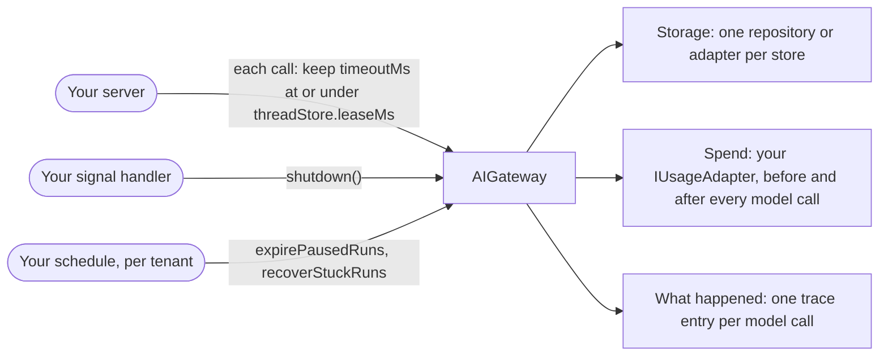

# Run it in production

**This path is complete for its goal.** Its chapters, its examples and the pages it links are all you need; no other page
of the documentation is required. It starts from four pages of Getting started:
[What is the AI gateway](../10-getting-started/10-what-is-the-ai-gateway.md),
[Installation](../10-getting-started/20-installation.md), [Example: ask](../10-getting-started/30-example-ask.md),
[Example: run](../10-getting-started/40-example-run.md).

**Prerequisites:** the setup of [Installation](../10-getting-started/20-installation.md) and an OpenAI API key in
`OPENAI_API_KEY`: the configuration of [8.0](#80-the-configuration) reads it for the two OpenAI models of
Installation, `gpt-5-mini` and `text-embedding-3-small`.

## 1. About

What a gateway needs beyond the first answer: your own storage, a spend decision on every model call, calls that can be
stopped, a clean shutdown, a job for what a crash or an absent approver leaves behind, and a trace of every model call.

## 2. Description

The in-memory repositories of [Installation](../10-getting-started/20-installation.md) lose everything on a restart and
allow every call. Production replaces them with adapters over your database, puts a usage adapter in front of the
providers, and runs two jobs next to the server. Nothing in your calls changes.

## 3. What you will be able to do

- Replace each in-memory repository with your own. Example: [8.1](#81-your-own-database-behind-every-store).
- Decide in your code who may spend how many tokens, and see the cost of each call. Examples: [8.2](#82-a-per-tenant-budget-decides-every-model-call), [8.5](#85-the-budget-refuses-a-call-and-the-user-reads-why), [8.6](#86-an-operator-reads-what-the-model-saw-and-what-it-cost).
- Cancel a call and give it a deadline. Examples: [8.3](#83-a-tool-that-stops-when-the-call-is-stopped), [8.4](#84-the-user-stops-a-run-or-its-deadline-passes).
- Stop the server without losing work. Example: [8.7](#87-graceful-shutdown-and-the-two-scheduled-jobs).
- Recover the runs a crashed server left, and expire the pauses nobody answered. Example: [8.7](#87-graceful-shutdown-and-the-two-scheduled-jobs).
- Find out what the model saw and what it cost. Examples: [8.6](#86-an-operator-reads-what-the-model-saw-and-what-it-cost), [8.8](#88-a-developer-reads-the-transcript-of-one-call).

## 4. The parts

| #  | Read                                                                                                                                                                                                                                 | For                                             |
|----|--------------------------------------------------------------------------------------------------------------------------------------------------------------------------------------------------------------------------------------|-------------------------------------------------|
| 1  | [Token control with the Usage Guard](../20-learn-the-gateway/060-usage-guard.md)                                                                                                                                                     | the adapter, denials, tokens and cost           |
| 2  | [Can I cancel a call, or limit how long it takes?](../10-getting-started/90-faq.md#can-i-cancel-a-call-or-limit-how-long-it-takes)                                                                                                   | `abortSignal`, `timeoutMs`                      |
| 3  | [How do I stop the server cleanly?](../10-getting-started/90-faq.md#how-do-i-stop-the-server-cleanly)                                                                                                                                | `shutdown`                                      |
| 4  | [What happens to the runs a crashed server left behind?](../10-getting-started/90-faq.md#what-happens-to-the-runs-a-crashed-server-left-behind)                                                                                      | `recoverStuckRuns`                              |
| 5  | [Human in the loop: Expiry and cancel](../20-learn-the-gateway/040-human-in-the-loop.md#28-expiry-and-cancel), [Storage and restarts](../20-learn-the-gateway/040-human-in-the-loop.md#211-storage-and-restarts)                     | `expirePausedRuns`, the run repository          |
| 6  | [Every model call leaves an entry](../60-architecture/90-decisions.md#every-model-call-leaves-an-entry), [D63](../60-architecture/90-decisions.md#d63-debug-true-attaches-the-transcript-to-the-answer)                              | the trace and `debug`                           |
| 7  | [Is the system prompt cached, and what does it cost?](../10-getting-started/90-faq.md#is-the-system-prompt-cached-and-what-does-it-cost)                                                                                             | prompt caching                                  |
| 8  | [Persistence decisions](../60-architecture/90-decisions.md#16-persistence)                                                                                                                                                           | the seams and the table names                   |
| 9  | [What the gateway checks and what it trusts](../60-architecture/10-architecture-and-trade-offs.md#5-what-the-gateway-checks-and-what-it-trusts), [Known limits](../60-architecture/10-architecture-and-trade-offs.md#6-known-limits) | the boundary of your host                       |
| 10 | [Models and profiles](../20-learn-the-gateway/010-models-and-profiles.md)                                                                                                                                                            | the models and the profiles your database holds |

## 5. How the parts connect



| Concern         | Where it is decided                                                  | What ties it to the others                                                                                 |
|-----------------|----------------------------------------------------------------------|------------------------------------------------------------------------------------------------------------|
| Storage         | one repository or adapter per store, in `IAIGatewayConfig`           | a paused run in a shared repository resumes on any instance                                                |
| Spend           | your `IUsageAdapter`, before and after every model call              | helper calls (judges, memory, rewrite, embeddings) are asked too                                           |
| A call's length | `timeoutMs` of the call; the per-tool and per-model-call timeouts    | keep `timeoutMs` at or under `threadStore.leaseMs`, or the recovery job takes the call for stuck           |
| Shutdown        | `shutdown({timeoutMs})` in the signal handler                        | drains the calls, then the background work, as `whenIdle()` does                                           |
| Jobs            | `expirePausedRuns` and `recoverStuckRuns`, per tenant, on a schedule | `recoverStuckRuns` touches a run only when it can take the thread's lease, so a live call is never touched |
| What happened   | the trace repository, one entry per model call                       | each entry carries the model, the usage and the cost of its call                                           |

## 6. API you should know

Grouped by the step of your code where you meet them, in the order of the examples.

### 6.1 Your storage

Examples: [8.0](#80-the-configuration), [8.1](#81-your-own-database-behind-every-store).

| Symbol                                                                                                                                                                                                                                                                                                                                                                                                                                                                                                                                                                                                                                                                                               | What you use it for                       |
|------------------------------------------------------------------------------------------------------------------------------------------------------------------------------------------------------------------------------------------------------------------------------------------------------------------------------------------------------------------------------------------------------------------------------------------------------------------------------------------------------------------------------------------------------------------------------------------------------------------------------------------------------------------------------------------------------|-------------------------------------------|
| [`IAIGatewayConfig`](../30-api/index/interfaces/IAIGatewayConfig.md)                                                                                                                                                                                                                                                                                                                                                                                                                                                                                                                                                                                                                                 | the repository and adapter of every store |
| [`IModelRegistryRepository`](../30-api/index/interfaces/IModelRegistryRepository.md), [`IAIProfileRepository`](../30-api/index/interfaces/IAIProfileRepository.md), [`IPromptTemplateRepository`](../30-api/index/interfaces/IPromptTemplateRepository.md), [`IThreadRepository`](../30-api/index/interfaces/IThreadRepository.md), [`IRunRepository`](../30-api/index/interfaces/IRunRepository.md), [`IUserMemoryRepository`](../30-api/index/interfaces/IUserMemoryRepository.md), [`ITraceRepository`](../30-api/index/interfaces/ITraceRepository.md), [`IBlobAdapter`](../30-api/index/interfaces/IBlobAdapter.md), [`IVectorIndexAdapter`](../30-api/index/interfaces/IVectorIndexAdapter.md) | the storage you implement                 |

### 6.2 The budget

Examples: [8.2](#82-a-per-tenant-budget-decides-every-model-call), [8.5](#85-the-budget-refuses-a-call-and-the-user-reads-why).

| Symbol                                                                                                                                                                                                                                                                     | What you use it for |
|----------------------------------------------------------------------------------------------------------------------------------------------------------------------------------------------------------------------------------------------------------------------------|---------------------|
| [`IUsageAdapter`](../30-api/index/interfaces/IUsageAdapter.md), [`IUsageCheckArgs`](../30-api/index/interfaces/IUsageCheckArgs.md), [`IUsageCheckResult`](../30-api/index/interfaces/IUsageCheckResult.md), [`IUsageAddArgs`](../30-api/index/interfaces/IUsageAddArgs.md) | the spend decision  |
| [`USAGE_DENIED_ISSUE_CODE`](../30-api/index/variables/USAGE_DENIED_ISSUE_CODE.md), [`isUsageDeniedError`](../30-api/index/functions/isUsageDeniedError.md)                                                                                                                 | a denial            |

### 6.3 Stop a call, and its time limits

Examples: [8.0](#80-the-configuration), [8.1](#81-your-own-database-behind-every-store), [8.3](#83-a-tool-that-stops-when-the-call-is-stopped), [8.4](#84-the-user-stops-a-run-or-its-deadline-passes), [8.7](#87-graceful-shutdown-and-the-two-scheduled-jobs).

| Symbol                                                                                                                                                                                                                     | What you use it for                                                     |
|----------------------------------------------------------------------------------------------------------------------------------------------------------------------------------------------------------------------------|-------------------------------------------------------------------------|
| [`IGatewayAskInput`](../30-api/index/interfaces/IGatewayAskInput.md)                                                                                                                                                       | `abortSignal`, `timeoutMs`                                              |
| [`defineTool`](../30-api/index/functions/defineTool.md)                                                                                                                                                                    | a tool whose `execute` passes on its `abortSignal`, and its `timeoutMs` |
| [`CALL_ABORTED_ISSUE_CODE`](../30-api/index/variables/CALL_ABORTED_ISSUE_CODE.md), [`CALL_TIMED_OUT_ISSUE_CODE`](../30-api/index/variables/CALL_TIMED_OUT_ISSUE_CODE.md)                                                   | a stopped call                                                          |
| [`IThreadStoreConfig`](../30-api/index/interfaces/IThreadStoreConfig.md), [`ILLMClientConfig`](../30-api/index/interfaces/ILLMClientConfig.md), [`IToolRegistryConfig`](../30-api/index/interfaces/IToolRegistryConfig.md) | `leaseMs`, the model-call and tool timeouts                             |

### 6.4 Shutdown and the scheduled jobs

Example: [8.7](#87-graceful-shutdown-and-the-two-scheduled-jobs).

| Symbol                                                                                                                                                             | What you use it for |
|--------------------------------------------------------------------------------------------------------------------------------------------------------------------|---------------------|
| [`AIGateway.shutdown`](../30-api/index/classes/AIGateway.md#shutdown), [`whenIdle`](../30-api/index/classes/AIGateway.md#whenidle)                                 | stopping            |
| [`AIGateway.recoverStuckRuns`](../30-api/index/classes/AIGateway.md#recoverstuckruns), [`expirePausedRuns`](../30-api/index/classes/AIGateway.md#expirepausedruns) | the jobs            |

### 6.5 See what happened

Examples: [8.6](#86-an-operator-reads-what-the-model-saw-and-what-it-cost), [8.8](#88-a-developer-reads-the-transcript-of-one-call).

| Symbol                                                                                                                                                                                                                                                                                                    | What you use it for             |
|-----------------------------------------------------------------------------------------------------------------------------------------------------------------------------------------------------------------------------------------------------------------------------------------------------------|---------------------------------|
| [`AIGateway.trace`](../30-api/index/classes/AIGateway.md#trace), [`ITrace`](../30-api/index/interfaces/ITrace.md), [`ITraceEntry`](../30-api/index/interfaces/ITraceEntry.md), [`ITraceFilters`](../30-api/index/interfaces/ITraceFilters.md), [`ETraceKind`](../30-api/index/enumerations/ETraceKind.md) | reading the trace               |
| [`IAnswerDebug`](../30-api/index/interfaces/IAnswerDebug.md)                                                                                                                                                                                                                                              | the transcript of `debug: true` |

## 7. Advanced API

Grouped by the part of the gateway you replace.

### 7.1 The budget

| Symbol                                                     | Replace it when                                                              |
|------------------------------------------------------------|------------------------------------------------------------------------------|
| [`IUsageGuard`](../30-api/index/interfaces/IUsageGuard.md) | the wrapping of your adapter must change; an adapter is enough in most cases |

### 7.2 The trace

| Symbol                                           | Replace it when                                                     |
|--------------------------------------------------|---------------------------------------------------------------------|
| [`ITrace`](../30-api/index/interfaces/ITrace.md) | entries are recorded your way; a repository is enough in most cases |

### 7.3 The model call

| Symbol                                                   | Replace it when                          |
|----------------------------------------------------------|------------------------------------------|
| [`ILLMClient`](../30-api/index/interfaces/ILLMClient.md) | the provider calls go through your proxy |

### 7.4 Plugging your class in

| Symbol                                                                     | What it is                                                                                                                                                       |
|----------------------------------------------------------------------------|------------------------------------------------------------------------------------------------------------------------------------------------------------------|
| [`IAIGatewayOverrides`](../30-api/index/interfaces/IAIGatewayOverrides.md) | the second argument of `AIGateway`: any part ([What can be injected](../60-architecture/50-live-adjustment-and-dependency-injection.md#23-what-can-be-injected)) |

## 8. Examples

Each example runs on the `gateway` and the `userContext` of 8.0: paste 8.0 and the example into one file. What comes from your application, such as `invoices` or `ledger`, is a `declare` line at the top of the example.

### 8.0 The configuration

The in-memory stores of Installation with the settings that matter in production; 8.1 replaces the stores with yours, 8.3 builds it with a tool. The keys this path uses come with why. The others are required by `IAIGatewayConfig` and keep the values of [Installation](../10-getting-started/20-installation.md), with the features this path does not need switched off; most of them are `baseConfig`, collapsed above the configuration, which spreads it first: a key the path sets wins over it. `gpt5Mini` and `textEmbedding3Small` are the models of Installation, in the same collapsed block.

> **The bigger picture:** Your server builds this gateway once at startup, with the timeouts, the thread lease and the stores it needs in production; every request of every tenant goes through it.

<details>
<summary>The models of Installation, and <code>baseConfig</code>: the keys <code>IAIGatewayConfig</code> requires that this path does not use</summary>

```ts
import {
  IAIGatewayConfig,
  IModelInfo,
  EModelProvider,
  InMemoryBlobAdapter,
  InMemoryPromptTemplateRepository,
  InMemoryUserMemoryRepository,
  InMemoryVectorIndexAdapter,
} from "dyna-ai-gateway";

// The two models of Installation
const gpt5Mini: IModelInfo = {
  id: "gpt-5-mini",
  provider: EModelProvider.OPENAI,
  providerModelId: "gpt-5-mini",
  label: "GPT-5 mini",
  caps: {
    tools: true, images: true, pdf: true, structuredOutput: true, reasoning: true, temperature: false, embeddings: false,
    contextTokens: 400_000, maxOutputTokens: 128_000, costInPerMTokUsd: 0.25, costOutPerMTokUsd: 2,
  },
  enabled: true,
  deprecatedAt: null,
};

const textEmbedding3Small: IModelInfo = {
  id: "text-embedding-3-small",
  provider: EModelProvider.OPENAI,
  providerModelId: "text-embedding-3-small",
  label: "text-embedding-3-small",
  caps: {
    tools: false, images: false, pdf: false, structuredOutput: false, reasoning: false, temperature: false, embeddings: true,
    contextTokens: 8_191, maxOutputTokens: 0, costInPerMTokUsd: 0.02, costOutPerMTokUsd: 0,
  },
  enabled: true,
  deprecatedAt: null,
};

// Required by IAIGatewayConfig, nothing specific to this path: the in-memory stores of Installation,
// and the features this path does not need switched off
const baseConfig = {
  promptTemplateStore: {repository: new InMemoryPromptTemplateRepository()},
  fileStore: {adapter: new InMemoryBlobAdapter(), path: "ai-files"},
  workingMemory: {enabled: true},
  userMemoryStore: {repository: new InMemoryUserMemoryRepository(), enabled: false}, // user facts off
  embedder: {embeddingModelId: "text-embedding-3-small", dimensions: 1536},
  vectorStore: {adapter: new InMemoryVectorIndexAdapter({embeddingModelId: "text-embedding-3-small", dimensions: 1536})},
  queryRewriter: {enabled: false}, // no follow-up rewrite
  defaultCheapModelId: "gpt-5-mini",
} satisfies Partial<IAIGatewayConfig>;
```

</details>

```ts
import {
  AIGateway,
  IAIProfile,
  IUserContext,
  InMemoryAIProfileRepository,
  InMemoryModelRegistryRepository,
  InMemoryRunRepository,
  InMemoryThreadRepository,
  InMemoryTraceRepository,
  InMemoryUsageAdapter,
} from "dyna-ai-gateway";

const accounting: IAIProfile = {
  id: "accounting",
  tenantId: "acme",
  name: "Accounting assistant",
  modelId: "gpt-5-mini",
  promptAddendum: "You assist the accounting team of a Norwegian company. Amounts are in NOK.",
  allowedTools: ["fetch_bank_statement"], // the tool of 8.3
  approvals: [],
  limits: {maxStepsPerRun: 6, maxOutputTokens: 2_000},
};

const config: IAIGatewayConfig = {
  ...baseConfig, // the required keys this path does not use, collapsed above; a key below wins over it

  // What this path uses
  // your IUsageAdapter decides every model call (8.2); this one allows all
  usageGuard: {adapter: new InMemoryUsageAdapter()},
  // one entry per model call: what the model saw and what it cost (8.6)
  trace: {repository: new InMemoryTraceRepository()},
  // a call holds its thread this long at most; keep timeoutMs under it
  threadStore: {repository: new InMemoryThreadRepository(), leaseMs: 300_000},
  runStore: {repository: new InMemoryRunRepository()}, // paused runs; with your repository they survive a restart
  // how long a pause waits before expirePausedRuns closes it
  humanGate: {timeoutMs: 24 * 60 * 60_000, userQuestions: {enabled: false}},
  // one model call: its timeout and its retries
  llmClient: {providers: {[EModelProvider.OPENAI]: {apiKey: process.env.OPENAI_API_KEY ?? ""}}, timeoutMs: 60_000, maxRetries: 2},
  toolRegistry: {tools: [], toolTimeoutMs: 15_000}, // the timeout of one tool call; 8.3 adds a tool
  // the stable prompt block is cached, per tenant
  contextAssembler: {promptCaching: true, sharePromptCacheAcrossTenants: false},

  // required too, and kept in view: the models, the profiles
  modelRegistry: {repository: new InMemoryModelRegistryRepository({models: [gpt5Mini, textEmbedding3Small]})},
  aiProfileStore: {repository: new InMemoryAIProfileRepository({profiles: [accounting]})},
};

const gateway = new AIGateway(config);

// Per request, from your authentication: who asks, in which tenant (Example: ask)
const userContext: IUserContext = {
  tenantId: "acme",
  userId: "u-17",
  permissions: [],
  locale: "en-GB",
  timezone: "Europe/Oslo",
  now: new Date(),
};
```

### 8.1 Your own database behind every store

Every in-memory store and adapter of 8.0 is replaced by a class of your application that implements the interface named in its comment; the rest of `config` stays. With your `IRunRepository`, paused runs survive a restart. Your database starts empty: the models and the profiles are written once, as an admin or a migration does ([Models and profiles](../20-learn-the-gateway/010-models-and-profiles.md)).

> **The bigger picture:** The step from development to production: the same configuration at startup, with the stores pointed at the database and the blob storage your application already runs.

```ts
import {
  IModelRegistryRepository,
  IAIProfileRepository,
  IPromptTemplateRepository,
  IThreadRepository,
  IRunRepository,
  IUserMemoryRepository,
  ITraceRepository,
  IBlobAdapter,
  IVectorIndexAdapter,
  IUsageAdapter,
} from "dyna-ai-gateway";

// your database and your implementations of the store interfaces
declare const db: unknown;
declare const s3: unknown;
declare const MyModelRegistryRepository: new (db: unknown) => IModelRegistryRepository;
declare const MyAIProfileRepository: new (db: unknown) => IAIProfileRepository;
declare const MyPromptTemplateRepository: new (db: unknown) => IPromptTemplateRepository;
declare const MyThreadRepository: new (db: unknown) => IThreadRepository;
declare const MyRunRepository: new (db: unknown) => IRunRepository;
declare const MyUserMemoryRepository: new (db: unknown) => IUserMemoryRepository;
declare const MyTraceRepository: new (db: unknown) => ITraceRepository;
declare const MyBlobAdapter: new (s3: unknown) => IBlobAdapter;
declare const MyVectorIndexAdapter: new (db: unknown) => IVectorIndexAdapter;
declare const MyUsageAdapter: new (db: unknown) => IUsageAdapter;

const gateway = new AIGateway({
  ...config,
  modelRegistry: {repository: new MyModelRegistryRepository(db)},       // IModelRegistryRepository
  aiProfileStore: {repository: new MyAIProfileRepository(db)},          // IAIProfileRepository
  promptTemplateStore: {repository: new MyPromptTemplateRepository(db)}, // IPromptTemplateRepository
  threadStore: {repository: new MyThreadRepository(db), leaseMs: 300_000}, // IThreadRepository
  runStore: {repository: new MyRunRepository(db)},                      // IRunRepository: paused runs survive a restart
  userMemoryStore: {repository: new MyUserMemoryRepository(db), enabled: true}, // IUserMemoryRepository
  trace: {repository: new MyTraceRepository(db)},                       // ITraceRepository
  fileStore: {adapter: new MyBlobAdapter(s3), path: "ai-files"},        // IBlobAdapter
  vectorStore: {adapter: new MyVectorIndexAdapter(db)},                 // IVectorIndexAdapter
  usageGuard: {adapter: new MyUsageAdapter(db)},                        // IUsageAdapter
});

// once, on the empty database: the models and the profile of 8.0
await gateway.modelRegistry.upsertModel({model: gpt5Mini});
await gateway.modelRegistry.upsertModel({model: textEmbedding3Small});
await gateway.aiProfileStore.upsertProfile({tenantId: "acme", profile: accounting});
```

### 8.2 A per-tenant budget decides every model call

`check` is asked before every model call the gateway makes, with the call's `tenantId` and its rough size in `neededTokens`; a denial carries your `denyCode` and `denyUserMessage`. `addUsage` is told what each approved call used and cost, also for a failed or aborted call, then with zero usage.

> **The bigger picture:** The billing side of your product: the plan of each customer company sets its monthly budget, and the ledger the adapter writes feeds the usage page and the invoice.

```ts
import {IUsage, IUsageAdapter, IUsageAddArgs, IUsageCheckArgs, IUsageCheckResult} from "dyna-ai-gateway";

declare const budgets: {
  tokensLeft(tenantId: string): Promise<number>;
  record(args: {tenantId: string; traceId: string; usage: IUsage; costUsd: number}): Promise<void>;
}; // your budget table

class TenantBudget implements IUsageAdapter {
  public async check(args: IUsageCheckArgs): Promise<IUsageCheckResult> {
    const left = await budgets.tokensLeft(args.tenantId);
    return args.neededTokens.input + args.neededTokens.output <= left
      ? {approved: true}
      : {approved: false, denyCode: "budget_exhausted", denyUserMessage: "Your team has used this month's AI budget."};
  }

  public async addUsage(args: IUsageAddArgs): Promise<void> {
    await budgets.record({tenantId: args.tenantId, traceId: args.traceId, usage: args.usage, costUsd: args.costUsd}); // also failed calls, with 0
  }
}

// the gateway of 8.0 with this adapter, in place of the gateway line of 8.0
const gateway = new AIGateway({...config, usageGuard: {adapter: new TenantBudget()}});
```

### 8.3 A tool that stops when the call is stopped

The tool's `execute` passes its `abortSignal` to `fetch`, so the HTTP request ends when the tool passes its own `timeoutMs` (it wins over `toolTimeoutMs`) or when the call is stopped. A tool that ignores the signal keeps running, and its late result is dropped.

> **The bigger picture:** Registered at startup in `toolRegistry.tools`; it matters when a user presses stop, or a deadline passes, in the middle of a slow request to the bank.

```ts
import {z} from "zod";
import {defineTool} from "dyna-ai-gateway";

const fetchStatement = defineTool({
  name: "fetch_bank_statement",
  description: "Returns the bank statement of a month: {lines}.",
  inputSchema: z.object({month: z.string()}),
  tags: ["bank"],
  timeoutMs: 20_000,
  execute: async ({input, abortSignal}) =>
    (await fetch(`https://bank.example/statements/${input.month}`, {signal: abortSignal})).json(), // the signal reaches the HTTP call
});

// the gateway of 8.0 with this tool, in place of the gateway line of 8.0
const gateway = new AIGateway({...config, toolRegistry: {...config.toolRegistry, tools: [fetchStatement]}});
```

### 8.4 The user stops a run, or its deadline passes

`abortSignal` and `timeoutMs` bound the whole call, tools included. A stopped call answers `FAILED` with one issue: `CALL_ABORTED_ISSUE_CODE` when the signal stopped it, `CALL_TIMED_OUT_ISSUE_CODE` when the deadline passed.

> **The bigger picture:** The chat screen's stop button aborts the controller, or the HTTP request's signal does it when the user closes the tab; the deadline keeps a long run under the thread lease.

```ts
import {CALL_ABORTED_ISSUE_CODE, CALL_TIMED_OUT_ISSUE_CODE, EGatewayResponseKind} from "dyna-ai-gateway";

const controller = new AbortController(); // abort() from the stop button, or pass the HTTP request's signal

const result = await gateway.run({
  userContext,
  profileId: "accounting",
  prompt: "Reconcile the bank account for October.",
  abortSignal: controller.signal,
  timeoutMs: 60_000, // the whole call, tools included; keep it at or under threadStore.leaseMs
  kbFilters: {libraryIds: [], bookIds: []},
}).response;

if (result.kind === EGatewayResponseKind.FAILED) {
  const timedOut = result.issues.some(issue => issue.code === CALL_TIMED_OUT_ISSUE_CODE);
  const aborted = result.issues.some(issue => issue.code === CALL_ABORTED_ISSUE_CODE);
}
```

### 8.5 The budget refuses a call, and the user reads why

When your `check` refuses a call, the response carries an issue with the code `USAGE_DENIED_ISSUE_CODE`: its `userMessage` is your `denyUserMessage`, its `data.denyCode` your `denyCode`. The message is shown as it is. The example scripts the refusal with the `deny` option of `InMemoryUsageAdapter`; in production it comes from your adapter, as in 8.2.

> **The bigger picture:** A user asks in the chat after the team's budget ran out and reads "Your team has used this month's AI budget." instead of an error; the UI can branch on `denyCode`, for example to offer a plan upgrade.

```ts
import {EGatewayResponseKind, USAGE_DENIED_ISSUE_CODE} from "dyna-ai-gateway";

declare function showToUser(text: string): void; // your UI

// a test stand-in for the TenantBudget of 8.2 with no budget left, in place of the gateway line of 8.0
const gateway = new AIGateway({
  ...config,
  usageGuard: {adapter: new InMemoryUsageAdapter({
    deny: () => ({approved: false, denyCode: "budget_exhausted", denyUserMessage: "Your team has used this month's AI budget."}),
  })},
});

const result = await gateway.ask({userContext, profileId: "accounting", prompt: "Summarise October.", kbFilters: {libraryIds: [], bookIds: []}}).response;
const denied = result.kind === EGatewayResponseKind.PAUSED ? undefined : result.issues.find(issue => issue.code === USAGE_DENIED_ISSUE_CODE);
if (denied) showToUser(denied.userMessage ?? ""); // your denyUserMessage; denied.data?.denyCode is your denyCode
```

### 8.6 An operator reads what the model saw and what it cost

`gateway.trace.query` lists the trace entries of one tenant, here the run steps of one thread, each with its `modelId`, `usage` and `costUsd`.

> **The bigger picture:** The admin or support screen: a customer asks why an answer was wrong or why the bill is high, and an operator opens the trace of that thread.

```ts
import {ETraceKind} from "dyna-ai-gateway";

declare const threadId: string; // the thread the operator opened

const entries = await gateway.trace.query({
  tenantId: "acme",
  filters: {threadId, kind: ETraceKind.RUN_STEP},
  skip: 0,
  limit: 50,
});
for (const entry of entries) console.log(entry.modelId, entry.usage, entry.costUsd);
```

### 8.7 Graceful shutdown and the two scheduled jobs

On `SIGTERM`, `shutdown` refuses new calls with a 503, gives the calls in flight `timeoutMs` to end, aborts the rest and waits for the background work. On a timer, per tenant, `expirePausedRuns` closes the pauses nobody answered within `humanGate.timeoutMs`, and `recoverStuckRuns` fails the runs a crashed instance left running.

> **The bigger picture:** A deploy or a scale-down stops an instance while users are chatting; the jobs run on a timer of the server, or on your scheduler, and clean up what nobody finished.

```ts
declare const tenantIds: string[]; // your tenants

process.on("SIGTERM", async () => {
  await gateway.shutdown({timeoutMs: 20_000}); // new calls get a 503, the running ones 20 s, then the background work lands
  process.exit(0);
});

setInterval(async () => {
  for (const tenantId of tenantIds) {
    await gateway.expirePausedRuns({tenantId}); // the pauses nobody answered within humanGate.timeoutMs
    await gateway.recoverStuckRuns({tenantId}); // the runs a crashed server left running
  }
}, 60_000);
```

### 8.8 A developer reads the transcript of one call

With `debug: true`, the answer carries `debug`: the system prompt and the messages the model saw. It is large and sensitive.

> **The bigger picture:** On a developer's machine or a staging server, to see why the model answered as it did; production code never passes `debug` through to an end user.

```ts
import {EGatewayResponseKind} from "dyna-ai-gateway";

const result = await gateway.ask({userContext, profileId: "accounting", prompt: "Hi", debug: true, kbFilters: {libraryIds: [], bookIds: []}}).response;
if (result.kind === EGatewayResponseKind.ANSWER) console.log(result.debug); // the system prompt and the messages: never to an end user
```

## 9. Pitfalls

- [Token control with the Usage Guard: Pitfalls](../20-learn-the-gateway/060-usage-guard.md#4-pitfalls)
- [Human in the loop: Pitfalls](../20-learn-the-gateway/040-human-in-the-loop.md#4-pitfalls)
- A tool that ignores its `abortSignal` runs to its end after a stop
  ([Can I cancel a call?](../10-getting-started/90-faq.md#can-i-cancel-a-call-or-limit-how-long-it-takes)).
- A call longer than the thread's lease looks stuck to `recoverStuckRuns`
  ([What happens to the runs a crashed server left behind?](../10-getting-started/90-faq.md#what-happens-to-the-runs-a-crashed-server-left-behind)).
- `debug: true` carries the system prompt and every tool output; never pass it to an end user
  ([D63](../60-architecture/90-decisions.md#d63-debug-true-attaches-the-transcript-to-the-answer)).

## 10. Summary

- Every store has a repository or an adapter; yours replace the in-memory ones without changing a call.
- Your usage adapter decides every model call and receives its tokens and cost.
- `abortSignal` and `timeoutMs` stop a call; `shutdown` drains the server.
- `expirePausedRuns` and `recoverStuckRuns` run on a schedule.
- The trace holds one entry per model call.

## 11. FAQ

- [How do I control the spend?](../10-getting-started/90-faq.md#how-do-i-control-the-spend)
- [Is the system prompt cached, and what does it cost?](../10-getting-started/90-faq.md#is-the-system-prompt-cached-and-what-does-it-cost)
- [Can I cancel a call, or limit how long it takes?](../10-getting-started/90-faq.md#can-i-cancel-a-call-or-limit-how-long-it-takes)
- [How do I stop the server cleanly?](../10-getting-started/90-faq.md#how-do-i-stop-the-server-cleanly)
- [What happens to the runs a crashed server left behind?](../10-getting-started/90-faq.md#what-happens-to-the-runs-a-crashed-server-left-behind)
- [Token control with the Usage Guard: FAQ](../20-learn-the-gateway/060-usage-guard.md#6-faq)
