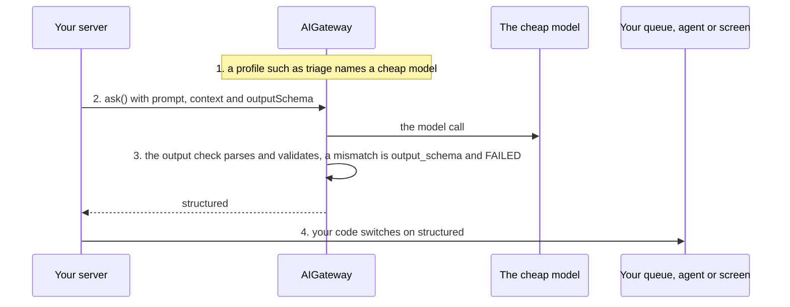

# Classify and route requests

**This path is complete for its goal.** Its chapters, its examples and the pages it links are all you need; no other page
of the documentation is required. It starts from four pages of Getting started:
[What is the AI gateway](../10-getting-started/10-what-is-the-ai-gateway.md),
[Installation](../10-getting-started/20-installation.md), [Example: ask](../10-getting-started/30-example-ask.md),
[Example: run](../10-getting-started/40-example-run.md).

**Prerequisites:** the setup of [Installation](../10-getting-started/20-installation.md) and an OpenAI API key in
`OPENAI_API_KEY`: the configuration of [8.0](#80-the-configuration) reads it for the two OpenAI models of
Installation, `gpt-5-mini` and `text-embedding-3-small`. Example [8.4](#84-the-same-message-gets-the-same-intent-every-time) also calls a Claude model: an Anthropic API key in
`ANTHROPIC_API_KEY`.

## 1. About

One `ask()` on a small, fast model whose `outputSchema` is the decision: an intent, a priority, a team. Your code reads
`structured` and routes; the model only classifies.

## 2. Description

For triage in front of your own logic: the intent of a chat message, the queue of a support ticket, the category of an
incoming email. The schema's enum makes the answer one of your values or a failed call, never free text. A profile of its
own puts the use case on a cheap model.

Where it ends: when the model must act on the decision itself, use [Let the model act](020-let-the-model-act.md).

## 3. What you will be able to do

- Define the classes as a zod enum and the triage as an object schema. Examples: [8.2](#82-route-a-message-by-its-intent), [8.3](#83-a-triage-decision-with-priority-team-and-summary).
- Run the classifier on a profile of its own, on a cheap model. Example: [8.1](#81-a-profile-of-its-own-for-the-classifier).
- Route on `structured` in your code, and handle a call that failed the schema. Examples: [8.2](#82-route-a-message-by-its-intent), [8.5](#85-the-model-answers-outside-the-enum-and-a-human-takes-the-message).
- Keep the answer stable with a low temperature, where the model takes one. Example: [8.4](#84-the-same-message-gets-the-same-intent-every-time).

## 4. The parts

| # | Read                                                                                                       | For                                                |
|---|------------------------------------------------------------------------------------------------------------|----------------------------------------------------|
| 1 | [Example: ask](../10-getting-started/30-example-ask.md)                                                    | `outputSchema` and `structured`                    |
| 2 | [Models and profiles](../20-learn-the-gateway/010-models-and-profiles.md)                                  | a profile per use case, the model's caps and price |
| 3 | [Guardrails: Structured output](../20-learn-the-gateway/050-guardrails.md#24-structured-output)            | an answer outside the schema fails                 |
| 4 | [D58: Sampling temperature per call](../60-architecture/90-decisions.md#d58-sampling-temperature-per-call) | `temperature`, and the model cap it needs          |
| 5 | [Token control with the Usage Guard](../20-learn-the-gateway/060-usage-guard.md#25-tokens-and-cost)        | the cost of each call                              |

## 5. How the parts connect



1. A profile such as `triage` names a cheap model ([Two profiles, the user picks the model](../20-learn-the-gateway/010-models-and-profiles.md#32-two-profiles-the-user-picks-the-model)
   shows the shape).
2. The call passes the message as `prompt`, what the screen knows as `context`, and the schema as `outputSchema`.
3. The output check parses and validates the answer; a mismatch is the ERROR `output_schema` and the call is `FAILED`
   ([Structured output](../20-learn-the-gateway/050-guardrails.md#24-structured-output)).
4. Your code switches on `structured` and calls the queue, the agent or the screen it chose.

## 6. API you should know

Grouped by the step of your code where you meet them, in the order of the examples.

### 6.1 Set up the classifier

Examples: [8.0](#80-the-configuration), [8.1](#81-a-profile-of-its-own-for-the-classifier), [8.4](#84-the-same-message-gets-the-same-intent-every-time).

| Symbol                                                                                                                                                | What you use it for                            |
|-------------------------------------------------------------------------------------------------------------------------------------------------------|------------------------------------------------|
| [`IAIProfile`](../30-api/index/interfaces/IAIProfile.md)                                                                                              | the classifier's profile                       |
| [`IModelCaps`](../30-api/index/interfaces/IModelCaps.md)                                                                                              | `structuredOutput`, `temperature`, the prices  |
| [`AIGateway.aiProfileStore`](../30-api/index/classes/AIGateway.md#aiprofilestore), [`IAIProfileStore`](../30-api/index/interfaces/IAIProfileStore.md) | `upsertProfile`: the profile stored at runtime |

### 6.2 Make the call

Examples: [8.2](#82-route-a-message-by-its-intent), [8.3](#83-a-triage-decision-with-priority-team-and-summary), [8.4](#84-the-same-message-gets-the-same-intent-every-time), [8.5](#85-the-model-answers-outside-the-enum-and-a-human-takes-the-message), [8.6](#86-delete-the-thread-of-each-classified-message).

| Symbol                                                                                                                        | What you use it for                                      |
|-------------------------------------------------------------------------------------------------------------------------------|----------------------------------------------------------|
| [`AIGateway.ask`](../30-api/index/classes/AIGateway.md#ask)                                                                   | the call                                                 |
| [`IGatewayAskInput`](../30-api/index/interfaces/IGatewayAskInput.md)                                                          | `outputSchema`, `temperature`, `context`, `instructions` |
| [`AIGateway.delete`](../30-api/index/classes/AIGateway.md#delete), [`IDeleteArgs`](../30-api/index/interfaces/IDeleteArgs.md) | removes the thread a classification left                 |

### 6.3 Read the decision

Example: [8.2](#82-route-a-message-by-its-intent).

| Symbol                                                                                                               | What you use it for           |
|----------------------------------------------------------------------------------------------------------------------|-------------------------------|
| [`IAnswerResponse`](../30-api/index/interfaces/IAnswerResponse.md)                                                   | `structured`                  |
| [`IFailedResponse`](../30-api/index/interfaces/IFailedResponse.md), [`IIssue`](../30-api/index/interfaces/IIssue.md) | a call that failed the schema |

## 7. Advanced API

Grouped by the part of the gateway you replace.

### 7.1 The model call

| Symbol                                                   | Replace it when                        |
|----------------------------------------------------------|----------------------------------------|
| [`ILLMClient`](../30-api/index/interfaces/ILLMClient.md) | another SDK, a proxy, a fake for tests |

### 7.2 The system prompt

| Symbol                                                                       | Replace it when                                          |
|------------------------------------------------------------------------------|----------------------------------------------------------|
| [`IContextAssembler`](../30-api/index/interfaces/IContextAssembler.md)       | the system prompt and the history are assembled your way |
| [`IPromptTemplateStore`](../30-api/index/interfaces/IPromptTemplateStore.md) | the template is versioned your way                       |

### 7.3 Plugging your class in

| Symbol                                                                     | What it is                                               |
|----------------------------------------------------------------------------|----------------------------------------------------------|
| [`IAIGatewayOverrides`](../30-api/index/interfaces/IAIGatewayOverrides.md) | the second argument of `AIGateway`: one factory per part |

The pattern: [What can be injected](../60-architecture/50-live-adjustment-and-dependency-injection.md#23-what-can-be-injected).

## 8. Examples

Each example runs on the `gateway` and the `userContext` of 8.0: paste 8.0 and the example into one file. What comes from your application, such as `invoices` or `ledger`, is a `declare` line at the top of the example.

### 8.0 The configuration

The classifier has a profile of its own; `triage-claude` runs on a model that takes a temperature (8.4). The keys this path uses come with why. The others are required by `IAIGatewayConfig` and keep the values of [Installation](../10-getting-started/20-installation.md), with the features this path does not need switched off: they are `baseConfig`, collapsed above the configuration, which spreads it first: a key the path sets wins over it. `gpt5Mini` and `textEmbedding3Small` are the models of Installation, in the same collapsed block.

> **The bigger picture:** Your server builds this gateway once at startup; the classifier calls of every tenant go through it, next to or instead of the chat.

<details>
<summary>The models of Installation, and <code>baseConfig</code>: the keys <code>IAIGatewayConfig</code> requires that this path does not use</summary>

```ts
import {
  IAIGatewayConfig,
  IModelInfo,
  EModelProvider,
  InMemoryBlobAdapter,
  InMemoryPromptTemplateRepository,
  InMemoryRunRepository,
  InMemoryThreadRepository,
  InMemoryTraceRepository,
  InMemoryUsageAdapter,
  InMemoryUserMemoryRepository,
  InMemoryVectorIndexAdapter,
} from "dyna-ai-gateway";

// The two models of Installation
const gpt5Mini: IModelInfo = {
  id: "gpt-5-mini",
  provider: EModelProvider.OPENAI,
  providerModelId: "gpt-5-mini",
  label: "GPT-5 mini",
  caps: {
    tools: true, images: true, pdf: true, structuredOutput: true, reasoning: true, temperature: false, embeddings: false,
    contextTokens: 400_000, maxOutputTokens: 128_000, costInPerMTokUsd: 0.25, costOutPerMTokUsd: 2,
  },
  enabled: true,
  deprecatedAt: null,
};

const textEmbedding3Small: IModelInfo = {
  id: "text-embedding-3-small",
  provider: EModelProvider.OPENAI,
  providerModelId: "text-embedding-3-small",
  label: "text-embedding-3-small",
  caps: {
    tools: false, images: false, pdf: false, structuredOutput: false, reasoning: false, temperature: false, embeddings: true,
    contextTokens: 8_191, maxOutputTokens: 0, costInPerMTokUsd: 0.02, costOutPerMTokUsd: 0,
  },
  enabled: true,
  deprecatedAt: null,
};

// Required by IAIGatewayConfig, nothing specific to this path: the in-memory stores of Installation,
// and the features this path does not need switched off
const baseConfig = {
  promptTemplateStore: {repository: new InMemoryPromptTemplateRepository()},
  threadStore: {repository: new InMemoryThreadRepository()},
  fileStore: {adapter: new InMemoryBlobAdapter(), path: "ai-files"},
  userMemoryStore: {repository: new InMemoryUserMemoryRepository(), enabled: false}, // user facts off
  embedder: {embeddingModelId: "text-embedding-3-small", dimensions: 1536},
  vectorStore: {adapter: new InMemoryVectorIndexAdapter({embeddingModelId: "text-embedding-3-small", dimensions: 1536})},
  queryRewriter: {enabled: false}, // no follow-up rewrite
  runStore: {repository: new InMemoryRunRepository()},
  humanGate: {userQuestions: {enabled: false}}, // the model asks no questions
  usageGuard: {adapter: new InMemoryUsageAdapter()},
  contextAssembler: {promptCaching: true, sharePromptCacheAcrossTenants: false},
  trace: {repository: new InMemoryTraceRepository()},
  defaultCheapModelId: "gpt-5-mini",
} satisfies Partial<IAIGatewayConfig>;
```

</details>

```ts
import {
  AIGateway,
  IAIProfile,
  IUserContext,
  InMemoryAIProfileRepository,
  InMemoryModelRegistryRepository,
} from "dyna-ai-gateway";

const claudeHaiku: IModelInfo = {
  id: "claude-haiku-4-5",
  provider: EModelProvider.ANTHROPIC,
  providerModelId: "claude-haiku-4-5-20251001",
  label: "Claude Haiku 4.5",
  caps: {
    tools: true, images: true, pdf: true, structuredOutput: true, reasoning: true, temperature: true, embeddings: false,
    contextTokens: 200_000, maxOutputTokens: 64_000, costInPerMTokUsd: 1, costOutPerMTokUsd: 5,
  },
  enabled: true,
  deprecatedAt: null,
};

const triage: IAIProfile = {
  id: "triage",
  tenantId: "acme",
  name: "Ticket triage",
  modelId: "gpt-5-mini",
  promptAddendum: "You classify support messages of a web shop. You never answer them.",
  allowedTools: [],
  approvals: [],
  limits: {maxStepsPerRun: 1, maxOutputTokens: 2_000}, // a reasoning model thinks within this cap
};

const triageClaude: IAIProfile = {
  id: "triage-claude",
  tenantId: "acme",
  name: "Ticket triage on Claude",
  modelId: "claude-haiku-4-5",
  promptAddendum: "You classify support messages of a web shop. You never answer them.",
  allowedTools: [],
  approvals: [],
  limits: {maxStepsPerRun: 1, maxOutputTokens: 2_000}, // a reasoning model thinks within this cap
};

const config: IAIGatewayConfig = {
  ...baseConfig, // the required keys this path does not use, collapsed above; a key below wins over it

  // What this path uses
  // the credentials of both providers
  llmClient: {providers: {
    [EModelProvider.OPENAI]: {apiKey: process.env.OPENAI_API_KEY ?? ""},
    [EModelProvider.ANTHROPIC]: {apiKey: process.env.ANTHROPIC_API_KEY ?? ""},
  }},
  // caps.structuredOutput and caps.temperature are read here
  modelRegistry: {repository: new InMemoryModelRegistryRepository({models: [gpt5Mini, textEmbedding3Small, claudeHaiku]})},
  // one profile per classifier
  aiProfileStore: {repository: new InMemoryAIProfileRepository({profiles: [triage, triageClaude]})},
  workingMemory: {enabled: false}, // each message is classified alone: no summary calls
};

const gateway = new AIGateway(config);

// Per request, from your authentication: who asks, in which tenant (Example: ask)
const userContext: IUserContext = {
  tenantId: "acme",
  userId: "u-17",
  permissions: [],
  locale: "en-GB",
  timezone: "Europe/Oslo",
  now: new Date(),
};
```

### 8.1 A profile of its own for the classifier

`upsertProfile` stores the `triage` profile of 8.0, which the configuration also seeds at startup: a small, fast model, no tools, one step, and an output limit that leaves room for the thinking of a reasoning model. The classifier's rule, to classify and never answer, lives in its `promptAddendum`.

> **The bigger picture:** Done once per tenant, at startup or from the admin screen that manages the profiles; every message classified later runs on it.

```ts
await gateway.aiProfileStore.upsertProfile({tenantId: "acme", profile: triage}); // the profile of 8.0, stored at runtime
```

### 8.2 Route a message by its intent

With an `outputSchema`, the answer carries `structured`, parsed and checked against the schema. A `switch` on `structured.intent` sends the message to the queue that handles it.

> **The bigger picture:** A customer writes to support; before anyone reads the message, your server classifies it and hands it to the order bot, the refunds queue or a human.

```ts
import {z} from "zod";
import {EGatewayResponseKind} from "dyna-ai-gateway";

declare const message: string; // the customer's text, from your inbox
declare const queues: {orderBot(text: string): Promise<void>; refunds(text: string): Promise<void>; humans(text: string): Promise<void>}; // your queues

const intent = z.object({intent: z.enum(["order_status", "refund", "complaint", "other"])});

const result = await gateway.ask({
  userContext,
  profileId: "triage",
  prompt: message, // the customer's text
  outputSchema: intent,
  kbFilters: {libraryIds: [], bookIds: []},
}).response;

if (result.kind === EGatewayResponseKind.ANSWER && result.structured) {
  switch (result.structured.intent) {
    case "order_status": await queues.orderBot(message); break;
    case "refund": await queues.refunds(message); break;
    default: await queues.humans(message);
  }
}
```

### 8.3 A triage decision with priority, team and summary

One call returns several fields at once. `context` gives the model what your system knows about the customer, as data; `instructions` adds the rule of this call.

> **The bigger picture:** A new ticket arrives in the helpdesk: it gets its priority, its team and a one-line summary before it lands in the team's list.

```ts
import {z} from "zod";

declare const ticket: {body: string; customerTier: string; openTickets: number}; // the ticket on screen

const ticketTriage = z.object({
  priority: z.enum(["P1", "P2", "P3"]),
  team: z.enum(["billing", "logistics", "tech"]),
  summary: z.string().max(200),
});

const {response} = gateway.ask({
  userContext,
  profileId: "triage",
  prompt: ticket.body,
  context: JSON.stringify({customerTier: ticket.customerTier, openTickets: ticket.openTickets}), // what your system knows
  instructions: "P1 only when the customer cannot pay or cannot receive goods.",
  outputSchema: ticketTriage,
  kbFilters: {libraryIds: [], bookIds: []},
});
```

### 8.4 The same message gets the same intent every time

`temperature: 0` makes the model draw the most likely token every time. It is accepted only on a profile whose model has `caps.temperature`; on any other the call is refused with a 400 before anything is stored.

> **The bigger picture:** A classifier whose decisions must be repeatable, for example when the routing is audited or the same message is classified again after a retry.

```ts
import {z} from "zod";

declare const message: string; // the customer's text, from your inbox

const intent = z.object({intent: z.enum(["order_status", "refund", "complaint", "other"])}); // the classes of 8.2

const {response} = gateway.ask({
  userContext,
  profileId: "triage-claude", // a profile whose model has caps.temperature: true
  prompt: message,
  outputSchema: intent,
  temperature: 0,
  kbFilters: {libraryIds: [], bookIds: []},
});
```

### 8.5 The model answers outside the enum, and a human takes the message

An answer that is not JSON or that the schema rejects ends the call as `FAILED` (`output_invalid_json` or `output_schema`). The message goes to a human instead of a guessed queue.

> **The bigger picture:** The fallback of the routing: a message the model could not classify within the schema lands in the human queue, not in a queue picked by guesswork.

```ts
import {z} from "zod";
import {EGatewayResponseKind} from "dyna-ai-gateway";

declare const message: string; // the customer's text, from your inbox
declare const queues: {orderBot(text: string): Promise<void>; refunds(text: string): Promise<void>; humans(text: string): Promise<void>}; // your queues

const intent = z.object({intent: z.enum(["order_status", "refund", "complaint", "other"])}); // the classes of 8.2

const result = await gateway.ask({userContext, profileId: "triage", prompt: message, outputSchema: intent, kbFilters: {libraryIds: [], bookIds: []}}).response;
if (result.kind === EGatewayResponseKind.FAILED) {
  // output_schema or output_invalid_json: route to a human instead of guessing
  await queues.humans(message);
}
```

### 8.6 Delete the thread of each classified message

Every `ask` stores its turns in a thread. Once the intent is known, `gateway.delete` removes that thread; a call refused before it started has no `threadId`.

> **The bigger picture:** After the routing: a classifier that handles every incoming message would otherwise leave one thread per message in your database.

```ts
import {z} from "zod";
import {EGatewayResponseKind} from "dyna-ai-gateway";

declare const message: string; // the customer's text, from your inbox

const intent = z.object({intent: z.enum(["order_status", "refund", "complaint", "other"])}); // the classes of 8.2

const result = await gateway.ask({userContext, profileId: "triage", prompt: message, outputSchema: intent, kbFilters: {libraryIds: [], bookIds: []}}).response;
if (result.kind !== EGatewayResponseKind.PAUSED && result.threadId) { // a call refused before it started has no thread
  await gateway.delete({tenantId: userContext.tenantId, threadIds: [result.threadId], userId: userContext.userId});
}
```

## 9. Pitfalls

- [Models and profiles: Pitfalls](../20-learn-the-gateway/010-models-and-profiles.md#4-pitfalls): a `temperature` on a
  model without the cap is a 400.
- A call without `threadId` starts a new thread. A classifier called on every message leaves one thread per message;
  remove them with `delete` ([How do I delete conversations?](../10-getting-started/90-faq.md#how-do-i-delete-conversations)).
- On a reasoning model (`caps.reasoning`), the thinking counts against `limits.maxOutputTokens`: a cap of a few hundred
  tokens can cut the answer before its JSON is complete. Keep the cap in the thousands.
- The classifier's profile needs no tools: an `ask()` offers none
  ([Human in the loop: About](../20-learn-the-gateway/040-human-in-the-loop.md#1-about)).

## 10. Summary

- One `ask()`, one profile on a cheap model, one zod schema.
- An answer outside the schema is a `FAILED` call, never a guess your code must parse.
- The routing is your code, on `structured`.

## 11. FAQ

- [How can the user change the model?](../10-getting-started/90-faq.md#how-can-the-user-change-the-model)
- [How do I control the spend?](../10-getting-started/90-faq.md#how-do-i-control-the-spend)
- [Models and profiles: FAQ](../20-learn-the-gateway/010-models-and-profiles.md#6-faq)
