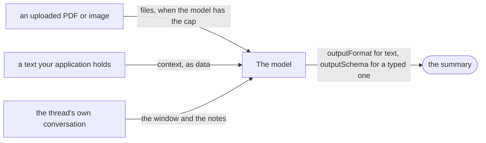

# Summarize a document

**This path is complete for its goal.** Its chapters, its examples and the pages it links are all you need; no other page
of the documentation is required. It starts from four pages of Getting started:
[What is the AI gateway](../10-getting-started/10-what-is-the-ai-gateway.md),
[Installation](../10-getting-started/20-installation.md), [Example: ask](../10-getting-started/30-example-ask.md),
[Example: run](../10-getting-started/40-example-run.md).

**Prerequisites:** the setup of [Installation](../10-getting-started/20-installation.md) and an OpenAI API key in
`OPENAI_API_KEY`: the configuration of [8.0](#80-the-configuration) reads it for the two OpenAI models of
Installation, `gpt-5-mini` and `text-embedding-3-small`.

## 1. About

One `ask()` with the document as a file or as `context`. The summary comes back as Markdown, as plain text, or as a typed
object with the points your screen shows.

## 2. Description

For a long contract, a report, a support thread, a meeting transcript: a short version the user reads instead. A PDF or
an image goes through the file store; a text your application already holds goes into `context`. A structured summary
(decisions, open points, deadlines) is data extraction with a schema of its own.

## 3. What you will be able to do

- Summarize an uploaded PDF, or a text from your database. Examples: [8.1](#81-summarise-an-uploaded-pdf-in-a-few-paragraphs), [8.2](#82-summarise-a-text-your-application-holds).
- Choose Markdown or plain text, or a schema of the points. Examples: [8.1](#81-summarise-an-uploaded-pdf-in-a-few-paragraphs), [8.2](#82-summarise-a-text-your-application-holds), [8.3](#83-a-contract-summary-as-structured-fields).
- Summarize the conversation of a thread. Example: [8.4](#84-the-decisions-and-open-points-of-a-conversation).
- Estimate what a long document costs before you send it. Example: [8.5](#85-estimate-the-cost-before-you-send-a-long-document).

## 4. The parts

| # | Read                                                                                                                                              | For                                |
|---|---------------------------------------------------------------------------------------------------------------------------------------------------|------------------------------------|
| 1 | [Example: ask](../10-getting-started/30-example-ask.md)                                                                                           | `context`, `outputSchema`          |
| 2 | [Chat files and their storage](../20-learn-the-gateway/092-chat-files.md)                                                                         | a document as a file               |
| 3 | [D42: The caller decides the format of a text answer](../60-architecture/90-decisions.md#d42-the-caller-decides-the-format-of-a-text-answer)      | `outputFormat`                     |
| 4 | [Thread memory](../20-learn-the-gateway/080-thread-memory.md)                                                                                     | what a summary of a thread can see |
| 5 | [Models and profiles: What the gateway reads from `caps`](../20-learn-the-gateway/010-models-and-profiles.md#21-what-the-gateway-reads-from-caps) | the context window, `pdf`          |
| 6 | [Chat files: Tokens and cost](../20-learn-the-gateway/092-chat-files.md#24-tokens-and-cost)                                                       | the estimate of a file             |

## 5. How the parts connect



| Source of the text            | How it reaches the model                      | Read                                                                                        |
|-------------------------------|-----------------------------------------------|---------------------------------------------------------------------------------------------|
| an uploaded PDF or image      | `files`, read when the model has the cap      | [A question with files](../20-learn-the-gateway/092-chat-files.md#22-a-question-with-files) |
| a text your application holds | `context`, as data, not kept on the thread    | [D68](../60-architecture/90-decisions.md#d68-per-call-instructions-and-context)             |
| the thread's own conversation | the window and the notes of the thread memory | [Thread memory: About](../20-learn-the-gateway/080-thread-memory.md#1-about)                |

The form of the summary is `outputFormat` for text and `outputSchema` for a typed one; with a schema the format
instruction is left out ([D42](../60-architecture/90-decisions.md#d42-the-caller-decides-the-format-of-a-text-answer)).
Example 8.3 is a structured summary.

## 6. API you should know

Grouped by the step of your code where you meet them, in the order of the examples.

### 6.1 Set up

Examples: [8.0](#80-the-configuration), [8.6](#86-the-summary-was-cut-at-the-output-limit).

| Symbol                                                               | What you use it for                       |
|----------------------------------------------------------------------|-------------------------------------------|
| [`IModelCaps`](../30-api/index/interfaces/IModelCaps.md)             | `contextTokens`, `maxOutputTokens`, `pdf` |
| [`IAIProfileLimits`](../30-api/index/interfaces/IAIProfileLimits.md) | `maxOutputTokens` of the summary          |

### 6.2 Hand over the text

Example: [8.4](#84-the-decisions-and-open-points-of-a-conversation).

| Symbol                                                                                                                          | What you use it for                                     |
|---------------------------------------------------------------------------------------------------------------------------------|---------------------------------------------------------|
| [`AIGateway.uploadFile`](../30-api/index/classes/AIGateway.md#uploadfile), [`IFileRef`](../30-api/index/interfaces/IFileRef.md) | a document as a file                                    |
| [`AIGateway.getTurns`](../30-api/index/classes/AIGateway.md#getturns)                                                           | the whole thread, when your code builds the text itself |

### 6.3 Make the call

Examples: [8.1](#81-summarise-an-uploaded-pdf-in-a-few-paragraphs), [8.2](#82-summarise-a-text-your-application-holds), [8.3](#83-a-contract-summary-as-structured-fields), [8.4](#84-the-decisions-and-open-points-of-a-conversation), [8.6](#86-the-summary-was-cut-at-the-output-limit).

| Symbol                                                                                                                            | What you use it for                                                |
|-----------------------------------------------------------------------------------------------------------------------------------|--------------------------------------------------------------------|
| [`AIGateway.ask`](../30-api/index/classes/AIGateway.md#ask), [`IGatewayAskInput`](../30-api/index/interfaces/IGatewayAskInput.md) | `files`, `context`, `outputFormat`, `outputSchema`, `instructions` |
| [`EOutputFormat`](../30-api/index/enumerations/EOutputFormat.md)                                                                  | `MARKDOWN` or `PLAIN`                                              |

### 6.4 Read the summary

Examples: [8.1](#81-summarise-an-uploaded-pdf-in-a-few-paragraphs), [8.2](#82-summarise-a-text-your-application-holds), [8.4](#84-the-decisions-and-open-points-of-a-conversation).

| Symbol                                                             | What you use it for           |
|--------------------------------------------------------------------|-------------------------------|
| [`IAnswerResponse`](../30-api/index/interfaces/IAnswerResponse.md) | `text`, `structured`, `usage` |

## 7. Advanced API

Grouped by the part of the gateway you replace.

### 7.1 The model call

| Symbol                                                   | Replace it when                        |
|----------------------------------------------------------|----------------------------------------|
| [`ILLMClient`](../30-api/index/interfaces/ILLMClient.md) | another SDK, a proxy, a fake for tests |

### 7.2 The system prompt

| Symbol                                                                       | Replace it when                                          |
|------------------------------------------------------------------------------|----------------------------------------------------------|
| [`IContextAssembler`](../30-api/index/interfaces/IContextAssembler.md)       | the system prompt and the history are assembled your way |
| [`IPromptTemplateStore`](../30-api/index/interfaces/IPromptTemplateStore.md) | the template is versioned your way                       |

### 7.3 Plugging your class in

| Symbol                                                                     | What it is                                               |
|----------------------------------------------------------------------------|----------------------------------------------------------|
| [`IAIGatewayOverrides`](../30-api/index/interfaces/IAIGatewayOverrides.md) | the second argument of `AIGateway`: one factory per part |

The pattern: [What can be injected](../60-architecture/50-live-adjustment-and-dependency-injection.md#23-what-can-be-injected).

## 8. Examples

Each example runs on the `gateway` and the `userContext` of 8.0: paste 8.0 and the example into one file. What comes from your application, such as `invoices` or `ledger`, is a `declare` line at the top of the example.

### 8.0 The configuration

The profile runs on `gpt-5-mini`, whose caps have `pdf: true` and a context of 400 000 tokens. The keys this path uses come with why. The others are required by `IAIGatewayConfig` and keep the values of [Installation](../10-getting-started/20-installation.md), with the features this path does not need switched off; most of them are `baseConfig`, collapsed above the configuration, which spreads it first: a key the path sets wins over it. `gpt5Mini` and `textEmbedding3Small` are the models of Installation, in the same collapsed block.

> **The bigger picture:** Your server builds this gateway once at startup; the summaries of every screen and every tenant are calls to it.

<details>
<summary>The models of Installation, and <code>baseConfig</code>: the keys <code>IAIGatewayConfig</code> requires that this path does not use</summary>

```ts
import {
  IAIGatewayConfig,
  IModelInfo,
  EModelProvider,
  InMemoryPromptTemplateRepository,
  InMemoryRunRepository,
  InMemoryTraceRepository,
  InMemoryUsageAdapter,
  InMemoryUserMemoryRepository,
  InMemoryVectorIndexAdapter,
} from "dyna-ai-gateway";

// The two models of Installation
const gpt5Mini: IModelInfo = {
  id: "gpt-5-mini",
  provider: EModelProvider.OPENAI,
  providerModelId: "gpt-5-mini",
  label: "GPT-5 mini",
  caps: {
    tools: true, images: true, pdf: true, structuredOutput: true, reasoning: true, temperature: false, embeddings: false,
    contextTokens: 400_000, maxOutputTokens: 128_000, costInPerMTokUsd: 0.25, costOutPerMTokUsd: 2,
  },
  enabled: true,
  deprecatedAt: null,
};

const textEmbedding3Small: IModelInfo = {
  id: "text-embedding-3-small",
  provider: EModelProvider.OPENAI,
  providerModelId: "text-embedding-3-small",
  label: "text-embedding-3-small",
  caps: {
    tools: false, images: false, pdf: false, structuredOutput: false, reasoning: false, temperature: false, embeddings: true,
    contextTokens: 8_191, maxOutputTokens: 0, costInPerMTokUsd: 0.02, costOutPerMTokUsd: 0,
  },
  enabled: true,
  deprecatedAt: null,
};

// Required by IAIGatewayConfig, nothing specific to this path: the in-memory stores of Installation,
// and the features this path does not need switched off
const baseConfig = {
  promptTemplateStore: {repository: new InMemoryPromptTemplateRepository()},
  workingMemory: {enabled: true},
  userMemoryStore: {repository: new InMemoryUserMemoryRepository(), enabled: false}, // user facts off
  embedder: {embeddingModelId: "text-embedding-3-small", dimensions: 1536},
  vectorStore: {adapter: new InMemoryVectorIndexAdapter({embeddingModelId: "text-embedding-3-small", dimensions: 1536})},
  queryRewriter: {enabled: false}, // no follow-up rewrite
  runStore: {repository: new InMemoryRunRepository()},
  humanGate: {userQuestions: {enabled: false}}, // the model asks no questions
  usageGuard: {adapter: new InMemoryUsageAdapter()},
  contextAssembler: {promptCaching: true, sharePromptCacheAcrossTenants: false},
  trace: {repository: new InMemoryTraceRepository()},
  defaultCheapModelId: "gpt-5-mini",
} satisfies Partial<IAIGatewayConfig>;
```

</details>

```ts
import {
  AIGateway,
  IAIGatewayConfig,
  IAIProfile,
  IUserContext,
  EModelProvider,
  InMemoryAIProfileRepository,
  InMemoryBlobAdapter,
  InMemoryModelRegistryRepository,
  InMemoryThreadRepository,
} from "dyna-ai-gateway";

const accounting: IAIProfile = {
  id: "accounting",
  tenantId: "acme",
  name: "Accounting assistant",
  modelId: "gpt-5-mini",
  promptAddendum: "You assist the accounting team of a Norwegian company. Amounts are in NOK.",
  allowedTools: [],
  approvals: [],
  limits: {maxStepsPerRun: 6, maxOutputTokens: 4_000},
};

const config: IAIGatewayConfig = {
  ...baseConfig, // the required keys this path does not use, collapsed above; a key below wins over it

  // What this path uses
  // caps.pdf, caps.contextTokens and the prices bound what a summary can take
  modelRegistry: {repository: new InMemoryModelRegistryRepository({models: [gpt5Mini, textEmbedding3Small]})},
  // limits.maxOutputTokens bounds the length of a summary
  aiProfileStore: {repository: new InMemoryAIProfileRepository({profiles: [accounting]})},
  fileStore: {adapter: new InMemoryBlobAdapter(), path: "ai-files"}, // the uploaded documents
  threadStore: {repository: new InMemoryThreadRepository()}, // the thread a conversation summary reads (8.4)

  // required too, and kept in view: the provider key
  llmClient: {providers: {[EModelProvider.OPENAI]: {apiKey: process.env.OPENAI_API_KEY ?? ""}}},
};

const gateway = new AIGateway(config);

// Per request, from your authentication: who asks, in which tenant (Example: ask)
const userContext: IUserContext = {
  tenantId: "acme",
  userId: "u-17",
  permissions: [],
  locale: "en-GB",
  timezone: "Europe/Oslo",
  now: new Date(),
};
```

### 8.1 Summarise an uploaded PDF in a few paragraphs

The PDF goes in `files` and the length and the reader in `prompt`. The answer is `text`, in Markdown.

> **The bigger picture:** A user uploads a contract and presses "Summarise"; the manager reads five paragraphs instead of twenty pages.

```ts
import {EGatewayResponseKind, IFileRef} from "dyna-ai-gateway";

declare const pdf: IFileRef; // the PDF the user uploaded (uploadFile)

const result = await gateway.ask({
  userContext,
  profileId: "accounting", // its model has caps.pdf
  prompt: "Summarise this contract in five paragraphs for a manager.",
  files: [pdf],
  kbFilters: {libraryIds: [], bookIds: []},
}).response;
if (result.kind === EGatewayResponseKind.ANSWER) console.log(result.text); // Markdown
```

### 8.2 Summarise a text your application holds

A text that is not a file goes in `context`, as data, not instructions. `EOutputFormat.PLAIN` returns text without Markdown.

> **The bigger picture:** A report stored in your database gets a three-sentence summary for a list view or a plain-text field, with no upload.

```ts
import {EOutputFormat} from "dyna-ai-gateway";

declare const report: {text: string}; // a text your application holds

const {response} = gateway.ask({
  userContext,
  profileId: "accounting",
  prompt: "Summarise this report in three sentences.",
  context: report.text,         // data, not instructions
  outputFormat: EOutputFormat.PLAIN, // for a plain-text field
  kbFilters: {libraryIds: [], bookIds: []},
});
```

### 8.3 A contract summary as structured fields

With an `outputSchema`, the summary comes back as parties, term, obligations, deadlines and risks, checked against the schema; `outputFormat` does not apply.

> **The bigger picture:** The contract screen fills its fields from the summary, and the deadlines can go to the calendar of your application.

```ts
import {IFileRef} from "dyna-ai-gateway";
import {z} from "zod";

declare const pdf: IFileRef; // the PDF the user uploaded (uploadFile)

const contractSummary = z.object({
  parties: z.array(z.string()),
  term: z.string(),
  obligations: z.array(z.object({party: z.string(), obligation: z.string()})),
  deadlines: z.array(z.object({date: z.string(), what: z.string()})),
  risks: z.array(z.string()),
});

const {response} = gateway.ask({
  userContext,
  profileId: "accounting",
  prompt: "Summarise this contract.",
  files: [pdf],
  outputSchema: contractSummary, // with a schema, outputFormat does not apply
  kbFilters: {libraryIds: [], bookIds: []},
});
```

### 8.4 The decisions and open points of a conversation

`getTurns` reads every turn of the thread, oldest first, not only the window the memory keeps. Their text is passed as `context` to a call that returns two lists.

> **The bigger picture:** At the end of a long chat the user presses "Wrap up" and gets what was decided and what is still open, for the minutes or the next meeting.

```ts
import {z} from "zod";
import {EPartKind} from "dyna-ai-gateway";

declare const threadId: string; // the thread your screen has open

const turns = await gateway.getTurns({userContext, threadId}); // every turn, not only the memory's window
const transcript = turns
  .map(turn => `${turn.role}: ${turn.parts.flatMap(part => part.kind === EPartKind.TEXT ? [part.text] : []).join(" ")}`)
  .join("\n");

const {response} = gateway.ask({
  userContext,
  profileId: "accounting",
  prompt: "List the decisions and the open points of this conversation.",
  context: transcript,
  outputSchema: z.object({decisions: z.array(z.string()), openPoints: z.array(z.string())}),
  kbFilters: {libraryIds: [], bookIds: []},
});
```

### 8.5 Estimate the cost before you send a long document

`modelRegistry.estimateCostUsd` computes the USD cost of a call from token counts and the list prices of the model, before anything is sent.

> **The bigger picture:** Before a large PDF is summarised, your server compares the estimate with the tenant's budget, or the UI shows it to the user to confirm.

```ts
const costUsd = await gateway.modelRegistry.estimateCostUsd({
  modelId: "gpt-5-mini",
  inputTokens: 40 * 2_000, // a 40-page PDF counts 2 000 tokens per page
  outputTokens: 1_500,
});
```

### 8.6 The summary was cut at the output limit

When the model stops at the profile's `limits.maxOutputTokens`, the answer is still an `ANSWER`, with the warning `output_truncated` in `issues`.

> **The bigger picture:** After the call: your code asks again for a shorter summary or raises the limit, instead of showing the user a text that ends mid-sentence.

```ts
import {EGatewayResponseKind, IFileRef} from "dyna-ai-gateway";

declare const pdf: IFileRef; // the PDF the user uploaded (uploadFile)

const result = await gateway.ask({userContext, profileId: "accounting", prompt: "Summarise this report.", files: [pdf], kbFilters: {libraryIds: [], bookIds: []}}).response;
if (result.kind === EGatewayResponseKind.ANSWER && result.issues.some(issue => issue.code === "output_truncated")) {
  // the model stopped at the profile's limits.maxOutputTokens: ask for a shorter summary, or raise the limit
}
```

## 9. Pitfalls

- [Chat files: Pitfalls](../20-learn-the-gateway/092-chat-files.md#4-pitfalls)
- A summary of a thread sees what its memory gives the model, not every turn: the window and, under `SUMMARY_BUFFER`, the
  notes ([Thread memory: About](../20-learn-the-gateway/080-thread-memory.md#1-about)). For every turn, read them with
  `getTurns` and pass them as `context`.
- A summary cut by `maxOutputTokens` carries the WARNING `output_truncated`
  ([The output check](../20-learn-the-gateway/050-guardrails.md#22-the-output-check)).
- A model without `caps.pdf` drops the PDF with `file_dropped`
  ([Which models read which files](../20-learn-the-gateway/092-chat-files.md#23-which-models-read-which-files)).

## 10. Summary

- A file in `files`, a text in `context`, a thread by its `threadId`.
- `outputFormat` for text, `outputSchema` for a typed summary.
- The model's context window and `maxOutputTokens` bound what goes in and what comes out.

## 11. FAQ

- [How much of the conversation does the model see, and how do I choose?](../10-getting-started/90-faq.md#how-much-of-the-conversation-does-the-model-see-and-how-do-i-choose)
- [Chat files: FAQ](../20-learn-the-gateway/092-chat-files.md#6-faq)
