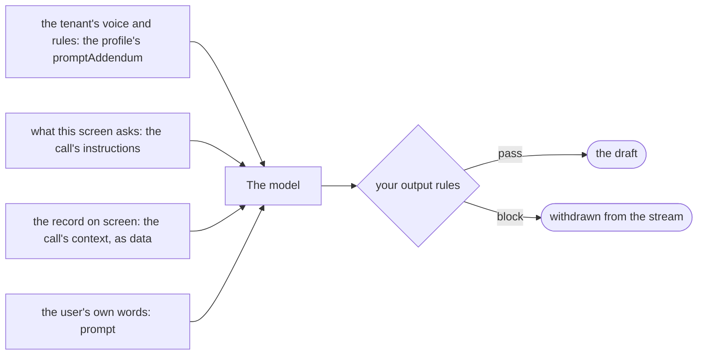

# Generate content

**This path is complete for its goal.** Its chapters, its examples and the pages it links are all you need; no other page
of the documentation is required. It starts from four pages of Getting started:
[What is the AI gateway](../10-getting-started/10-what-is-the-ai-gateway.md),
[Installation](../10-getting-started/20-installation.md), [Example: ask](../10-getting-started/30-example-ask.md),
[Example: run](../10-getting-started/40-example-run.md).

## 1. About

One `ask()` that writes for the user: a reply to an email, a product description, a follow-up message. The data comes
from the screen as `context`; the tone and the rules come from the profile and the call's `instructions`.

## 2. Description

For text the user edits and sends: the draft of a customer reply, the description of a product from its attributes, a
reminder from the data of an overdue invoice. The tenant's voice lives in the profile's `promptAddendum`, the task of the
screen in `instructions`, the record in `context`. The output format follows the field the text goes into.

## 3. What you will be able to do

- Pass the record of the screen as `context` and the task as `instructions`. Example: [8.3](#83-the-agent-asks-for-a-reply-to-a-customer-email).
- Keep a tenant's tone in its profile. Example: [8.2](#82-the-tenants-admin-sets-the-voice-of-every-draft).
- Get Markdown for a rich editor or plain text for an SMS or a plain field. Examples: [8.3](#83-the-agent-asks-for-a-reply-to-a-customer-email), [8.6](#86-a-payment-reminder-as-plain-text-for-an-sms).
- Stream the draft into the editor as it is written. Example: [8.4](#84-the-draft-streams-into-the-editor-as-the-model-writes-it).
- Check the draft with an output rule before the user sees it. Example: [8.1](#81-an-output-rule-blocks-a-draft-that-promises-a-discount).

## 4. The parts

| # | Read                                                                                                                                         | For                                                        |
|---|----------------------------------------------------------------------------------------------------------------------------------------------|------------------------------------------------------------|
| 1 | [Example: ask](../10-getting-started/30-example-ask.md)                                                                                      | `context`, streaming                                       |
| 2 | [System prompt layers](../60-architecture/40-system-prompt-production-layers.md)                                                             | addendum, `instructions`, `context`: which text goes where |
| 3 | [D68: Per-call instructions and context](../60-architecture/90-decisions.md#d68-per-call-instructions-and-context)                           | what is kept and what is not                               |
| 4 | [D42: The caller decides the format of a text answer](../60-architecture/90-decisions.md#d42-the-caller-decides-the-format-of-a-text-answer) | `outputFormat`                                             |
| 5 | [D58: Sampling temperature per call](../60-architecture/90-decisions.md#d58-sampling-temperature-per-call)                                   | more or less varied drafts                                 |
| 6 | [Guardrails: The output check](../20-learn-the-gateway/050-guardrails.md#22-the-output-check)                                                | a rule on the draft                                        |

## 5. How the parts connect



| Text                                  | Layer                          | Kept                  |
|---------------------------------------|--------------------------------|-----------------------|
| the tenant's voice and rules          | the profile's `promptAddendum` | stored on the profile |
| what this screen asks the model to do | the call's `instructions`      | this call only        |
| the record the user is looking at     | the call's `context`, as data  | this call only        |
| the user's own words, if any          | `prompt`                       | the thread            |

[Which layer to use](../60-architecture/40-system-prompt-production-layers.md#which-layer-to-use) has the rule. A draft
that an output rule blocks is withdrawn from the stream
([A streamed answer that is blocked](../20-learn-the-gateway/050-guardrails.md#27-a-streamed-answer-that-is-blocked)).

## 6. API you should know

Grouped by the step of your code where you meet them, in the order of the examples.

### 6.1 Set up the voice and the check

Examples: [8.0](#80-the-configuration), [8.1](#81-an-output-rule-blocks-a-draft-that-promises-a-discount), [8.2](#82-the-tenants-admin-sets-the-voice-of-every-draft).

| Symbol                                                     | What you use it for  |
|------------------------------------------------------------|----------------------|
| [`IAIProfile`](../30-api/index/interfaces/IAIProfile.md)   | `promptAddendum`     |
| [`IOutputRule`](../30-api/index/interfaces/IOutputRule.md) | a check on the draft |

### 6.2 Make the call

Examples: [8.3](#83-the-agent-asks-for-a-reply-to-a-customer-email), [8.4](#84-the-draft-streams-into-the-editor-as-the-model-writes-it), [8.5](#85-a-product-description-written-from-structured-data), [8.6](#86-a-payment-reminder-as-plain-text-for-an-sms), [8.7](#87-three-subject-lines-with-a-higher-temperature).

| Symbol                                                                                                                            | What you use it for                                      |
|-----------------------------------------------------------------------------------------------------------------------------------|----------------------------------------------------------|
| [`AIGateway.ask`](../30-api/index/classes/AIGateway.md#ask), [`IGatewayAskInput`](../30-api/index/interfaces/IGatewayAskInput.md) | `context`, `instructions`, `outputFormat`, `temperature` |
| [`EOutputFormat`](../30-api/index/enumerations/EOutputFormat.md)                                                                  | `MARKDOWN` or `PLAIN`                                    |

### 6.3 Read the draft

Examples: [8.3](#83-the-agent-asks-for-a-reply-to-a-customer-email), [8.4](#84-the-draft-streams-into-the-editor-as-the-model-writes-it).

| Symbol                                                                       | What you use it for              |
|------------------------------------------------------------------------------|----------------------------------|
| [`ELLMClientEventKind`](../30-api/index/enumerations/ELLMClientEventKind.md) | `TEXT_DELTA`, `ANSWER_WITHDRAWN` |
| [`IAnswerResponse`](../30-api/index/interfaces/IAnswerResponse.md)           | `text`                           |

## 7. Advanced API

Grouped by the part of the gateway you replace.

### 7.1 The system prompt

| Symbol                                                                                                                                                   | Replace it when                                                                                                                                       |
|----------------------------------------------------------------------------------------------------------------------------------------------------------|-------------------------------------------------------------------------------------------------------------------------------------------------------|
| [`IPromptTemplateStore`](../30-api/index/interfaces/IPromptTemplateStore.md), [`EPromptTemplateKey`](../30-api/index/enumerations/EPromptTemplateKey.md) | the system prompt's template itself changes ([Changing the template](../60-architecture/40-system-prompt-production-layers.md#changing-the-template)) |
| [`IContextAssembler`](../30-api/index/interfaces/IContextAssembler.md)                                                                                   | the prompt is assembled your way                                                                                                                      |

### 7.2 Plugging your class in

| Symbol                                                                     | What it is                                                                                                 |
|----------------------------------------------------------------------------|------------------------------------------------------------------------------------------------------------|
| [`IAIGatewayOverrides`](../30-api/index/interfaces/IAIGatewayOverrides.md) | the second argument of `AIGateway`; the keys of the parts above: `promptTemplateStore`, `contextAssembler` |

## 8. Examples

The examples run on the `gateway` of 8.0 and the `userContext` of [Example: ask](../10-getting-started/30-example-ask.md). Names such as `invoices` or `ledger` stand for your application's code.

### 8.0 The configuration

The profiles carry the tenant's voice; `support-claude` runs on a model that takes a temperature (8.7); the rule is the one of 8.1. The keys this path uses come first, each with why; the others are required by `IAIGatewayConfig` and keep the values of [Installation](../10-getting-started/20-installation.md), with the features this path does not need switched off. `gpt5Mini` and `textEmbedding3Small` are the models of Installation.

> **The bigger picture:** Your server builds this gateway once at startup. The voice of each tenant lives in its profiles; the output rule is registered here once and checks the draft of every call.

```ts
import {
  AIGateway,
  IAIGatewayConfig,
  IAIProfile,
  IModelInfo,
  EModelProvider,
  InMemoryAIProfileRepository,
  InMemoryBlobAdapter,
  InMemoryModelRegistryRepository,
  InMemoryPromptTemplateRepository,
  InMemoryRunRepository,
  InMemoryThreadRepository,
  InMemoryTraceRepository,
  InMemoryUsageAdapter,
  InMemoryUserMemoryRepository,
  InMemoryVectorIndexAdapter,
} from "dyna-ai-gateway";

const claudeHaiku: IModelInfo = {
  id: "claude-haiku-4-5",
  provider: EModelProvider.ANTHROPIC,
  providerModelId: "claude-haiku-4-5-20251001",
  label: "Claude Haiku 4.5",
  caps: {
    tools: true, images: true, pdf: true, structuredOutput: true, reasoning: true, temperature: true, embeddings: false,
    contextTokens: 200_000, maxOutputTokens: 64_000, costInPerMTokUsd: 1, costOutPerMTokUsd: 5,
  },
  enabled: true,
  deprecatedAt: null,
};

const support: IAIProfile = {
  id: "support",
  tenantId: "acme",
  name: "Customer support writer",
  modelId: "gpt-5-mini",
  promptAddendum: "You write for Acme, a family-run shop. Warm, short sentences, no exclamation marks.",
  allowedTools: [],
  approvals: [],
  limits: {maxStepsPerRun: 1, maxOutputTokens: 1_200},
};

const supportClaude: IAIProfile = {
  id: "support-claude",
  tenantId: "acme",
  name: "Customer support writer on Claude",
  modelId: "claude-haiku-4-5",
  promptAddendum: "You write for Acme, a family-run shop. Warm, short sentences, no exclamation marks.",
  allowedTools: [],
  approvals: [],
  limits: {maxStepsPerRun: 1, maxOutputTokens: 1_200},
};

const config: IAIGatewayConfig = {
  // What this path uses
  // the credentials of both providers
  llmClient: {providers: {
    [EModelProvider.OPENAI]: {apiKey: process.env.OPENAI_API_KEY ?? ""},
    [EModelProvider.ANTHROPIC]: {apiKey: process.env.ANTHROPIC_API_KEY ?? ""},
  }},
  // caps.temperature is read here
  modelRegistry: {repository: new InMemoryModelRegistryRepository({models: [gpt5Mini, textEmbedding3Small, claudeHaiku]})},
  // the promptAddendum of each profile is the tenant's voice
  aiProfileStore: {repository: new InMemoryAIProfileRepository({profiles: [support, supportClaude]})},
  guardrails: {outputRules: [noDiscountPromises]}, // 8.1: a check on every draft

  // Required by IAIGatewayConfig, nothing specific to this path: the in-memory stores of Installation,
  // and the features this path does not need switched off
  promptTemplateStore: {repository: new InMemoryPromptTemplateRepository()},
  threadStore: {repository: new InMemoryThreadRepository()},
  fileStore: {adapter: new InMemoryBlobAdapter(), path: "ai-files"},
  workingMemory: {enabled: true},
  userMemoryStore: {repository: new InMemoryUserMemoryRepository(), enabled: false}, // user facts off
  embedder: {embeddingModelId: "text-embedding-3-small", dimensions: 1536},
  vectorStore: {adapter: new InMemoryVectorIndexAdapter({embeddingModelId: "text-embedding-3-small", dimensions: 1536})},
  queryRewriter: {enabled: false}, // no follow-up rewrite
  runStore: {repository: new InMemoryRunRepository()},
  humanGate: {userQuestions: {enabled: false}}, // the model asks no questions
  usageGuard: {adapter: new InMemoryUsageAdapter()},
  contextAssembler: {promptCaching: true, sharePromptCacheAcrossTenants: false},
  trace: {repository: new InMemoryTraceRepository()},
  defaultCheapModelId: "gpt-5-mini",
};

const gateway = new AIGateway(config);
```

### 8.1 An output rule blocks a draft that promises a discount

An `IOutputRule` in `guardrails.outputRules` runs on the answer after the model call. This one returns an `ERROR` issue when a draft of the `support` profile promises a discount, so the response is `FAILED` instead of `ANSWER` and the draft never reaches the editor.

> **The bigger picture:** A rule of the business, written by your developers and registered at startup: whatever the model writes, support never promises a discount the shop did not decide.

```ts
import {EIssueSeverity, IIssue, IOutputRule} from "dyna-ai-gateway";

const noDiscountPromises: IOutputRule = {
  name: "no_discount_promises",
  check: async ({evidence}): Promise<IIssue[]> =>
    evidence.profile.id === "support" && /\b\d+ ?% (off|discount)\b/i.test(String(evidence.output))
      ? [{code: "discount_promise", message: "The draft promises a discount", severity: EIssueSeverity.ERROR}]
      : [],
};
```

### 8.2 The tenant's admin sets the voice of every draft

`promptAddendum` on the profile is the tenant's voice, part of the system prompt of every call on `support`. `upsertProfile` validates the profile and stores it whole; the calls use the new text from then on, other server instances after their cache TTL.

> **The bigger picture:** The settings screen of one tenant: its admin adds a sign-off to the voice once, and every draft written afterwards for that tenant carries it.

```ts
import {IAIProfile} from "dyna-ai-gateway";

const support: IAIProfile = {
  id: "support",
  tenantId: "acme",
  name: "Customer support writer",
  modelId: "gpt-5-mini",
  promptAddendum: "You write for Acme, a family-run shop. Warm, short sentences, no exclamation marks. Sign as 'The Acme team'.",
  allowedTools: [],
  approvals: [],
  limits: {maxStepsPerRun: 1, maxOutputTokens: 1_200},
};
await gateway.aiProfileStore.upsertProfile({tenantId: "acme", profile: support});
```

### 8.3 The agent asks for a reply to a customer email

`ask()` gets the email as `context` and the rules of this screen as `instructions`; the request itself is the `prompt`. An `ANSWER` response carries the draft in `text`, which goes into the editor.

> **The bigger picture:** The "Draft reply" button of the support inbox: the agent opens an email, clicks, and edits the draft before sending it. The gateway sends nothing.

```ts
import {EGatewayResponseKind} from "dyna-ai-gateway";

const result = await gateway.ask({
  userContext,
  profileId: "support",
  prompt: "Write the reply.",
  context: JSON.stringify({from: email.from, subject: email.subject, body: email.body, order: email.order}),
  instructions: "Answer in the language of the email. Thank the customer once. End with the order number.",
  kbFilters: {libraryIds: [], bookIds: []},
}).response;
if (result.kind === EGatewayResponseKind.ANSWER) editor.setDraft(result.text);
```

### 8.4 The draft streams into the editor as the model writes it

The same call, read through `events`: each `TEXT_DELTA` appends to the editor. When an output rule blocks the finished draft, `ANSWER_WITHDRAWN` arrives last and the editor clears what it showed.

> **The bigger picture:** The same "Draft reply" button, with the text appearing as it is written instead of after a wait; the withdrawn event is the moment the rule of 8.1 says no.

```ts
import {ELLMClientEventKind} from "dyna-ai-gateway";

const {events, response} = gateway.ask({
  userContext,
  profileId: "support",
  prompt: "Write the reply.",
  context: JSON.stringify(email),
  kbFilters: {libraryIds: [], bookIds: []},
});
for await (const event of events) {
  if (event.kind === ELLMClientEventKind.TEXT_DELTA) editor.append(event.text ?? "");
  if (event.kind === ELLMClientEventKind.ANSWER_WITHDRAWN) editor.setDraft(""); // an output rule blocked the draft
}
```

### 8.5 A product description written from structured data

The product's data is the `context`, and `instructions` forbid any fact that is not in it. The same profile and voice write a different kind of text.

> **The bigger picture:** The product editor of the shop's back office: a merchant fills the fields of a product and asks for the description of the shop page.

```ts
const {response} = gateway.ask({
  userContext,
  profileId: "support",
  prompt: "Write the product description for the shop page.",
  context: JSON.stringify(product), // name, material, sizes, care
  instructions: "Two short paragraphs, then a bullet list of the facts. Never invent a fact that is not in the data.",
  kbFilters: {libraryIds: [], bookIds: []},
});
```

### 8.6 A payment reminder as plain text for an SMS

`outputFormat: EOutputFormat.PLAIN` asks the model for text without Markdown, for a channel that renders none. The length limit is in the `prompt`; the gateway does not count the characters.

> **The bigger picture:** The invoice screen or the reminder job of the back office: the reminder goes out by SMS, where Markdown would show as raw symbols.

```ts
import {EOutputFormat} from "dyna-ai-gateway";

const {response} = gateway.ask({
  userContext,
  profileId: "support",
  prompt: "Write a payment reminder of at most 160 characters.",
  context: JSON.stringify({invoiceNo: invoice.invoiceNo, totalCents: invoice.totalCents, currency: invoice.currency}),
  outputFormat: EOutputFormat.PLAIN,
  kbFilters: {libraryIds: [], bookIds: []},
});
```

### 8.7 Three subject lines with a higher temperature

Three calls in parallel with `temperature: 1` give more varied variants. `temperature` is accepted only on a model whose registry entry has `caps.temperature`, so the calls run on `support-claude`; on `support` (GPT-5 mini) the call is refused with a 400.

> **The bigger picture:** The newsletter editor: the marketer asks for suggestions and picks one of the three, or asks again.

```ts
const variants = await Promise.all([1, 2, 3].map(() => gateway.ask({
  userContext,
  profileId: "support-claude", // its model has caps.temperature: true
  prompt: "Suggest one subject line for the spring newsletter.",
  temperature: 1,
  kbFilters: {libraryIds: [], bookIds: []},
}).response));
```

## 9. Pitfalls

- The format is Markdown or plain text; there is no HTML. Convert and sanitise Markdown where it is rendered
  ([D42](../60-architecture/90-decisions.md#d42-the-caller-decides-the-format-of-a-text-answer)).
- `context` and `instructions` are not stored; a second draft on the same thread passes them again
  ([D68](../60-architecture/90-decisions.md#d68-per-call-instructions-and-context)).
- A `temperature` on a model without the cap is a 400
  ([Models and profiles: Pitfalls](../20-learn-the-gateway/010-models-and-profiles.md#4-pitfalls)).

## 10. Summary

- The profile carries the voice, `instructions` the task, `context` the data.
- `outputFormat` matches the field the text goes into.
- `events` stream the draft; an output rule can withdraw it.

## 11. FAQ

- [Is the system prompt cached, and what does it cost?](../10-getting-started/90-faq.md#is-the-system-prompt-cached-and-what-does-it-cost)
- [How do I add moderation or other safety checks?](../10-getting-started/90-faq.md#how-do-i-add-moderation-or-other-safety-checks)
