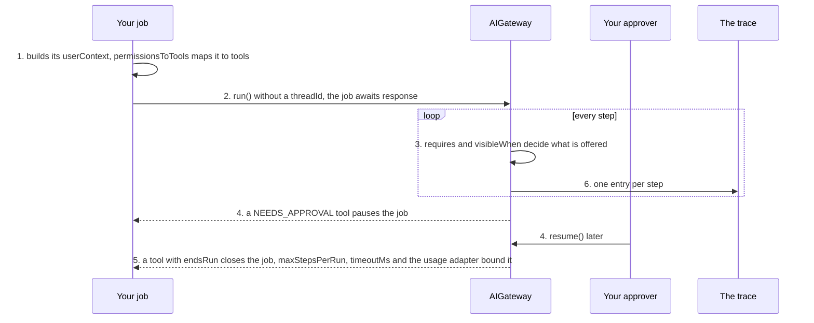

# Automate a back-office task

**This path is complete for its goal.** Its chapters, its examples and the pages it links are all you need; no other page
of the documentation is required. It starts from four pages of Getting started:
[What is the AI gateway](../10-getting-started/10-what-is-the-ai-gateway.md),
[Installation](../10-getting-started/20-installation.md), [Example: ask](../10-getting-started/30-example-ask.md),
[Example: run](../10-getting-started/40-example-run.md).

**Prerequisites:** the setup of [Installation](../10-getting-started/20-installation.md) and an OpenAI API key in
`OPENAI_API_KEY`: the configuration of [8.0](#80-the-configuration) reads it for the two OpenAI models of
Installation, `gpt-5-mini` and `text-embedding-3-small`.

## 1. About

A `run()` your server starts as a job, with no chat screen: a nightly report, a reconciliation, the triage of an inbox. The
tools do the work, the policies and `requires` keep it in order, a terminal tool closes it, and a pause waits for an
approver like any other run.

## 2. Description

The same agent loop as a chat, started by a scheduler instead of a user. The job runs under a `userContext` your host
sets for it, whose permissions unlock the job's tools. Nobody reads the stream; the job awaits `response`. A deadline
and the step limit bound it; your usage adapter decides what it may spend.

## 3. What you will be able to do

- Start a run from a job, with a service `userContext`. Examples: [8.2](#82-the-service-user-the-job-runs-as), [8.3](#83-the-job-starts-the-run-and-handles-its-three-outcomes).
- Force an order of tools: look up before you act. Example: [8.0](#80-the-configuration).
- End the job from a tool. Example: [8.1](#81-the-jobs-tools-read-the-bank-match-the-payments-file-the-report).
- Bound the job by steps and by time. Examples: [8.0](#80-the-configuration), [8.3](#83-the-job-starts-the-run-and-handles-its-three-outcomes).
- Leave a risky action waiting for an approver, and find it later. Examples: [8.1](#81-the-jobs-tools-read-the-bank-match-the-payments-file-the-report), [8.4](#84-an-approver-lists-the-jobs-paused-runs-and-approves-them).

## 4. The parts

| # | Read                                                                                                                               | For                                            |
|---|------------------------------------------------------------------------------------------------------------------------------------|------------------------------------------------|
| 1 | [Tools](../20-learn-the-gateway/030-tools.md)                                                                                      | the tools, `requires`, `visibleWhen`, failures |
| 2 | [D15, D76: Guarded workflows](../60-architecture/90-decisions.md#d15-d76-guarded-workflows)                                        | the order of tools                             |
| 3 | [How does a run end, and can a tool end it?](../10-getting-started/90-faq.md#how-does-a-run-end-and-can-a-tool-end-it)             | `endsRun`                                      |
| 4 | [Can I cancel a call, or limit how long it takes?](../10-getting-started/90-faq.md#can-i-cancel-a-call-or-limit-how-long-it-takes) | `timeoutMs`                                    |
| 5 | [Human in the loop](../20-learn-the-gateway/040-human-in-the-loop.md)                                                              | a pause, the inbox, expiry                     |
| 6 | [Token control with the Usage Guard](../20-learn-the-gateway/060-usage-guard.md)                                                   | the job's spend                                |

## 5. How the parts connect



1. The job builds a `userContext` for itself; `toolPolicy.permissionsToTools` maps its permissions to the tools it may
   use ([Narrow, never widen](../20-learn-the-gateway/030-tools.md#23-narrow-never-widen)).
2. `run()` without a `threadId` starts a thread for the job; the job awaits `response` and ignores `events`
   ([Example: ask](../10-getting-started/30-example-ask.md#the-parts-of-the-call)).
3. `requires` offers the action only after the lookup ran in this run; `visibleWhen` limits a tool to some steps.
4. A tool with a `policy` of `NEEDS_APPROVAL` pauses the job; the approver resumes it later
   ([Human in the loop](../20-learn-the-gateway/040-human-in-the-loop.md), example 8.4).
5. A terminal tool with `endsRun` closes the job; `maxStepsPerRun`, `timeoutMs` and your usage adapter bound it.
6. The trace keeps one entry per step ([Every model call leaves an entry](../60-architecture/90-decisions.md#every-model-call-leaves-an-entry)).

## 6. API you should know

Grouped by the step of your code where you meet them, in the order of the examples.

### 6.1 The job's tools and identity

Example: [8.0](#80-the-configuration).

| Symbol                                                                                                        | What you use it for                |
|---------------------------------------------------------------------------------------------------------------|------------------------------------|
| [`defineTool`](../30-api/index/functions/defineTool.md), [`IToolDef`](../30-api/index/interfaces/IToolDef.md) | `policy`, `endsRun`, `visibleWhen` |
| [`IToolPolicyConfig`](../30-api/index/interfaces/IToolPolicyConfig.md)                                        | `permissionsToTools`, `requires`   |
| [`IUserContext`](../30-api/index/interfaces/IUserContext.md)                                                  | the job's identity and permissions |
| [`IAIProfileLimits`](../30-api/index/interfaces/IAIProfileLimits.md)                                          | `maxStepsPerRun`                   |

### 6.2 Start the job

Examples: [8.3](#83-the-job-starts-the-run-and-handles-its-three-outcomes), [8.5](#85-the-nightly-schedule-runs-the-job-and-the-maintenance-jobs).

| Symbol                                                                                                                            | What you use it for                 |
|-----------------------------------------------------------------------------------------------------------------------------------|-------------------------------------|
| [`AIGateway.run`](../30-api/index/classes/AIGateway.md#run), [`IGatewayRunInput`](../30-api/index/interfaces/IGatewayRunInput.md) | the job, `timeoutMs`, `activeTools` |

### 6.3 Read the outcome

Examples: [8.3](#83-the-job-starts-the-run-and-handles-its-three-outcomes), [8.4](#84-an-approver-lists-the-jobs-paused-runs-and-approves-them).

| Symbol                                                                                                                                                                                                         | What you use it for           |
|----------------------------------------------------------------------------------------------------------------------------------------------------------------------------------------------------------------|-------------------------------|
| [`IAnswerResponse`](../30-api/index/interfaces/IAnswerResponse.md)                                                                                                                                             | `endedByTool`, `issues`       |
| [`IPausedResponse`](../30-api/index/interfaces/IPausedResponse.md), [`AIGateway.listPausedRuns`](../30-api/index/classes/AIGateway.md#listpausedruns), [`resume`](../30-api/index/classes/AIGateway.md#resume) | a job that waits              |
| [`TOnToolErrorHandler`](../30-api/index/type-aliases/TOnToolErrorHandler.md)                                                                                                                                   | being told that a tool failed |

## 7. Advanced API

Grouped by the part of the gateway you replace.

### 7.1 The tools

| Symbol                                                         | Replace it when                                               |
|----------------------------------------------------------------|---------------------------------------------------------------|
| [`IToolRegistry`](../30-api/index/interfaces/IToolRegistry.md) | the tools are offered and executed your way                   |
| [`IToolPolicy`](../30-api/index/interfaces/IToolPolicy.md)     | allow, deny, approval and `requires` follow rules of your own |

### 7.2 The paused jobs

| Symbol                                                 | Replace it when                                                       |
|--------------------------------------------------------|-----------------------------------------------------------------------|
| [`IRunStore`](../30-api/index/interfaces/IRunStore.md) | paused jobs are stored your way; a repository is enough in most cases |

### 7.3 Plugging your class in

| Symbol                                                                     | What it is                                                                                                |
|----------------------------------------------------------------------------|-----------------------------------------------------------------------------------------------------------|
| [`IAIGatewayOverrides`](../30-api/index/interfaces/IAIGatewayOverrides.md) | the second argument of `AIGateway`; the keys of the parts above: `toolRegistry`, `toolPolicy`, `runStore` |

## 8. Examples

Each example runs on the `gateway` and the `userContext` of 8.0: paste 8.0 and the example into one file. What comes from your application, such as `invoices` or `ledger`, is a `declare` line at the top of the example.

### 8.0 The configuration

The tools (8.1) and the service user the job runs as (8.2) are defined here. The keys this path uses come first, each with why. The others are required by `IAIGatewayConfig` and keep the values of [Installation](../10-getting-started/20-installation.md), with the features this path does not need switched off; most of them are `baseConfig`, collapsed above the configuration that spreads it. `gpt5Mini` and `textEmbedding3Small` are the models of Installation, in the same collapsed block.

> **The bigger picture:** Your worker process builds this gateway once at startup. Nobody watches its runs, so a failed tool call goes to the log through `onToolError`, and `toolPolicy` fixes which tools the job may use and in which order.

<details>
<summary>The models of Installation, and <code>baseConfig</code>: the keys <code>IAIGatewayConfig</code> requires that this path does not use</summary>

```ts
import {
  IAIGatewayConfig,
  IModelInfo,
  EModelProvider,
  InMemoryBlobAdapter,
  InMemoryPromptTemplateRepository,
  InMemoryTraceRepository,
  InMemoryUsageAdapter,
  InMemoryUserMemoryRepository,
  InMemoryVectorIndexAdapter,
} from "dyna-ai-gateway";

// The two models of Installation
const gpt5Mini: IModelInfo = {
  id: "gpt-5-mini",
  provider: EModelProvider.OPENAI,
  providerModelId: "gpt-5-mini",
  label: "GPT-5 mini",
  caps: {
    tools: true, images: true, pdf: true, structuredOutput: true, reasoning: true, temperature: false, embeddings: false,
    contextTokens: 400_000, maxOutputTokens: 128_000, costInPerMTokUsd: 0.25, costOutPerMTokUsd: 2,
  },
  enabled: true,
  deprecatedAt: null,
};

const textEmbedding3Small: IModelInfo = {
  id: "text-embedding-3-small",
  provider: EModelProvider.OPENAI,
  providerModelId: "text-embedding-3-small",
  label: "text-embedding-3-small",
  caps: {
    tools: false, images: false, pdf: false, structuredOutput: false, reasoning: false, temperature: false, embeddings: true,
    contextTokens: 8_191, maxOutputTokens: 0, costInPerMTokUsd: 0.02, costOutPerMTokUsd: 0,
  },
  enabled: true,
  deprecatedAt: null,
};

// Required by IAIGatewayConfig, nothing specific to this path: the in-memory stores of Installation,
// and the features this path does not need switched off
const baseConfig = {
  promptTemplateStore: {repository: new InMemoryPromptTemplateRepository()},
  fileStore: {adapter: new InMemoryBlobAdapter(), path: "ai-files"},
  workingMemory: {enabled: false}, // no summary of the thread
  userMemoryStore: {repository: new InMemoryUserMemoryRepository(), enabled: false}, // user facts off
  embedder: {embeddingModelId: "text-embedding-3-small", dimensions: 1536},
  vectorStore: {adapter: new InMemoryVectorIndexAdapter({embeddingModelId: "text-embedding-3-small", dimensions: 1536})},
  queryRewriter: {enabled: false}, // no follow-up rewrite
  humanGate: {userQuestions: {enabled: false}}, // the model asks no questions
  usageGuard: {adapter: new InMemoryUsageAdapter()},
  contextAssembler: {promptCaching: true, sharePromptCacheAcrossTenants: false},
  trace: {repository: new InMemoryTraceRepository()},
  defaultCheapModelId: "gpt-5-mini",
} satisfies Partial<IAIGatewayConfig>;
```

</details>

```ts
import {z} from "zod";
import {
  AIGateway,
  IAIGatewayConfig,
  IAIProfile,
  IUserContext,
  EModelProvider,
  InMemoryAIProfileRepository,
  InMemoryModelRegistryRepository,
  InMemoryRunRepository,
  InMemoryThreadRepository,
  EToolCallVerdict,
  defineTool,
} from "dyna-ai-gateway";

// your application's own code
declare const bank: {statement(accountId: string, signal: AbortSignal): Promise<{lines: object[]}>};
declare const ledger: {
  isLargeAmount(bankLineId: string): Promise<boolean>;
  match(tenantId: string, input: {bankLineId: string; invoiceNo: string}): Promise<{matched: boolean}>;
};
declare const reports: {file(tenantId: string, report: object): Promise<{reportId: string}>};

// the job's tools (8.1) and its service user (8.2)
const fetchStatement = defineTool({
  name: "fetch_bank_statement",
  description: "Returns yesterday's bank lines: {lines: [{id, amountCents, text}]}.",
  inputSchema: z.object({accountId: z.string()}),
  tags: ["bank"],
  execute: async ({input, abortSignal}) => bank.statement(input.accountId, abortSignal),
});

const matchPayment = defineTool({
  name: "match_payment",
  description: "Marks an invoice as paid by a bank line. Returns {matched}.",
  inputSchema: z.object({bankLineId: z.string(), invoiceNo: z.string()}),
  tags: ["ledger"],
  policy: async ({input}) => ({
    verdict: (await ledger.isLargeAmount(input.bankLineId)) ? EToolCallVerdict.NEEDS_APPROVAL : EToolCallVerdict.ALLOW,
  }),
  execute: async ({input, userContext}) => ledger.match(userContext.tenantId, input),
});

const fileReport = defineTool({
  name: "file_reconciliation_report",
  description: "Files the report of the night. Call it last. Returns {reportId}.",
  inputSchema: z.object({matched: z.number(), unmatched: z.array(z.string())}),
  tags: ["reports"],
  endsRun: true, // the job ends with the report
  execute: async ({input, userContext}) => reports.file(userContext.tenantId, input),
});

const jobContext: IUserContext = {
  tenantId: "acme",
  userId: "job-nightly-reconciliation", // a service user of your host
  permissions: ["bank.read", "ledger.write"],
  locale: "en-GB",
  timezone: "Europe/Oslo",
  now: new Date(),
};


const reconciliation: IAIProfile = {
  id: "reconciliation",
  tenantId: "acme",
  name: "Nightly reconciliation",
  modelId: "gpt-5-mini",
  promptAddendum: "You reconcile bank lines with open invoices.",
  allowedTools: ["fetch_bank_statement", "match_payment", "file_reconciliation_report"],
  approvals: [],
  limits: {maxStepsPerRun: 20, maxOutputTokens: 2_000},
};

const config: IAIGatewayConfig = {
  // What this path uses
  toolRegistry: {
    tools: [fetchStatement, matchPayment, fileReport], // defined above (8.1)
    onToolError: (report): void => console.error("job tool failed", report.toolName, report.modelText), // nobody watches the run
  },
  toolPolicy: {
    permissionsToTools: {"bank.read": ["fetch_bank_statement"], "ledger.write": ["match_payment", "file_reconciliation_report"]},
    requires: {match_payment: ["fetch_bank_statement"], file_reconciliation_report: ["fetch_bank_statement"]},
  },
  // maxStepsPerRun bounds the job
  aiProfileStore: {repository: new InMemoryAIProfileRepository({profiles: [reconciliation]})},
  runStore: {repository: new InMemoryRunRepository()}, // a job that waits for an approver is stored here
  threadStore: {repository: new InMemoryThreadRepository(), leaseMs: 300_000}, // the job's timeoutMs stays under it

  // required too, and kept in view: the provider key, the models
  llmClient: {providers: {[EModelProvider.OPENAI]: {apiKey: process.env.OPENAI_API_KEY ?? ""}}},
  modelRegistry: {repository: new InMemoryModelRegistryRepository({models: [gpt5Mini, textEmbedding3Small]})},
  ...baseConfig, // the other required keys, collapsed above
};

const gateway = new AIGateway(config);

// Per request, from your authentication: who asks, in which tenant (Example: ask)
const userContext: IUserContext = {
  tenantId: "acme",
  userId: "u-17",
  permissions: [],
  locale: "en-GB",
  timezone: "Europe/Oslo",
  now: new Date(),
};
```

### 8.1 The job's tools: read the bank, match the payments, file the report

`fetch_bank_statement` reads, `match_payment` writes and needs an approval when the amount is large, `file_reconciliation_report` ends the run with `endsRun: true`. The policy of `match_payment` is a function, decided on the input of each call.

> **The bigger picture:** Registered once at startup, they wrap your bank integration and your ledger; only a call with a large amount waits for a person.

The three are defined in 8.0; their order and their permissions are its `toolPolicy`.

### 8.2 The service user the job runs as

The job has no logged-in user, so it runs with the `IUserContext` of a service user of your host: `jobContext`, defined in 8.0. Its `permissions` decide, through `toolPolicy.permissionsToTools`, which tools the model is offered.

> **The bigger picture:** A technical account your host creates per job: the job's threads and paused runs belong to this user, and its permissions are the only ones the job has.

### 8.3 The job starts the run and handles its three outcomes

The job awaits `response` and never reads `events`; `timeoutMs` stays under `threadStore.leaseMs`. The response is an `ANSWER` (with `endedByTool` when the report was filed), `PAUSED` when a large amount waits for an approver, or `FAILED`.

> **The bigger picture:** The job's code on the worker, started by the schedule of 8.5: a finished run is logged, a paused one notifies the approvers, a failed one goes to the error log.

```ts
import {EGatewayResponseKind} from "dyna-ai-gateway";

declare const notify: {approvers(args: {runId: string; pauseId: string}): Promise<void>}; // your notifications

const result = await gateway.run({
  userContext: {...jobContext, now: new Date()},
  profileId: "reconciliation",
  prompt: "Reconcile yesterday's lines of account NO-1234 with the open invoices, then file the report.",
  timeoutMs: 240_000, // under threadStore.leaseMs
  kbFilters: {libraryIds: [], bookIds: []},
}).response; // events are never read

switch (result.kind) {
  case EGatewayResponseKind.ANSWER:
    console.info("job done", result.endedByTool, result.issues.map(issue => issue.code)); // output_truncated: the step cap cut it
    break;
  case EGatewayResponseKind.PAUSED:
    await notify.approvers({runId: result.envelopes[0].runId, pauseId: result.pauseId}); // a large amount waits
    break;
  case EGatewayResponseKind.FAILED:
    console.error("job failed", result.issues);
}
```

### 8.4 An approver lists the job's paused runs and approves them

`listPausedRuns` with the job's context lists the runs of the service user that wait for a human. The approver resumes each with one `EResumeAction.APPROVE` per envelope; the tools then run with the approver's context.

> **The bigger picture:** The approvals screen of the accounting team the next morning: a person checks the large payments the night job left open and lets the job finish.

```ts
import {EResumeAction, IUserContext} from "dyna-ai-gateway";

// per request, from the approver's own session
const approverContext: IUserContext = {...jobContext, userId: "u-42", permissions: ["ledger.write"]};

const waiting = await gateway.listPausedRuns({userContext: jobContext}); // the runs of the job's user
for (const run of waiting) {
  await gateway.resume({
    userContext: approverContext,
    runId: run.runId,
    pauseId: run.pauseId,
    decisions: run.envelopes.map(() => ({action: EResumeAction.APPROVE})), // one decision per card
  }).response;
}
```

### 8.5 The nightly schedule runs the job and the maintenance jobs

One timer starts the run, then calls `expirePausedRuns`, which closes the pauses nobody answered in time, and `recoverStuckRuns`, which fails the runs a dead instance left `RUNNING`.

> **The bigger picture:** Your scheduler on the worker, once per tenant and night: the job itself, then the clean-up of what nobody decided and of what a crash left open.

```ts
setInterval(async () => {
  await gateway.run({
    userContext: {...jobContext, now: new Date()},
    profileId: "reconciliation",
    prompt: "Reconcile yesterday's lines of account NO-1234, then file the report.",
    timeoutMs: 240_000,
    kbFilters: {libraryIds: [], bookIds: []},
  }).response;
  await gateway.expirePausedRuns({tenantId: "acme"});
  await gateway.recoverStuckRuns({tenantId: "acme"});
}, 24 * 60 * 60_000);
```

## 9. Pitfalls

- [Tools: Pitfalls](../20-learn-the-gateway/030-tools.md#4-pitfalls)
- A tool failure does not stop the job: the model reads it and goes on. Use `onToolError` to be told
  ([When a tool fails](../20-learn-the-gateway/030-tools.md#24-when-a-tool-fails)).
- `listPausedRuns` lists the calling user's own runs: a job's paused runs are listed under the job's `userContext`
  ([Who may read a thread, a file or a paused run?](../10-getting-started/90-faq.md#who-may-read-a-thread-a-file-or-a-paused-run)).
- `requires` counts only this run: a lookup of an earlier job on the same thread does not unlock the action
  ([`IToolPolicyConfig.requires`](../30-api/index/interfaces/IToolPolicyConfig.md)).
- A job's `timeoutMs` above `threadStore.leaseMs` looks stuck to `recoverStuckRuns`
  ([What happens to the runs a crashed server left behind?](../10-getting-started/90-faq.md#what-happens-to-the-runs-a-crashed-server-left-behind)).

## 10. Summary

- A job is a `run()` with a service `userContext`, awaited without reading `events`.
- `permissionsToTools`, `requires` and `visibleWhen` decide what it may call and when.
- `endsRun` closes it; `maxStepsPerRun`, `timeoutMs` and the usage adapter bound it.
- A pause waits for an approver, as in a chat.

## 11. FAQ

- [How do I control whether a tool call runs?](../10-getting-started/90-faq.md#how-do-i-control-whether-a-tool-call-runs)
- [Can a tool be offered only in some steps of a run?](../10-getting-started/90-faq.md#can-a-tool-be-offered-only-in-some-steps-of-a-run)
- [What does the model read when my tool fails, and how do I get told?](../10-getting-started/90-faq.md#what-does-the-model-read-when-my-tool-fails-and-how-do-i-get-told)
