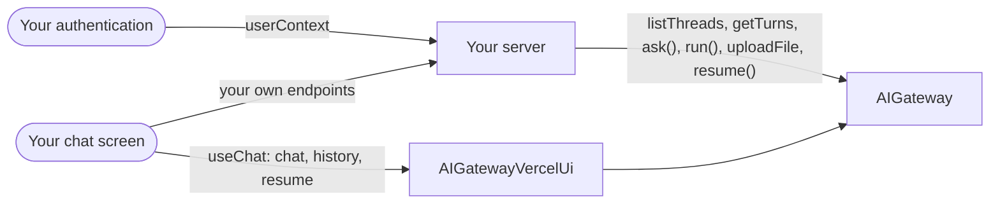

# Build a chat screen

**This path is complete for its goal.** Its chapters, its examples and the pages it links are all you need; no other page
of the documentation is required. It starts from four pages of Getting started:
[What is the AI gateway](../10-getting-started/10-what-is-the-ai-gateway.md),
[Installation](../10-getting-started/20-installation.md), [Example: ask](../10-getting-started/30-example-ask.md),
[Example: run](../10-getting-started/40-example-run.md).

**Prerequisites:** the setup of [Installation](../10-getting-started/20-installation.md) and an OpenAI API key in
`OPENAI_API_KEY`: the configuration of [8.0](#80-the-configuration) reads it for the two OpenAI models of
Installation, `gpt-5-mini` and `text-embedding-3-small`. Examples [8.7](#87-the-same-screen-on-usechat-through-dyna-ai-gatewayvercel-ui) and [8.8](#88-the-cards-of-a-paused-run-in-a-usechat-screen) also need a front end built on the Vercel AI
SDK's `useChat`.

## 1. About

A chat screen on the gateway: the user's conversations in a sidebar, the answer streamed as it is written, attachments,
approval cards. With the Vercel AI SDK's `useChat` the module `dyna-ai-gateway/vercel-ui` speaks the client's protocol;
with any other client your endpoints call `ask()`, `run()` and the thread methods directly.

## 2. Description

The screen most applications start with. A thread is one conversation of one user; the gateway stores its turns, lists
the user's threads, and holds one call at a time per thread. The stream carries the text, the tool calls and the end of
each step. Every other path plugs into this screen: tools, approvals, memory, documents, files.

## 3. What you will be able to do

- List, open, rename and delete the user's conversations. Examples: [8.1](#81-the-sidebar-lists-the-users-conversations-page-by-page), [8.2](#82-the-user-opens-renames-or-deletes-a-conversation).
- Stream the answer and show the tool calls of a run. Example: [8.4](#84-the-user-sends-a-message-and-the-answer-streams-to-the-screen).
- Connect a `useChat` client with three endpoints. Examples: [8.7](#87-the-same-screen-on-usechat-through-dyna-ai-gatewayvercel-ui), [8.8](#88-the-cards-of-a-paused-run-in-a-usechat-screen).
- Upload files and show them in the thread. Examples: [8.3](#83-the-upload-route-stores-an-attachment-before-the-message-is-sent), [8.6](#86-the-thread-shows-its-attachments-through-short-lived-urls).
- Render approval cards and resume from the screen. Example: [8.8](#88-the-cards-of-a-paused-run-in-a-usechat-screen).
- Show "still answering" when a second message arrives. Example: [8.5](#85-a-second-message-while-the-first-is-still-answering-is-a-409).

## 4. The parts

| # | Read                                                                                                                                       | For                                             |
|---|--------------------------------------------------------------------------------------------------------------------------------------------|-------------------------------------------------|
| 1 | [Vercel chat client](../10-getting-started/50-vercel-chat-client.md)                                                                       | the module, the endpoints, the cards, the files |
| 2 | [How do I show the user's conversations and open one?](../10-getting-started/90-faq.md#how-do-i-show-the-users-conversations-and-open-one) | the sidebar                                     |
| 3 | [How do I delete conversations?](../10-getting-started/90-faq.md#how-do-i-delete-conversations)                                            | "delete conversation"                           |
| 4 | [Thread memory: About](../20-learn-the-gateway/080-thread-memory.md#1-about)                                                               | threads and turns                               |
| 5 | [Tools: Showing the tool calls in a UI](../20-learn-the-gateway/030-tools.md#36-showing-the-tool-calls-in-a-ui)                            | the tool events                                 |
| 6 | [Chat files: Show the files of a thread](../20-learn-the-gateway/092-chat-files.md#33-show-the-files-of-a-thread)                          | attachments                                     |
| 7 | [Human in the loop: Render the cards and resume](../20-learn-the-gateway/040-human-in-the-loop.md#32-render-the-cards-and-resume)          | the cards                                       |

## 5. How the parts connect



| Screen element             | Gateway                                                                                                               | `useChat` through `vercel-ui`                                                                                                                                                         |
|----------------------------|-----------------------------------------------------------------------------------------------------------------------|---------------------------------------------------------------------------------------------------------------------------------------------------------------------------------------|
| the sidebar                | `listThreads`, `renameThread`, `delete`                                                                               | the same methods, from your own endpoints ([What stays the gateway's](../10-getting-started/50-vercel-chat-client.md#6-what-stays-the-gateways))                                      |
| opening a conversation     | `getTurns`                                                                                                            | `history`                                                                                                                                                                             |
| sending a message          | `ask()` or `run()` with the `threadId`; `events` stream                                                               | `chat`                                                                                                                                                                                |
| an attachment              | `uploadFile`, then `files` on the call; `getFileUrl` to show it                                                       | [Files](../10-getting-started/50-vercel-chat-client.md#5-files)                                                                                                                       |
| an approval or a question  | the `PAUSED` envelopes, then `resume()`                                                                               | the SDK's card through `chat`; answers, edits and typed rejections through `resume` ([Approvals](../10-getting-started/50-vercel-chat-client.md#4-approvals-and-the-other-decisions)) |
| a second message too early | a 409 while the thread's lease is held ([D77](../60-architecture/90-decisions.md#d77-one-call-at-a-time-on-a-thread)) | a JSON response with the status 409 ([The endpoints](../10-getting-started/50-vercel-chat-client.md#2-the-endpoints))                                                                 |

The user is your host's: `userContext` comes from your authentication, never from the request body
([D118](../60-architecture/90-decisions.md#d118-the-gateway-checks-what-a-user-could-forge-and-trusts-what-the-host-sets)).

## 6. API you should know

Grouped by the step of your code where you meet them, in the order of the examples.

### 6.1 The sidebar and the conversations

Examples: [8.1](#81-the-sidebar-lists-the-users-conversations-page-by-page), [8.2](#82-the-user-opens-renames-or-deletes-a-conversation), [8.6](#86-the-thread-shows-its-attachments-through-short-lived-urls).

| Symbol                                                                                                                                                                                                                                                                 | What you use it for            |
|------------------------------------------------------------------------------------------------------------------------------------------------------------------------------------------------------------------------------------------------------------------------|--------------------------------|
| [`AIGateway.listThreads`](../30-api/index/classes/AIGateway.md#listthreads), [`getTurns`](../30-api/index/classes/AIGateway.md#getturns), [`renameThread`](../30-api/index/classes/AIGateway.md#renamethread), [`delete`](../30-api/index/classes/AIGateway.md#delete) | the conversations              |
| [`IThread`](../30-api/index/interfaces/IThread.md), [`ITurn`](../30-api/index/interfaces/ITurn.md)                                                                                                                                                                     | a conversation and its entries |
| [`IPage`](../30-api/index/interfaces/IPage.md), [`IPageArgs`](../30-api/index/interfaces/IPageArgs.md)                                                                                                                                                                 | the paging of the list         |

### 6.2 Send a message and stream the answer

Examples: [8.3](#83-the-upload-route-stores-an-attachment-before-the-message-is-sent), [8.4](#84-the-user-sends-a-message-and-the-answer-streams-to-the-screen), [8.6](#86-the-thread-shows-its-attachments-through-short-lived-urls).

| Symbol                                                                                                                                           | What you use it for |
|--------------------------------------------------------------------------------------------------------------------------------------------------|---------------------|
| [`ILLMClientEvent`](../30-api/index/interfaces/ILLMClientEvent.md), [`ELLMClientEventKind`](../30-api/index/enumerations/ELLMClientEventKind.md) | the stream          |
| [`AIGateway.uploadFile`](../30-api/index/classes/AIGateway.md#uploadfile), [`getFileUrl`](../30-api/index/classes/AIGateway.md#getfileurl)       | attachments         |

### 6.3 The same screen on `useChat`

Examples: [8.0](#80-the-configuration), [8.7](#87-the-same-screen-on-usechat-through-dyna-ai-gatewayvercel-ui).

| Symbol                                                                                                                                                                                                                                                           | What you use it for                |
|------------------------------------------------------------------------------------------------------------------------------------------------------------------------------------------------------------------------------------------------------------------|------------------------------------|
| [`AIGatewayVercelUi`](../30-api/entries/vercel-ui/classes/AIGatewayVercelUi.md), [`IAIGatewayVercelUiConfig`](../30-api/entries/vercel-ui/interfaces/IAIGatewayVercelUiConfig.md)                                                                                | the `useChat` endpoints            |
| [`IUiChatRequestBody`](../30-api/entries/vercel-ui/interfaces/IUiChatRequestBody.md), [`TGatewayUiMessage`](../30-api/entries/vercel-ui/type-aliases/TGatewayUiMessage.md), [`IUiMessageMetadata`](../30-api/entries/vercel-ui/interfaces/IUiMessageMetadata.md) | what the client sends and receives |
| [`IUiPause`](../30-api/entries/vercel-ui/interfaces/IUiPause.md), [`IUiApprovalResponses`](../30-api/entries/vercel-ui/interfaces/IUiApprovalResponses.md)                                                                                                       | the cards in the client            |

## 7. Advanced API

Grouped by the part of the gateway you replace.

### 7.1 The transport

| Symbol                                                        | Replace it when                                                                                                         |
|---------------------------------------------------------------|-------------------------------------------------------------------------------------------------------------------------|
| [`UiMapper`](../30-api/entries/vercel-ui/classes/UiMapper.md) | your screen streams on another transport (a WebSocket, a resumable stream): it maps the gateway's `events` to UI chunks |

### 7.2 The threads

| Symbol                                                       | Replace it when                                                   |
|--------------------------------------------------------------|-------------------------------------------------------------------|
| [`IThreadStore`](../30-api/index/interfaces/IThreadStore.md) | threads are stored your way; a repository is enough in most cases |

### 7.3 Plugging your class in

| Symbol                                                                     | What it is                                                        |
|----------------------------------------------------------------------------|-------------------------------------------------------------------|
| [`IAIGatewayOverrides`](../30-api/index/interfaces/IAIGatewayOverrides.md) | the second argument of `AIGateway`; the key of 7.2: `threadStore` |

## 8. Examples

Each example runs on the `gateway` and the `userContext` of 8.0: paste 8.0 and the example into one file. What comes from your application, such as `invoices` or `ledger`, is a `declare` line at the top of the example.

### 8.0 The configuration

The screen runs on one profile, with the knowledge base of the help center. The keys this path uses come first, each with why. The others are required by `IAIGatewayConfig` and keep the values of [Installation](../10-getting-started/20-installation.md), with the features this path does not need switched off; most of them are `baseConfig`, collapsed above the configuration that spreads it. `gpt5Mini` and `textEmbedding3Small` are the models of Installation, in the same collapsed block.

> **The bigger picture:** Your server builds this gateway once at startup, and the routes of the chat screen call it for every user. Threads, files and paused runs are kept per tenant and per user.

<details>
<summary>The models of Installation, and <code>baseConfig</code>: the keys <code>IAIGatewayConfig</code> requires that this path does not use</summary>

```ts
import {
  IAIGatewayConfig,
  IModelInfo,
  EModelProvider,
  InMemoryPromptTemplateRepository,
  InMemoryTraceRepository,
  InMemoryUsageAdapter,
  InMemoryUserMemoryRepository,
  InMemoryVectorIndexAdapter,
} from "dyna-ai-gateway";

// The two models of Installation
const gpt5Mini: IModelInfo = {
  id: "gpt-5-mini",
  provider: EModelProvider.OPENAI,
  providerModelId: "gpt-5-mini",
  label: "GPT-5 mini",
  caps: {
    tools: true, images: true, pdf: true, structuredOutput: true, reasoning: true, temperature: false, embeddings: false,
    contextTokens: 400_000, maxOutputTokens: 128_000, costInPerMTokUsd: 0.25, costOutPerMTokUsd: 2,
  },
  enabled: true,
  deprecatedAt: null,
};

const textEmbedding3Small: IModelInfo = {
  id: "text-embedding-3-small",
  provider: EModelProvider.OPENAI,
  providerModelId: "text-embedding-3-small",
  label: "text-embedding-3-small",
  caps: {
    tools: false, images: false, pdf: false, structuredOutput: false, reasoning: false, temperature: false, embeddings: true,
    contextTokens: 8_191, maxOutputTokens: 0, costInPerMTokUsd: 0.02, costOutPerMTokUsd: 0,
  },
  enabled: true,
  deprecatedAt: null,
};

// Required by IAIGatewayConfig, nothing specific to this path: the in-memory stores of Installation,
// and the features this path does not need switched off
const baseConfig = {
  promptTemplateStore: {repository: new InMemoryPromptTemplateRepository()},
  userMemoryStore: {repository: new InMemoryUserMemoryRepository(), enabled: false}, // user facts off
  embedder: {embeddingModelId: "text-embedding-3-small", dimensions: 1536},
  vectorStore: {adapter: new InMemoryVectorIndexAdapter({embeddingModelId: "text-embedding-3-small", dimensions: 1536})},
  queryRewriter: {enabled: false}, // no follow-up rewrite
  humanGate: {userQuestions: {enabled: false}}, // the model asks no questions
  usageGuard: {adapter: new InMemoryUsageAdapter()},
  contextAssembler: {promptCaching: true, sharePromptCacheAcrossTenants: false},
  trace: {repository: new InMemoryTraceRepository()},
  defaultCheapModelId: "gpt-5-mini",
} satisfies Partial<IAIGatewayConfig>;
```

</details>

```ts
import {
  AIGateway,
  IAIGatewayConfig,
  IAIProfile,
  EModelProvider,
  InMemoryAIProfileRepository,
  InMemoryBlobAdapter,
  InMemoryModelRegistryRepository,
  InMemoryRunRepository,
  InMemoryThreadRepository,
  IUserContext,
} from "dyna-ai-gateway";

const support: IAIProfile = {
  id: "support",
  tenantId: "acme",
  name: "Customer support",
  modelId: "gpt-5-mini",
  promptAddendum: "You answer the customers of the Acme web shop.",
  allowedTools: [],
  approvals: [],
  limits: {maxStepsPerRun: 6, maxOutputTokens: 2_000},
};

const config: IAIGatewayConfig = {
  // What this path uses
  threadStore: {repository: new InMemoryThreadRepository()}, // the user's conversations: list, open, rename, delete
  workingMemory: {enabled: true}, // what the model sees of a long conversation
  fileStore: {adapter: new InMemoryBlobAdapter(), path: "ai-files"}, // the attachments
  runStore: {repository: new InMemoryRunRepository()}, // a run that waits for a card
  aiProfileStore: {repository: new InMemoryAIProfileRepository({profiles: [support]})}, // the profile of the chat

  // required too, and kept in view: the provider key, the models
  llmClient: {providers: {[EModelProvider.OPENAI]: {apiKey: process.env.OPENAI_API_KEY ?? ""}}},
  modelRegistry: {repository: new InMemoryModelRegistryRepository({models: [gpt5Mini, textEmbedding3Small]})},
  ...baseConfig, // the other required keys, collapsed above
};

const gateway = new AIGateway(config);

// Per request, from your authentication: who asks, in which tenant (Example: ask); a route reads it from the session (8.3)
const userContext: IUserContext = {
  tenantId: "acme",
  userId: "u-17",
  permissions: [],
  locale: "en-GB",
  timezone: "Europe/Oslo",
  now: new Date(),
};
```

### 8.1 The sidebar lists the user's conversations, page by page

`listThreads` returns the newest `limit` threads of the calling user; `endingBefore` with the last id shown reads the next, older page, and `hasMore` tells whether there is one.

> **The bigger picture:** The left column of the chat screen when it opens, and the "load more" at its bottom.

```ts
const firstPage = await gateway.listThreads({userContext, page: {limit: 20, startingAfter: null, endingBefore: null}});
// firstPage.items: the newest 20 threads; firstPage.hasMore: there are older ones

const lastShown = firstPage.items[firstPage.items.length - 1];
const older = lastShown
  ? await gateway.listThreads({userContext, page: {limit: 20, startingAfter: null, endingBefore: lastShown.id}})
  : undefined;
```

### 8.2 The user opens, renames or deletes a conversation

`getTurns` returns the turns of the thread, oldest first, to draw it; `renameThread` sets its title. `delete` removes the thread with its turns, files, runs and trace entries; it takes raw ids and checks no user, so your route decides who may call it.

> **The bigger picture:** A click on a thread of the sidebar, and the rename and delete entries of its menu.

```ts
declare const threadId: string; // the thread your screen has open

const turns = await gateway.getTurns({userContext, threadId}); // every turn, oldest first

await gateway.renameThread({userContext, threadId, title: "VAT of the March invoices"});

await gateway.delete({tenantId: userContext.tenantId, threadIds: [threadId], userId: userContext.userId}); // with its files and runs
```

### 8.3 The upload route stores an attachment before the message is sent

The route takes the user from the session, reads the file of the form and calls `uploadFile`. The `IFileRef` it returns is what the next message passes in `files`.

> **The bigger picture:** The paperclip of the message box: the browser uploads the file first, then sends the message with the reference it got back.

```ts
import {IFileRef, IUserContext} from "dyna-ai-gateway";

declare function sessionOf(request: Request): Promise<IUserContext>; // your authentication

const uploadRoute = async (request: Request): Promise<IFileRef> => {
  const userContext = await sessionOf(request);
  const upload = (await request.formData()).get("file");
  if (!(upload instanceof File)) throw new Error("No file in the request");
  return gateway.uploadFile({userContext, bytes: new Uint8Array(await upload.arrayBuffer()), mime: upload.type, name: upload.name});
};
```

### 8.4 The user sends a message and the answer streams to the screen

`run()` on the open thread, or without `threadId` on a new one, with the attachments of 8.3. Your own client forwards `TEXT_DELTA`, `TOOL_REQUEST` and `ANSWER_WITHDRAWN` over the socket; a `PAUSED` response sends the cards to draw.

> **The bigger picture:** The send button of the message box, on a screen with your own client and transport instead of `useChat`.

```ts
import {EGatewayResponseKind, ELLMClientEventKind, IFileRef} from "dyna-ai-gateway";

declare const threadId: string; // the thread your screen has open
declare const text: string; // what the user typed
declare const attachments: IFileRef[]; // the pointers the upload route returned (8.3)
declare const socket: {send(message: object): void}; // your transport to the screen

const {events, response} = gateway.run({
  userContext,
  profileId: "support",
  threadId,          // omit it on the first message: the response names the new thread
  prompt: text,
  files: attachments, // the IFileRefs the upload route returned
  kbFilters: {libraryIds: ["help-center"], bookIds: []},
});

for await (const event of events) {
  if (event.kind === ELLMClientEventKind.TEXT_DELTA) socket.send({type: "text", text: event.text ?? ""});
  if (event.kind === ELLMClientEventKind.TOOL_REQUEST) socket.send({type: "tool", name: event.toolCall?.toolName ?? ""});
  if (event.kind === ELLMClientEventKind.ANSWER_WITHDRAWN) socket.send({type: "withdrawn"});
}

const result = await response;
if (result.kind === EGatewayResponseKind.PAUSED) socket.send({type: "cards", pauseId: result.pauseId, envelopes: result.envelopes});
```

### 8.5 A second message while the first is still answering is a 409

One call at a time runs on a thread: a `run()` on a thread with a call in flight, or one that waits for a human, throws an error with `status` 409. The screen asks the user to send it again.

> **The bigger picture:** A user who presses send twice, or writes on in a second tab while the answer still streams.

```ts
declare const threadId: string; // the thread your screen has open
declare const text: string; // what the user typed
declare function showToUser(text: string): void; // your UI

try {
  await gateway.run({userContext, profileId: "support", threadId, prompt: text, kbFilters: {libraryIds: [], bookIds: []}}).response;
} catch (error) {
  if (typeof error === "object" && error !== null && "status" in error && error.status === 409) {
    showToUser("Still answering. Send it again in a moment."); // one call at a time per thread
  }
}
```

### 8.6 The thread shows its attachments through short-lived URLs

The `FILE` parts of the turns name the uploaded files; `getFileUrl` signs a URL for each, valid for `ttlSec` seconds, and the browser loads the bytes from the storage.

> **The bigger picture:** A thread opened again from the sidebar: the images and PDFs the user attached appear with their messages.

```ts
import {EPartKind} from "dyna-ai-gateway";

declare const threadId: string; // the thread your screen has open

const shown = await Promise.all((await gateway.getTurns({userContext, threadId}))
  .flatMap(turn => turn.parts)
  .flatMap(part => part.kind === EPartKind.FILE
    ? [gateway.getFileUrl({userContext, fileId: part.file.id, ttlSec: 300}).then(url => ({name: part.file.name, url}))]
    : []));
```

### 8.7 The same screen on `useChat`, through `dyna-ai-gateway/vercel-ui`

`AIGatewayVercelUi` serves the endpoints of the AI SDK's `useChat`: `chat` streams the answer to the last user message, `history` returns the messages of a thread. The user comes from your session, never from the request body.

> **The bigger picture:** A front end built on `useChat`: two routes take the place of the socket code of 8.4 and the `getTurns` of 8.2.

```ts
import {IUserContext} from "dyna-ai-gateway";
import {AIGatewayVercelUi} from "dyna-ai-gateway/vercel-ui";

declare function sessionOf(request: Request): Promise<IUserContext>; // your authentication

const supportChat = new AIGatewayVercelUi({
  mode: "run",
  userContext: async ({request}) => sessionOf(request), // the request body never names the tenant or the user
  call: {profileId: "support", kbFilters: {libraryIds: ["help-center"], bookIds: []}},
}, {gateway});

// POST /api/chat: what useChat posts
export const POST = (request: Request): Promise<Response> => supportChat.chat({request});

// GET /api/chat/:threadId: the messages to draw when a thread is opened
export const GET = async (request: Request, {params}: {params: {threadId: string}}): Promise<Response> =>
  Response.json(await supportChat.history({request, threadId: params.threadId}));
```

### 8.8 The cards of a paused run in a `useChat` screen

A third route, next to the two of 8.7, streams the continuation of a paused run the way `chat` does.

> **The bigger picture:** The question card or the edit form in the chat: the user answers, and the screen posts the decisions to this route instead of sending a message.

An approval card is the SDK's own and goes back through `chat`. What it cannot express (the answers to the model's
question, an `EDIT`, a `REJECT` with the user's text) goes through `resume`, built from the message's `metadata.pause`.

```ts
import {AIGatewayVercelUi} from "dyna-ai-gateway/vercel-ui";

declare const supportChat: AIGatewayVercelUi; // the instance of 8.7

// POST /api/chat/resume
export const POST = async (request: Request): Promise<Response> => {
  const {runId, pauseId, decisions} = await request.clone().json();
  return supportChat.resume({request, runId, pauseId, decisions});
};
```

## 9. Pitfalls

- [Thread memory: Pitfalls](../20-learn-the-gateway/080-thread-memory.md#4-pitfalls)
- A thread has no title until `renameThread` sets one
  ([How do I show the user's conversations?](../10-getting-started/90-faq.md#how-do-i-show-the-users-conversations-and-open-one)).
- A streamed answer can be withdrawn by an output rule: the stream ends with `ANSWER_WITHDRAWN`, in `useChat` the
  message carries `metadata.withdrawn`; grey or drop the text
  ([What the client receives](../10-getting-started/50-vercel-chat-client.md#3-what-the-client-receives),
  [A streamed answer that is blocked](../20-learn-the-gateway/050-guardrails.md#27-a-streamed-answer-that-is-blocked)).
- `vercel-ui` is server-only, like the gateway; the browser runs only `useChat`
  ([Vercel chat client](../10-getting-started/50-vercel-chat-client.md)).

## 10. Summary

- A thread is one conversation of one user; `listThreads` and `getTurns` feed the screen.
- `events` stream the answer and the tool calls; one call at a time per thread.
- `dyna-ai-gateway/vercel-ui` serves `useChat` with `chat`, `history` and `resume`.
- Files, cards and memory plug into the same thread.

## 11. FAQ

- [How do I connect a Vercel chat client (`useChat`)?](../10-getting-started/90-faq.md#how-do-i-connect-a-vercel-chat-client-usechat)
- [How do I show the user's conversations and open one?](../10-getting-started/90-faq.md#how-do-i-show-the-users-conversations-and-open-one)
- [How do I delete conversations?](../10-getting-started/90-faq.md#how-do-i-delete-conversations)
- [Who may read a thread, a file or a paused run?](../10-getting-started/90-faq.md#who-may-read-a-thread-a-file-or-a-paused-run)
