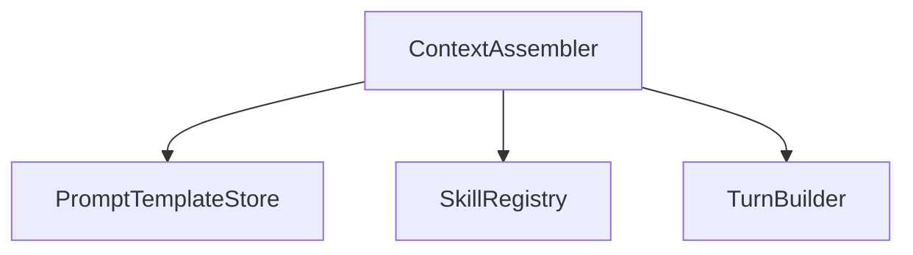
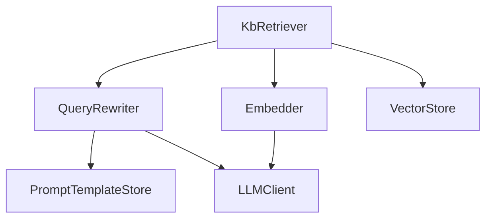
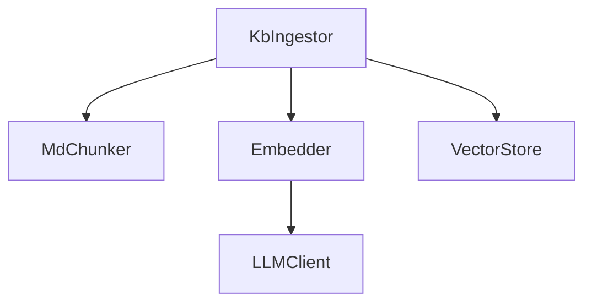
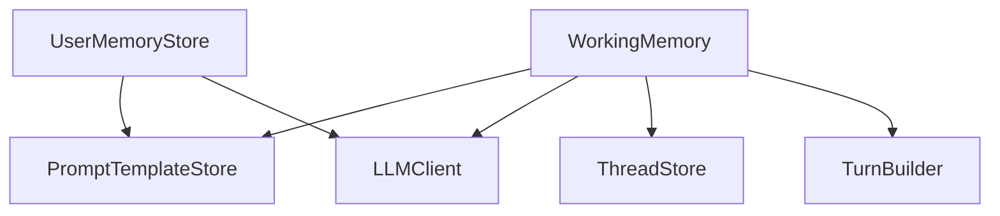
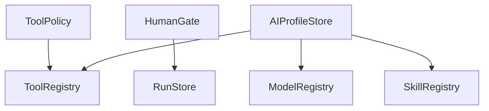
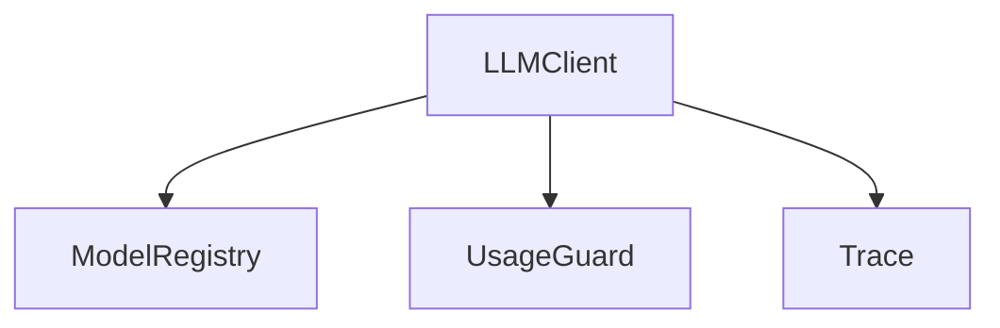
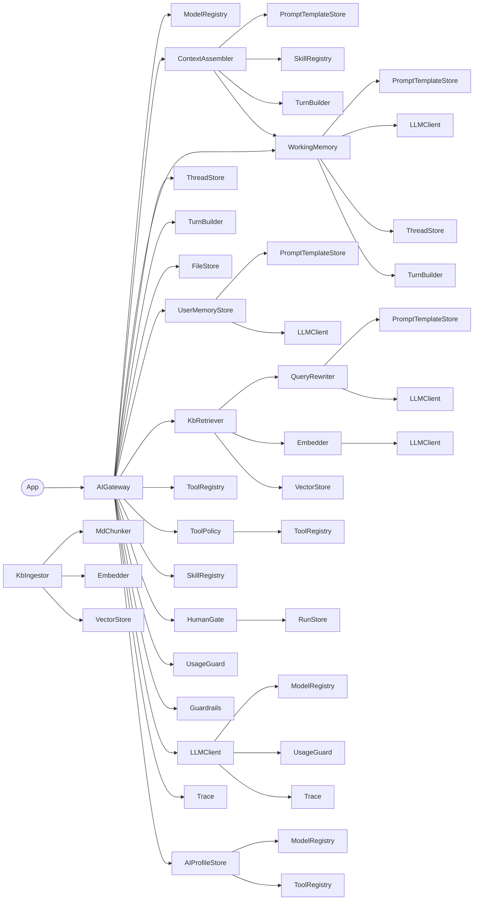
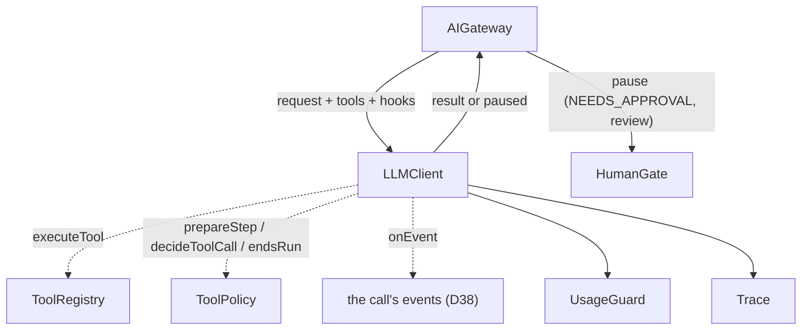
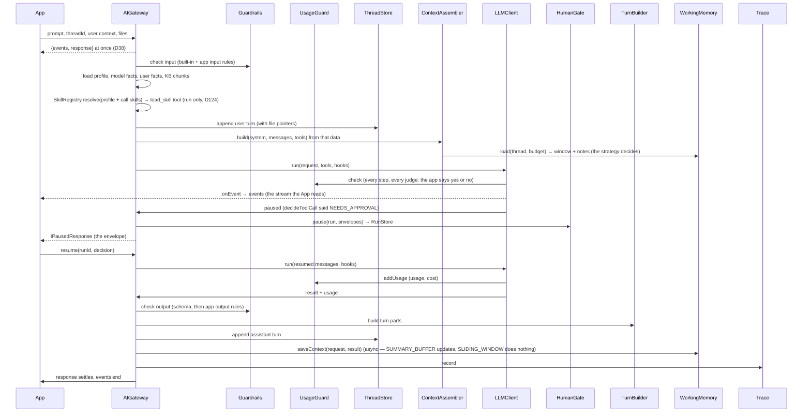

# Blueprint: classes and connections

The classes the gateway is built from, who holds whom, and how one prompt travels through them. Classes only, no methods: the
methods are in the [API reference](../30-api/index.md). [Architecture and trade-offs](10-architecture-and-trade-offs.md) explains why
the gateway is composed this way.

Legend: solid arrow = holds an instance (constructor injection) · dashed arrow = called back through hooks · `App` = the
business service that uses the gateway.

Rule applied everywhere: **data is passed, services are injected.** The gateway loads profile, model facts, memory, turns and chunks once per call and passes them as plain data; only services (stores, LLM helpers) are constructor-injected.

---


## 1. Classes

| Layer     | Class                   | Owns one job                                                                                                                                                                                                                                                                                                                 |
|-----------|-------------------------|------------------------------------------------------------------------------------------------------------------------------------------------------------------------------------------------------------------------------------------------------------------------------------------------------------------------------|
| Facade    | **AIGateway**           | orchestrates; no prompt text, no token math, no SDK                                                                                                                                                                                                                                                                          |
| Config    | **ModelRegistry**       | global facts per model: provider, id, `caps`, cost                                                                                                                                                                                                                                                                           |
| Config    | **AIProfileStore**      | tenant choices: model, allowed tools, approvals, addendum, loop and output caps; validates against ModelRegistry + ToolRegistry + SkillRegistry on upsert                                                                                                                                                                    |
| Config    | **PromptTemplateStore** | versioned templates by key (`CHAT_MAIN`, `MEMORY_WORKING`, …)                                                                                                                                                                                                                                                                |
| Context   | **ContextAssembler**    | builds `system + messages + tools` from data handed to it                                                                                                                                                                                                                                                                    |
| Thread    | **ThreadStore**         | threads and turns (typed parts), pagination, soft delete                                                                                                                                                                                                                                                                     |
| Thread    | **TurnBuilder**         | LLMClient result → typed turn parts                                                                                                                                                                                                                                                                                          |
| Thread    | **FileStore**           | uploads (image/PDF) as blobs; turns keep pointers                                                                                                                                                                                                                                                                            |
| Memory    | **WorkingMemory**       | the thread's window for every request (`IWorkingMemory`, D122): SLIDING_WINDOW (newest turns that fit the budget) or SUMMARY_BUFFER (rolling summary + facts, last N turns), per profile                                                                                                                                     |
| Memory    | **UserMemoryStore**     | durable facts per tenant + user, across threads                                                                                                                                                                                                                                                                              |
| KB        | **KbIngestor**          | second root of the service: on KB save, chunk → embed → store (async, idempotent per doc)                                                                                                                                                                                                                                    |
| KB        | **MdChunker**           | MD → chunks (heading path, size, overlap)                                                                                                                                                                                                                                                                                    |
| KB        | **Embedder**            | thin class: holds the one fixed embedding model id + batching; calls LLMClient `embed`                                                                                                                                                                                                                                       |
| KB        | **VectorStore**         | chunks + vectors + metadata, filtered search                                                                                                                                                                                                                                                                                 |
| KB        | **QueryRewriter**       | prompt + thread facts → standalone search query                                                                                                                                                                                                                                                                              |
| KB        | **KbRetriever**         | query → top-k chunks above threshold, "no match" signal                                                                                                                                                                                                                                                                      |
| Tools     | **ToolRegistry**        | all tool definitions (name, description, schema, execute); the one place a tool runs, so it normalises every failure (the model reads code / status / userMessage, the developer gets `onToolError`, D100)                                                                                                                   |
| Tools     | **ToolPolicy**          | Registry ∩ Profile ∩ rights ∩ caps; which tools need approval                                                                                                                                                                                                                                                                |
| Tools     | **SkillRegistry**       | the skills of a call (D124): the profile's and the call's as one validated list, the `{skills}` slot text and the per-call built-in `load_skill`                                                                                                                                                                             |
| Control   | **HumanGate**           | pause the run, emit envelope, resume with decision                                                                                                                                                                                                                                                                           |
| Control   | **RunStore**            | persisted run state (messages, pending action, status)                                                                                                                                                                                                                                                                       |
| Control   | **UsageGuard**          | the app's `IUsageAdapter` behind one wrapper: asked before every model call, told what it used after it; no token logic in the gateway (D121)                                                                                                                                                                                |
| Control   | **Guardrails**          | built-in rules (prompt sanitising, injection markers, output schema) + the app's input/output rules (moderation, sums, ids, grounding); hands the rules a `judge` (one classification call through the LLMClient with the evidence of the check); reports every failed rule to the developer's `onRuleError` (D107) |
| Execution | **LLMClient**           | one class, all providers; AI SDK sealed inside; `complete`, `run`, `embed` doors; hooks out; asks the UsageGuard before, reports to it after, and records Trace for every call                                                                                                                                               |
| Ops       | **Trace**               | audit: request, raw, final, cost, latency, verdict                                                                                                                                                                                                                                                                           |

25 classes, two roots: `AIGateway` (query path, per prompt) and `KbIngestor` (ingestion path, per KB save). `App` is not a class of the gateway; it injects its guardrail rules, tools and user context.

---


## 2. Composition — who holds whom


### 2.1 AIGateway holds (constructor injection)

| Group             | Children                                          |
|-------------------|---------------------------------------------------|
| Config            | ModelRegistry, AIProfileStore                     |
| Prompts           | PromptTemplateStore                               |
| Context           | ContextAssembler                                  |
| Thread            | ThreadStore, TurnBuilder, FileStore               |
| Memory            | WorkingMemory, UserMemoryStore                    |
| KB (read side)    | KbRetriever, QueryRewriter, Embedder, VectorStore |
| KB (write side)   | KbIngestor, MdChunker                             |
| Tools             | ToolRegistry, ToolPolicy, SkillRegistry           |
| Control           | HumanGate, RunStore, UsageGuard, Guardrails       |
| Execution         | LLMClient                                         |
| Ops               | Trace                                             |

Every child is created once by `createGatewayDeps` (the composition root) and held in `IAIGatewayDeps`, the
leaves included: `PromptTemplateStore`, `Embedder`, `VectorStore`, `RunStore`, `QueryRewriter` and `MdChunker` are
built by the gateway and injected into the classes that use them, never constructed by those classes. `KbIngestor` is the
second root, exposed as `gateway.kbIngestor` for the KB write endpoints; a prompt never reaches it.


### 2.2 Internal dependencies (small graphs, top to bottom)


Context



KB — read side (per prompt)



KB — ingestion side (second root; on KB save, not part of a chat call)



Memory helpers (cheap model through the LLMClient's `complete` door)



Tools, control, config validation



LLMClient (one class; every LLM call passes here, so it asks the UsageGuard, reports to it and traces)



### 2.3 Full composition — tree (root left, leaves stack downwards)



Shared instances appear more than once in the tree (`LLMClient`, `PromptTemplateStore`, `TurnBuilder`, `ToolRegistry`, `ModelRegistry`, `UsageGuard`, `Trace`, `Embedder`, `VectorStore`); the composition root creates each **once** and injects the same
instance. `KbIngestor` is the ingestion root (second entry point of the service), outside the gateway tree.


### 2.4 Same tree as text

```
AIGateway
├─ ModelRegistry*
├─ AIProfileStore
│  ├─ ModelRegistry*
│  ├─ ToolRegistry*
│  └─ SkillRegistry*
├─ ContextAssembler
│  ├─ PromptTemplateStore*
│  ├─ TurnBuilder*
│  └─ WorkingMemory*
├─ ThreadStore
├─ TurnBuilder*
├─ FileStore
├─ WorkingMemory
│  ├─ PromptTemplateStore*
│  ├─ LLMClient*
│  ├─ ThreadStore*
│  └─ TurnBuilder*
├─ UserMemoryStore
│  ├─ PromptTemplateStore*
│  └─ LLMClient*
├─ KbRetriever
│  ├─ QueryRewriter
│  │  ├─ PromptTemplateStore*
│  │  └─ LLMClient*
│  ├─ Embedder
│  │  └─ LLMClient*
│  └─ VectorStore*
├─ ToolRegistry*
├─ ToolPolicy
│  └─ ToolRegistry*
├─ SkillRegistry*
├─ HumanGate
│  └─ RunStore
├─ UsageGuard*         (the app's adapter inside)
├─ Guardrails         (app rules injected)
│  └─ LLMClient*      (the rules' judge: one completion, checked, reported and traced)
├─ LLMClient*
│  ├─ ModelRegistry*
│  ├─ UsageGuard*
│  └─ Trace*
└─ Trace*

KbIngestor            (second root: KB save, not a prompt)
├─ MdChunker
├─ Embedder*
│  └─ LLMClient*
└─ VectorStore*

* shared instance
```

Notes

- `ToolPolicy` receives profile, user rights and `caps` as **data** from the gateway; it holds only the registry.
- `LLMClient` is one class with credentials per provider; it resolves `modelId` through `ModelRegistry` to the SDK provider (SDK knowledge stays sealed). It holds `UsageGuard` and `Trace` so every call — main or helper — is asked for, reported and
  recorded in one place; the gateway only annotates the main trace entry.
- `AIProfileStore` holds `ModelRegistry`, `ToolRegistry` and `SkillRegistry` only to validate a profile on upsert.
- `SkillRegistry` is stateless (config only, like `ToolPolicy`); the call preparation and the assembler receive it as a dep.
- `ContextAssembler` receives profile, memory, turns, chunks, skills and allowed tools as data; it holds only the templates, the stateless `TurnBuilder` (turns → messages) and the `SkillRegistry` (the `{skills}` slot text).
- No cycles: `LLMClient` holds only `ModelRegistry`, `UsageGuard`, `Trace` (none of which hold the LLMClient); helpers that hold the LLMClient are not held by the LLMClient.

---


## 3. Execution — LLMClient hooks (dashed = callback supplied by AIGateway)



- The hooks are the five of `ILLMClientHooks`, wired by `createRunHooks`: `prepareStep` → `ToolPolicy.narrowForStep`, `decideToolCall` → `ToolPolicy.decide`, `executeTool` → `ToolPolicy.assertOfferedInStep` then `ToolRegistry.execute` (D88), `endsRun` → `ToolPolicy.endsRun` (D86), `onEvent` → the call's events. The LLMClient never calls the HumanGate: a NEEDS_APPROVAL verdict returns the run PAUSED to the gateway, and `settleRun` stores the pause through `HumanGate.pause`.

- Solid `LLMClient → UsageGuard / Trace`: the LLMClient asks before, reports after and records every call itself; a refused call is thrown as a 429 and the gateway shapes the response (D121).

- The loop runs inside the LLMClient: its own loop, one SDK call per step, tools handed to the SDK without an executor. That is what lets a run pause, persist in our message shape and resume with APPROVE / EDIT / REJECT. Every decision runs outside the LLMClient, in the hooks.
- Hook implementations are gateway code; the LLMClient only calls them. The per-call built-in `load_skill` (D124) runs through `executeTool` like every tool: the registry executes the tools of the offered list, so a tool that is not registered runs the same way.
- Same hooks object for `complete` and `run`; future execution doors reuse it. `embed` needs no hooks.

---


## 4. Flow — one user prompt (`run`)



Without a pause, the two `resume` lines are skipped; everything else is identical.
