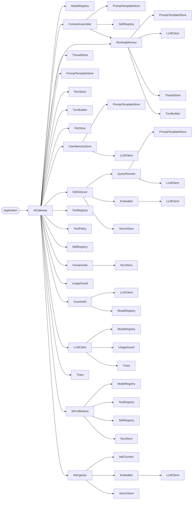
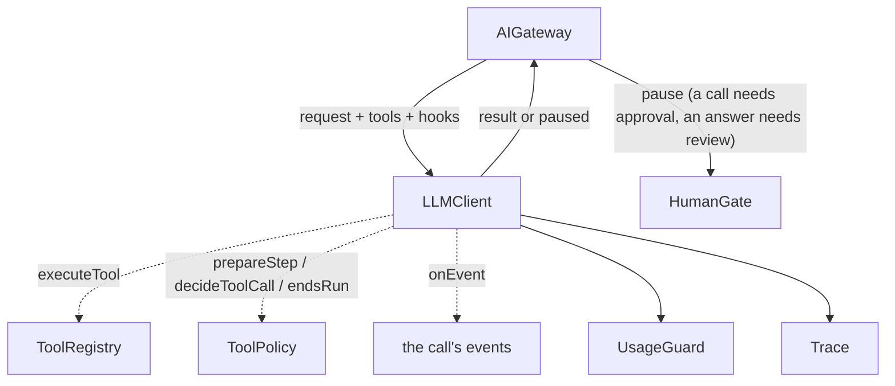
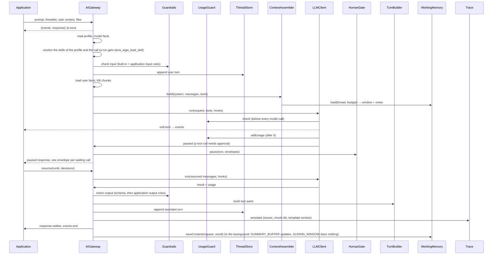

# Architecture and trade-offs

Status: 2026-11-18.

## 1. About

The classes the gateway is built from, who holds whom, how one call travels through them, and what each design choice
costs. Not needed to use the library.

## 2. Description

A server-only TypeScript library between a business application and the LLM providers. The application calls three doors — `ask()` (one grounded answer), `run()` (agent loop with tools, may pause for a human), `resume()` (continue a paused run) — and a set of admin and data methods. Everything else (prompt assembly, memory, knowledge base, tools, approvals, usage control, guardrails, tracing) is inside.

Two rules shape every class:

- **Data is passed, services are injected.** A call loads profile, model facts, user facts and chunks once and hands them on as plain data; the working memory loads the thread's window itself. Only services (stores, the LLM client) are constructor-injected.
- **One job per class.** 25 classes, two entry points: `AIGateway` (per prompt) and `KbIngestor` (per knowledge-base save).

## 3. For whom is this chapter

A developer who wants the whole picture before relying on the library, who reads a stack trace or a trace entry and wants
to place the class it names, or who weighs the gateway's design against another.

## 4. How it works

### 4.1 The classes

| Layer          | Class                 | Its one job                                                                                                                                                                                       |
|----------------|-----------------------|---------------------------------------------------------------------------------------------------------------------------------------------------------------------------------------------------|
| Facade         | `AIGateway`           | Orchestrates a call; no prompt text, no token math, no SDK                                                                                                                                        |
| Config         | `ModelRegistry`       | The global facts of each model: provider, id, `caps`, cost                                                                                                                                        |
| Config         | `AIProfileStore`      | A tenant's choices: model, allowed tools, approvals, addendum, loop and output caps; validates a profile against the `ModelRegistry`, the `ToolRegistry` and the `SkillRegistry` when it is saved |
| Config         | `PromptTemplateStore` | Versioned templates by key (`CHAT_MAIN`, `MEMORY_WORKING`, …)                                                                                                                                     |
| Context        | `ContextAssembler`    | Builds the system prompt, the messages and the tools of a request from the data handed to it; the layers of the prompt: [System prompt layers](40-system-prompt-production-layers.md)             |
| Thread         | `ThreadStore`         | Threads and their turns, paging, soft delete, the lease                                                                                                                                           |
| Thread         | `TurnBuilder`         | Turns from a question and from a model result; messages from stored turns                                                                                                                         |
| Thread         | `FileStore`           | Uploaded files (images, PDFs) as blobs; the turns keep pointers                                                                                                                                   |
| Memory         | `WorkingMemory`       | The thread's window for every request (D122): the newest turns that fit the budget (`SLIDING_WINDOW`), or a rolling summary with facts and the last turns (`SUMMARY_BUFFER`), per profile         |
| Memory         | `UserMemoryStore`     | Durable facts per tenant and user, across threads                                                                                                                                                 |
| Knowledge base | `KbIngestor`          | The second entry point: on a knowledge-base save, chunk, embed and store a document                                                                                                               |
| Knowledge base | `MdChunker`           | A Markdown document into chunks (heading path, size, overlap)                                                                                                                                     |
| Knowledge base | `Embedder`            | Holds the one embedding model and the batching; calls the `LLMClient`'s `embed`                                                                                                                   |
| Knowledge base | `VectorStore`         | Chunks, vectors and metadata; filtered search                                                                                                                                                     |
| Knowledge base | `QueryRewriter`       | A prompt plus the thread's summary and facts into a standalone search query                                                                                                                       |
| Knowledge base | `KbRetriever`         | A query into the best chunks above the threshold, with a "no match" signal                                                                                                                        |
| Tools          | `ToolRegistry`        | Every tool definition (name, description, schema, execute); the one place a tool runs, so every failure is normalised there (D100)                                                                |
| Tools          | `ToolPolicy`          | Which tools a run and a step get from the registry, the profile, the user's permissions and the model's `caps`; which calls are allowed, denied or need approval                                  |
| Tools          | `SkillRegistry`       | The skills of a call (D124): the profile's and the call's as one validated list, the text of the `{skills}` slot and the built-in `dyna_aigw_load_skill` tool                                     |
| Control        | `HumanGate`           | Pauses a run, hands out the envelopes, resumes it with the decisions                                                                                                                              |
| Control        | `RunStore`            | The persisted state of a run: messages, pending calls, status                                                                                                                                     |
| Control        | `UsageGuard`          | The application's `IUsageAdapter` behind one wrapper: asked before every model call, told what it used after it (D121)                                                                            |
| Control        | `Guardrails`          | The built-in rules and the application's input and output rules; hands each rule a `judge` (one classification call through the `LLMClient`); reports a failed rule to `onRuleError` (D107)       |
| Execution      | `LLMClient`           | One class for all providers, the AI SDK sealed inside; the doors `complete`, `run` and `embed`; asks the `UsageGuard` before every call, reports to it after, and records the `Trace`             |
| Ops            | `Trace`               | The audit record of a completed model call: request, result, usage, cost, and the issues and chunk ids the gateway adds                                                                           |

`Application`, in the diagrams below, is the business application: not a class of the gateway. It supplies its tools, its
guardrail rules and the user context.

### 4.2 Composition

Solid arrow = holds an instance (constructor injection).



Shared instances appear more than once in the graph (`LLMClient`, `PromptTemplateStore`, `TurnBuilder`, `ToolRegistry`,
`SkillRegistry`, `RunStore`, `ThreadStore`, `WorkingMemory`, `ModelRegistry`, `UsageGuard`, `Trace`, `Embedder`,
`VectorStore`): the gateway creates each once and injects the same instance. None of the 24 classes constructs another one. The
`KbIngestor` is built and held like every other class, but no prompt reaches it: it is the entry point of a
knowledge-base save, exposed as `gateway.kbIngestor`.

The same composition as an ownership tree (`*` = shared instance, created once):

```
AIGateway
├─ ModelRegistry*
├─ AIProfileStore
│  ├─ ModelRegistry*
│  ├─ ToolRegistry*
│  ├─ SkillRegistry*
│  └─ RunStore*
├─ ContextAssembler
│  ├─ PromptTemplateStore*
│  ├─ SkillRegistry*
│  └─ WorkingMemory*
├─ ThreadStore*
├─ PromptTemplateStore*
├─ RunStore*
├─ TurnBuilder*
├─ FileStore
├─ WorkingMemory*
│  ├─ PromptTemplateStore*
│  ├─ LLMClient*
│  ├─ ThreadStore*
│  └─ TurnBuilder*
├─ UserMemoryStore
│  ├─ PromptTemplateStore*
│  └─ LLMClient*
├─ KbRetriever
│  ├─ QueryRewriter
│  │  ├─ PromptTemplateStore*
│  │  └─ LLMClient*
│  ├─ Embedder*
│  │  └─ LLMClient*
│  └─ VectorStore*
├─ ToolRegistry*
├─ ToolPolicy
├─ SkillRegistry*
├─ HumanGate
│  └─ RunStore*
├─ UsageGuard*         (the application's adapter inside)
├─ Guardrails         (application rules injected)
│  ├─ LLMClient*      (the rules' judge: one completion, checked, reported and traced)
│  └─ ModelRegistry*  (the judge model's caps)
├─ LLMClient*
│  ├─ ModelRegistry*
│  ├─ UsageGuard*
│  └─ Trace*
└─ Trace*

KbIngestor            (held by AIGateway; the entry point of a KB save, not of a prompt)
├─ MdChunker
├─ Embedder*
│  └─ LLMClient*
└─ VectorStore*
```

- No cycles: `LLMClient` holds only `ModelRegistry`, `UsageGuard` and `Trace`; the helpers that hold the `LLMClient` are not held by it.
- `ToolPolicy` and `SkillRegistry` hold no dependency. The policy receives the tools, the profile, the user's permissions
  and the `caps` as data; the skill registry receives the profile's and the call's skills.
- `LLMClient` resolves a `modelId` through the `ModelRegistry` to the provider. It holds the `UsageGuard` and the `Trace`,
  so every call, main or helper, is asked for and reported in one place, and every completed call is recorded there; the gateway only annotates the trace
  entries afterwards (issues, chunk ids, template version).
- `AIProfileStore` holds the `ModelRegistry`, the `ToolRegistry` and the `SkillRegistry` to validate a profile when it is
  saved, and the `RunStore` to refuse the removal of a profile a paused run waits on.
- `ContextAssembler` receives the profile, the user facts, the retrieved chunks, the skills and the allowed tools as data.
  It holds the templates, the `SkillRegistry` (the text of the `{skills}` slot) and the `WorkingMemory` (the thread's
  window, turned into messages through the `TurnBuilder`).

### 4.3 Execution

The agent loop runs inside the `LLMClient`; every decision in it is a hook the gateway implements (dashed = callback).



- The hooks are the five of `ILLMClientHooks`: `prepareStep` calls `ToolPolicy.narrowForStep`, `decideToolCall` calls
  `ToolPolicy.decide`, `executeTool` calls `ToolPolicy.assertOfferedInStep` and then `ToolRegistry.execute`
  ([D88](90-decisions.md#d88-a-refused-guarded-tool-names-what-must-run-first)), `endsRun` calls `ToolPolicy.endsRun`
  ([D86](90-decisions.md#d86-a-tool-can-end-the-run)), `onEvent` feeds the call's events.
- `run` takes all five hooks; `complete` takes only `onEvent`, and it is optional; `embed` takes none.
- The loop is the `LLMClient`'s own: one SDK call per step, the tools handed to the SDK without an executor. That is what
  lets a run pause, persist in the gateway's message shape and resume with a human's decision.
- The `LLMClient` asks the `UsageGuard` before every call, reports to it after and records the `Trace` itself; a refused
  call is thrown as a 429 and the gateway shapes the response; a refused step after the first ends the run with the text
  of the last completed step and a warning
  ([D121](90-decisions.md#d121-the-application-decides-every-model-call)).
- The built-in `dyna_aigw_load_skill` is made per call and is not in the registry; it runs through `executeTool` like every
  tool, because the registry executes the tools of the step's offered list
  ([D124](90-decisions.md#d124-skills-instructions-the-model-loads-on-demand)).

The `LLMClient` never calls the `HumanGate`: a verdict of NEEDS_APPROVAL returns the run paused to the gateway, which stores the pause.

One `run()` with a pause:



The tools of one step run [concurrently](90-decisions.md#d101-the-tool-calls-of-one-step-run-in-parallel), and a pause carries [every call of the step that waits](90-decisions.md#d102-one-pause-carries-every-pending-call-of-the-step) for a human; the application answers them in one `resume`. Without a pause the two `resume` lines are skipped. On a profile that [reviews its answers](90-decisions.md#d99-the-answer-waits-for-a-human) a second pause comes after the output check: the answer is kept on the run, the application resumes with the reviewer's decision, and the assistant turn is appended then, without another model call.

## 5. How it can be extended

| To change                                                 | Read                                                                                       |
|-----------------------------------------------------------|--------------------------------------------------------------------------------------------|
| Where the gateway keeps its data                          | [Storage adapters](20-adapters.md)                                                         |
| What one of the classes above does                        | [Class replacement](30-class-replacement.md)                                               |
| The model, the tools, the limits, the prompts, at runtime | [Live adjustment and dependency injection](50-live-adjustment-and-dependency-injection.md) |

## 6. Trade-offs

Each row: what was chosen, what was rejected, what it costs. The link leads to the full record in [Decisions](90-decisions.md).

| #  | Decision                                                                                                    | Chosen                                                                                                                                                                                                                                                      | Rejected                                                                                       | Cost of the choice                                                                                                                                                                                                                                                                                                                                                                                                                                                                                                                                                                      |
|----|-------------------------------------------------------------------------------------------------------------|-------------------------------------------------------------------------------------------------------------------------------------------------------------------------------------------------------------------------------------------------------------|------------------------------------------------------------------------------------------------|-----------------------------------------------------------------------------------------------------------------------------------------------------------------------------------------------------------------------------------------------------------------------------------------------------------------------------------------------------------------------------------------------------------------------------------------------------------------------------------------------------------------------------------------------------------------------------------------|
| 1  | [Agent loop](90-decisions.md#the-agent-loop-is-the-gateways-own)                                            | Own loop in `LLMClient`: one SDK call per step, tools handed to the SDK without executor, every decision a hook                                                                                                                                             | The AI SDK's built-in multi-step loop                                                          | We maintain the loop. Gain: a run can pause on any tool, persist in our message shape and resume with APPROVE / EDIT / REJECT / ANSWER; the SDK loop cannot stop mid-run.                                                                                                                                                                                                                                                                                                                                                                                                               |
| 2  | [SDK boundary](90-decisions.md#the-ai-sdk-is-sealed-in-one-class)                                           | The AI SDK is imported only inside `internal/llm-client/` (lint rule); one `LLMClient` for all providers                                                                                                                                                    | SDK types and calls across the codebase                                                        | Our own message and result types, and a mapping layer. Gain: a provider or SDK upgrade touches one folder; the rest of the code and the stored data are provider-neutral.                                                                                                                                                                                                                                                                                                                                                                                                               |
| 3  | [Model selection](90-decisions.md#d46-the-profile-and-with-it-the-model-is-chosen-per-call)                 | The profile, and with it the model, is chosen per call (`profileId`, required)                                                                                                                                                                              | Profile stored on the thread                                                                   | The caller passes the profile on every call. Gain: the application changes the model of a conversation by passing another profile; stored history and memory are provider-neutral, so any profile continues any thread.                                                                                                                                                                                                                                                                                                                                                                 |
| 4  | [Resume on another profile](90-decisions.md#d65-resume-continues-a-paused-run-on-another-profile)           | `resume({profileId?})` derives model, output cap, tools and limits from the given profile; the system prompt and messages stay                                                                                                                              | Resume locked to the starting profile                                                          | The pending tool must be allowed by the new profile (400 otherwise). Gain: a live model change even inside a pending approval.                                                                                                                                                                                                                                                                                                                                                                                                                                                          |
| 5  | [Streaming](90-decisions.md#d38-a-call-returns-its-stream-and-its-response)                                 | A call returns at once with `{events, response}`; the application pushes the events with its own transport                                                                                                                                                  | A gateway-owned Broadcaster with channel ids                                                   | The application writes the transport (SSE, WebSocket). Gain: the standard `streamText` shape; no channel id that arrives after the stream ended; a caller that ignores `events` pays nothing.                                                                                                                                                                                                                                                                                                                                                                                           |
| 6  | [Tools](90-decisions.md#d48-the-tools-are-fixed-at-construction-a-call-can-narrow-them-never-widen-them)    | The registry is fixed at construction from config; a call can narrow it (`activeTools`) or add its own tools (`additionalTools`), which run on the same pipeline: permissions, approvals, `requires`, timeout and output cap apply to them as to every tool | `register()` / `unregister()` on the running registry                                          | A new registry tool arrives with a deploy, as any code does; a tool that exists for one request is passed on that call. Additional tools skip the profile's `allowedTools` (the application that passes them is trusted code), and a paused run needs them again on resume. Gain: every server instance has the same registry; what a call may do depends on config and data (profile, permissions, the call), never on earlier calls; a new gateway for a new registry is cheap; the old one drains with `shutdown()` (no I/O in the constructor, state lives in the reused adapters). |
| 7  | [Guardrails](90-decisions.md#d47-d49-one-class-with-rules-and-the-severity-is-the-only-verdict)             | One `Guardrails` class: built-in rules in code, the application's input / output rules as config; each rule gets a `judge`: one classification call on the profile's cheap or main model (`EJudgeModel`), checked, reported and traced                      | A separate `Validator` class; a second `AIGateway` instance as the rules' way to reach a model | Application rules are fixed at construction. Gain: one vocabulary (as in the OpenAI Agents SDK, Mastra, NeMo); a judge call is charged and traced like every call; rules run in parallel under a timeout.                                                                                                                                                                                                                                                                                                                                                                               |
| 8  | [Usage](90-decisions.md#d121-the-application-decides-every-model-call)                                      | The `LLMClient` asks the application's usage adapter before every call, main or helper, reports after it and records the `Trace`; the gateway holds no token logic                                                                                          | A daily token budget per tenant inside the gateway; asking and recording around each call      | The application writes the adapter. Gain: its own rules on the gateway's facts; a memory, rewrite, judge or embedding call cannot be forgotten; one place to audit.                                                                                                                                                                                                                                                                                                                                                                                                                     |
| 9  | [Persistence](90-decisions.md#d28-d29-every-store-has-a-seam-and-the-names-of-its-tables-are-configuration) | Every store has a repository / adapter interface; in-memory adapters first, real adapters (Mongo, PostgreSQL, S3, vector search) as packages of their own                                                                                                   | Direct database access in the stores                                                           | More interfaces; the real adapters are not written yet. Gain: the whole gateway runs and is tested without infrastructure; table and collection names are configuration, which tenant isolation rests on.                                                                                                                                                                                                                                                                                                                                                                               |
| 10 | [Schemas](90-decisions.md#d43-zod-is-a-peer-dependency)                                                     | `zod` is a peer dependency; the caller's `outputSchema` crosses the API                                                                                                                                                                                     | Own schema type or bundled zod                                                                 | Version coupling with the caller. Gain: one schema instance, no double validation, the SDK's structured output used as is.                                                                                                                                                                                                                                                                                                                                                                                                                                                              |
| 11 | [Human in the loop](90-decisions.md#d62-the-model-asks-the-user-through-a-built-in-tool)                    | A pause is a tool whose approval is required; the user question is a built-in tool (`dyna_aigw_ask_user_question`); the [review of the answer](90-decisions.md#d99-the-answer-waits-for-a-human) is the one pause after the loop, per profile               | A separate pause API next to the tool loop                                                     | Every pause inside the loop is shaped as a tool call; the review reuses the same envelopes, resume and expiry. Gain: one mechanism for approvals, questions and reviews, the idiom of Claude Code, Codex and the AI SDK's approval tools.                                                                                                                                                                                                                                                                                                                                               |
| 12 | [Cancellation](90-decisions.md#d90-a-call-can-be-stopped-abortsignal-and-timeoutms)                         | `abortSignal` and `timeoutMs` on the call, one signal inside: the model call, the loop, the tool and the rules stop; the response is `FAILED` with an issue code                                                                                            | A thrown abort error; a gateway-side `cancel(callId)` API; a default deadline                  | A tool is stopped cooperatively only: a tool that ignores its `abortSignal` runs to its end, and an abort undoes nothing. Gain: the standard `AbortSignal` idiom, so the signal of the HTTP request or of a "stop" button is passed as is; a timeout is the same mechanism with a clock.                                                                                                                                                                                                                                                                                                |
| 13 | Shape of a class                                                                                            | Data passed, services injected; config and deps given to the constructor; no runtime mutators                                                                                                                                                               | Classes loading what they need themselves                                                      | More arguments per call. Gain: each class is testable alone, holds no per-request state, and behaviour is fully determined by configuration.                                                                                                                                                                                                                                                                                                                                                                                                                                            |

## 7. What the gateway checks and what it trusts

The gateway serves many tenants and many users through one application. It checks what an end user could forge; it
trusts what only the application's own code can set. The application authenticates the user and decides which of its users may call
which method; the gateway never sees a session or a token.

### 7.1 What the gateway checks

| Area                      | The check                                                                                                                                                                                                                                                                                                                                                                                                                                                                                                         |
|---------------------------|-------------------------------------------------------------------------------------------------------------------------------------------------------------------------------------------------------------------------------------------------------------------------------------------------------------------------------------------------------------------------------------------------------------------------------------------------------------------------------------------------------------------|
| Tenant                    | Every read and write is scoped to `userContext.tenantId`; another tenant's thread, run, file, profile or trace entry is not found.                                                                                                                                                                                                                                                                                                                                                                                |
| Threads                   | `ask` and `run` on a thread of another user of the tenant are a 404, checked before the thread's lease ([D32](90-decisions.md#d32-a-thread-belongs-to-its-user)).                                                                                                                                                                                                                                                                                                                                                 |
| Files                     | A question carries only the caller's own files: another user's or another tenant's pointer is a 400 ([D30](90-decisions.md#d30-a-file-is-its-pointer)). The default types exclude SVG; a file name is short and on one line.                                                                                                                                                                                                                                                                                      |
| Resume                    | A decision names its pause (`pauseId`, [D110](90-decisions.md#d110-a-decision-names-the-pause-it-is-for)); an answer must fit its card ([D117](90-decisions.md#d117-an-answer-must-fit-its-card)); an edited tool input goes through the tool's policy again ([D109](90-decisions.md#d109-an-edited-tool-input-goes-through-the-policy-again)); a profile switch keeps the review and the approvals for that resume ([D113](90-decisions.md#d113-a-profile-switch-on-resume-keeps-the-review-and-the-approvals)). |
| The run stays the asker's | Whoever resumes a run, its memory, its trace entries and the screens of its answer belong to the user who started it ([D32](90-decisions.md#d32-a-thread-belongs-to-its-user)).                                                                                                                                                                                                                                                                                                                                   |
| Review                    | The draft of a reviewed answer is not streamed and not in the asker's response or list; the reviewer reads it with `getPausedRun` ([D111](90-decisions.md#d111-the-draft-of-a-review-is-the-reviewers)).                                                                                                                                                                                                                                                                                                          |
| Tools                     | A policy that reads state sees the earlier calls of its step ([D112](90-decisions.md#d112-a-policy-that-reads-state-sees-the-earlier-calls-of-its-step)); the model reads a failed tool's `code`, `status` and `userMessage`, never its `message` ([D100](90-decisions.md#d100-what-the-model-reads-when-a-tool-fails-and-how-the-developer-is-told)).                                                                                                                                                            |
| Memory                    | The thread's window is the working memory's, sized in tokens by the profile's strategy ([D122](90-decisions.md#d122-the-working-memory-owns-the-threads-window)); the model cannot store a user fact unasked ([D116](90-decisions.md#d116-the-model-cannot-write-a-user-fact-unasked)); a fact has a size cap; the erasure keeps the user's calls out ([D114](90-decisions.md#d114-the-erasure-keeps-the-users-calls-out)).                                                                                       |
| Ids                       | Every id is a random UUID ([D115](90-decisions.md#d115-ids-are-random-uuids)): a run id is the key `resume` and `cancelRun` take.                                                                                                                                                                                                                                                                                                                                                                                 |
| What is kept              | The trace and a paused run hold no file bytes ([D108](90-decisions.md#d108-the-bytes-of-a-file-live-in-the-filestore-only)); a provider's error is passed on without the request it carried.                                                                                                                                                                                                                                                                                                                      |
| Sizes                     | A tool's output (50 000 characters), a tool error's text (2 000), a user fact (`maxFactChars`), a reviewer's edit (the model's output cap), the working-memory catch-up (20 turns, or `updateEveryTurns` when that is larger).                                                                                                                                                                                                                                                                                    |

### 7.2 What the gateway trusts

These come from the application's code; the application must not take them from an end user's request.

| Input                                                              | Why it is trusted, and what the application must ensure                                                                                                                                                                               |
|--------------------------------------------------------------------|---------------------------------------------------------------------------------------------------------------------------------------------------------------------------------------------------------------------------------------|
| `userContext`                                                      | `tenantId`, `userId` and `permissions` are who the application authenticated. A value taken from the request lets a user act as another.                                                                                              |
| `profileId`, `instructions`, `kbFilters`, `additionalTools`        | They shape what the model may see and do. `kbFilters` is the knowledge-base scope of the call; an `additionalTools` tool skips the profile's `allowedTools`.                                                                          |
| Who may `resume` and `cancelRun`                                   | Both are open to every user of the tenant ([D32](90-decisions.md#d32-a-thread-belongs-to-its-user)): the approver is often not the asker. The application decides who may approve, review or cancel.                                  |
| The admin surface                                                  | `getPausedRun`, `deleteUserData`, `anonymizeUserData`, `removeFilesByUser`, `delete`, `expirePausedRuns`, `recoverStuckRuns` and the getters (`trace`, `toolRegistry`, `aiProfileStore`, …) take raw ids and check no user.           |
| `debug: true`                                                      | Returns the system prompt (instructions, memory notes, knowledge-base excerpts) and the messages; on `resume` also the stored run. For developers only ([D63](90-decisions.md#d63-debug-true-attaches-the-transcript-to-the-answer)). |
| An error's `message` and `data`                                    | For the application's logs: they may carry ids or the provider's text. Only `userMessage` is written for the end user.                                                                                                                |
| A reviewer's edit                                                  | Not screened by the output rules: the reviewer is the application's own person ([D99](90-decisions.md#d99-the-answer-waits-for-a-human)).                                                                                             |
| Prompt templates, the model registry, `onToolError`, `onRuleError` | Platform configuration and the application's own handlers; the handlers receive the raw error and the user context.                                                                                                                   |

### 7.3 What no check covers

- Prompt injection: memory notes and knowledge-base excerpts enter the prompt labelled as "not instructions", and the
  built-in input rules screen the user's text; neither stops every injection. Keep a human approval on every tool with a
  side effect ([D87](90-decisions.md#d87-d67-d50-one-policy-on-the-tool-allow-deny-needs-approval)).
- A file's declared MIME type is not compared with its bytes.
- Concurrent model calls are checked one by one; whether two of them may both pass on the same remaining amount is the
  usage adapter's to decide (a reservation by `traceId` in `check` closes the gap).
- The erasure guard sees the calls of one server instance.

## 8. Known limits

- Real adapters (Mongo, PostgreSQL, S3, vector search) are not implemented; everything runs on the in-memory adapters.

## 9. Summary

- 25 classes with one job each: the `AIGateway` facade and the 24 classes it builds and holds.
- Data is passed, services are injected; each class is created once, and a class several others need is one shared
  instance.
- The agent loop is the `LLMClient`'s own, and every decision in it is a hook the gateway implements.
- Each design choice has a named cost (chapter 6); what the gateway checks and what it leaves to the application is in
  chapter 7.

## 10. FAQ

**Why does the gateway run its own agent loop?** So a run can stop on any tool call, be stored and resume later with a
human's decision ([decision](90-decisions.md#the-agent-loop-is-the-gateways-own)).

**Which class calls the model?** Only the `LLMClient`. The memory helpers, the query rewriter, the embedder and the
guardrails' judge all go through it, so every model call is checked by the usage adapter, and every completed one is traced.

**Does the application construct any of the 24 classes behind `AIGateway`?** No. It passes a config; the gateway builds
them. An application
that wants its own class in place of one passes a factory: [Class replacement](30-class-replacement.md).
