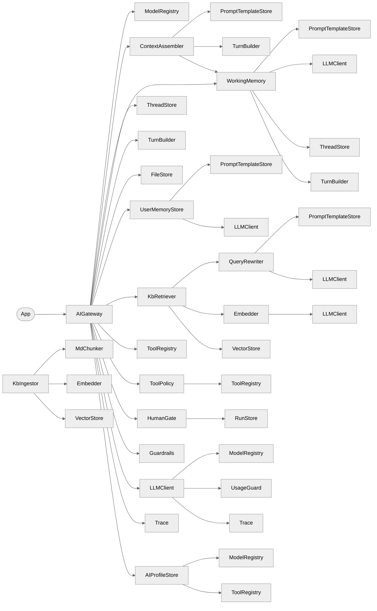
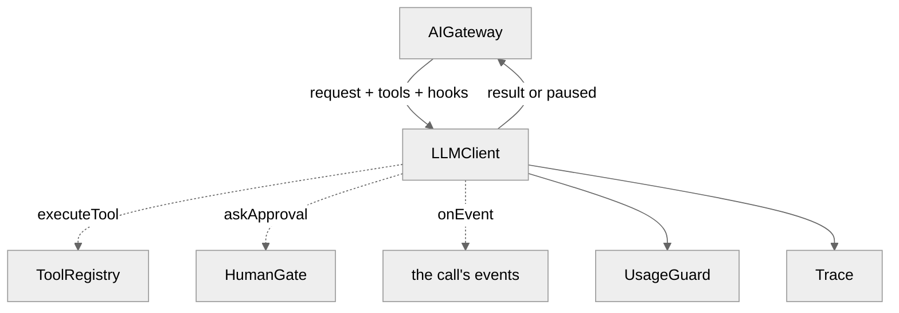
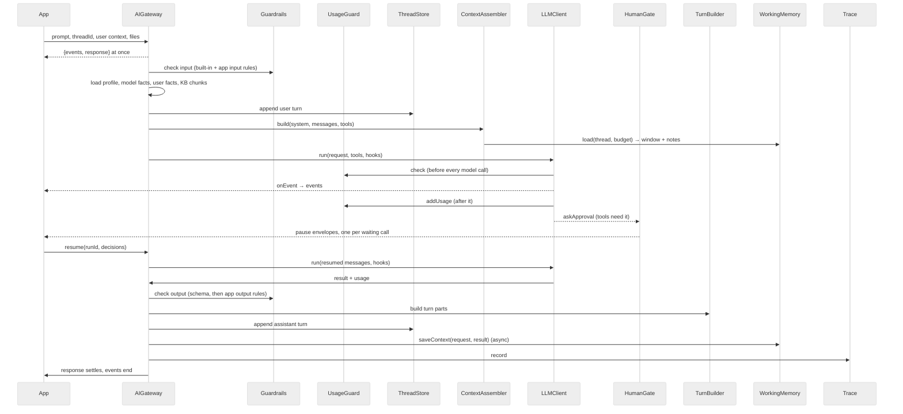

# AI Gateway — Architecture and trade-offs

Status: 2026-10-10.

## 1. What the gateway is

A server-only TypeScript library between a business application and the LLM providers. The application calls three doors — `ask()` (one grounded answer), `run()` (agent loop with tools, may pause for a human), `resume()` (continue a paused run) — and a set of admin and data methods. Everything else (prompt assembly, memory, knowledge base, tools, approvals, usage control, guardrails, tracing) is inside.

Two rules shape every class:

- **Data is passed, services are injected.** A call loads profile, model facts, memory, turns and chunks once and hands them on as plain data. Only services (stores, the LLM client) are constructor-injected.
- **One job per class.** 24 classes, two roots: `AIGateway` (per prompt) and `KbIngestor` (per knowledge-base save).

| Layer          | Classes                                                                                          |
|----------------|--------------------------------------------------------------------------------------------------|
| Facade         | AIGateway                                                                                        |
| Config         | ModelRegistry, AIProfileStore, PromptTemplateStore                                               |
| Context        | ContextAssembler, TurnBuilder — the system prompt's layers: `System prompt production layers.md` |
| Thread         | ThreadStore, FileStore                                                                           |
| Memory         | WorkingMemory, UserMemoryStore                                                                   |
| Knowledge base | KbIngestor, MdChunker, Embedder, VectorStore, QueryRewriter, KbRetriever                         |
| Tools          | ToolRegistry, ToolPolicy                                                                         |
| Control        | HumanGate, RunStore, UsageGuard, Guardrails                                                      |
| Execution      | LLMClient                                                                                        |
| Ops            | Trace                                                                                            |

## 2. Composition

Solid arrow = holds an instance (constructor injection). Shared instances appear more than once; the composition root creates each once.



The same composition as an ownership tree (`*` = shared instance, created once):

```
AIGateway
├─ ModelRegistry*
├─ AIProfileStore
│  ├─ ModelRegistry*
│  └─ ToolRegistry*
├─ ContextAssembler
│  ├─ PromptTemplateStore*
│  ├─ TurnBuilder*
│  └─ WorkingMemory*
├─ ThreadStore
├─ TurnBuilder*
├─ FileStore
├─ WorkingMemory
│  ├─ PromptTemplateStore*
│  ├─ LLMClient*
│  ├─ ThreadStore*
│  └─ TurnBuilder*
├─ UserMemoryStore
│  ├─ PromptTemplateStore*
│  └─ LLMClient*
├─ KbRetriever
│  ├─ QueryRewriter
│  │  ├─ PromptTemplateStore*
│  │  └─ LLMClient*
│  ├─ Embedder
│  │  └─ LLMClient*
│  └─ VectorStore*
├─ ToolRegistry*
├─ ToolPolicy
│  └─ ToolRegistry*
├─ HumanGate
│  └─ RunStore
├─ Guardrails         (app rules injected)
│  └─ LLMClient*      (the rules' judge)
├─ LLMClient*
│  ├─ ModelRegistry*
│  ├─ UsageGuard*
│  └─ Trace*
└─ Trace*

KbIngestor            (second root: KB save, not a prompt)
├─ MdChunker
├─ Embedder*
│  └─ LLMClient*
└─ VectorStore*
```

No cycles: `LLMClient` holds only `ModelRegistry`, `UsageGuard` and `Trace`; the helpers that hold the `LLMClient` are not held by it.

## 3. Execution

The agent loop runs inside the `LLMClient`; every decision in it is a hook the gateway implements (dashed = callback).



One `run()` with a pause:



The tools of one step run [concurrently](Decisions.md#d101-the-tool-calls-of-one-step-run-in-parallel), and a pause carries [every call of the step that waits](Decisions.md#d102-one-pause-carries-every-pending-call-of-the-step) for a human; the application answers them in one `resume`. Without a pause the two `resume` lines are skipped. On a profile that [reviews its answers](Decisions.md#d99-the-answer-waits-for-a-human) a second pause comes after the output check: the answer is kept on the run, the application resumes with the reviewer's decision, and the assistant turn is appended then, without another model call.

## 4. Trade-offs

Each row: what was chosen, what was rejected, what it costs. The link leads to the full record in [Decisions](Decisions.md).

| #   | Decision                                                                                                 | Chosen                                                                                                                                                                                                                                                      | Rejected                                                                                       | Cost of the choice                                                                                                                                                                                                                                                                                                                                                                                                                                                                                                                                            |
|-----|----------------------------------------------------------------------------------------------------------|-------------------------------------------------------------------------------------------------------------------------------------------------------------------------------------------------------------------------------------------------------------|------------------------------------------------------------------------------------------------|---------------------------------------------------------------------------------------------------------------------------------------------------------------------------------------------------------------------------------------------------------------------------------------------------------------------------------------------------------------------------------------------------------------------------------------------------------------------------------------------------------------------------------------------------------------|
| 1   | [Agent loop](Decisions.md#the-agent-loop-is-the-gateways-own)                                            | Own loop in `LLMClient`: one SDK call per step, tools handed to the SDK without executor, every decision a hook                                                                                                                                             | The AI SDK's built-in multi-step loop                                                          | We maintain the loop. Gain: a run can pause on any tool, persist in our message shape and resume with APPROVE / EDIT / REJECT / ANSWER; the SDK loop cannot stop mid-run.                                                                                                                                                                                                                                                                                                                                                                                     |
| 2   | [SDK boundary](Decisions.md#the-ai-sdk-is-sealed-in-one-class)                                           | The AI SDK is imported only inside `internal/llm-client/` (lint rule); one `LLMClient` for all providers                                                                                                                                                    | SDK types and calls across the codebase                                                        | Our own message and result types, and a mapping layer. Gain: a provider or SDK upgrade touches one folder; the rest of the code and the stored data are provider-neutral.                                                                                                                                                                                                                                                                                                                                                                                     |
| 3   | [Model selection](Decisions.md#d46-the-profile-and-with-it-the-model-is-chosen-per-call)                 | The profile, and with it the model, is chosen per call (`profileId`, required)                                                                                                                                                                              | Profile stored on the thread                                                                   | The caller passes the profile on every call. Gain: the application changes the model of a conversation by passing another profile; stored history and memory are provider-neutral, so any profile continues any thread.                                                                                                                                                                                                                                                                                                                                       |
| 4   | [Resume on another profile](Decisions.md#d65-resume-continues-a-paused-run-on-another-profile)           | `resume({profileId?})` derives model, output cap, tools and limits from the given profile; the system prompt and messages stay                                                                                                                              | Resume locked to the starting profile                                                          | The pending tool must be allowed by the new profile (400 otherwise). Gain: a live model change even inside a pending approval.                                                                                                                                                                                                                                                                                                                                                                                                                                |
| 5   | [Streaming](Decisions.md#d38-a-call-returns-its-stream-and-its-response)                                 | A call returns at once with `{events, response}`; the application pushes the events with its own transport                                                                                                                                                  | A gateway-owned Broadcaster with channel ids                                                   | The application writes the transport (SSE, WebSocket). Gain: the standard `streamText` shape; no channel id that arrives after the stream ended; a caller that ignores `events` pays nothing.                                                                                                                                                                                                                                                                                                                                                                 |
| 6   | [Tools](Decisions.md#d48-the-tools-are-fixed-at-construction-a-call-can-narrow-them-never-widen-them)    | The registry is fixed at construction from config; a call can narrow it (`activeTools`) or add its own tools (`additionalTools`), which run on the same pipeline: permissions, approvals, `requires`, timeout and output cap apply to them as to every tool | `register()` / `unregister()` on the running registry                                          | A new registry tool arrives with a deploy, as any code does; a tool that exists for one request is passed on that call. Additional tools skip the profile's `allowedTools` (the app that passes them is trusted code), and a paused run needs them again on resume. Gain: every server instance has the same registry; what a call may do depends on config and data (profile, permissions, the call), never on earlier calls; re-instantiating the gateway for a new registry costs nothing (no I/O in the constructor, state lives in the reused adapters). |
| 7   | [Guardrails](Decisions.md#d47-d49-one-class-with-rules-and-the-severity-is-the-only-verdict)             | One `Guardrails` class: built-in rules in code, the app's input / output rules as config; each rule gets a `judge`: one classification call on the profile's cheap or main model (`EJudgeModel`), checked, reported and traced                                        | A separate `Validator` class; a second `AIGateway` instance as the rules' way to reach a model | App rules are fixed at construction. Gain: one vocabulary (as in the OpenAI Agents SDK, Mastra, NeMo); a judge call is charged and traced like every call; rules run in parallel under a timeout.                                                                                                                                                                                                                                                                                                                                                             |
| 8   | [Usage](Decisions.md#d121-the-application-decides-every-model-call)                                      | The `LLMClient` asks the application's usage adapter before every call, main or helper, reports after it and records the `Trace`; the gateway holds no token logic                                                                                          | A daily token budget per tenant inside the gateway; asking and recording around each call      | The application writes the adapter. Gain: its own rules on the gateway's facts; a memory, rewrite, judge or embedding call cannot be forgotten; one place to audit.                                                                                                                                                                                                                                                                                                                                                                                           |
| 9   | [Persistence](Decisions.md#d28-d29-every-store-has-a-seam-and-the-names-of-its-tables-are-configuration) | Every store has a repository / adapter interface; in-memory adapters first, real adapters (Mongo, PostgreSQL, S3, vector search) later, each with a storage proposal first                                                                                  | Direct database access in the stores                                                           | More interfaces; the real adapters are not written yet. Gain: the whole gateway runs and is tested without infrastructure; table and collection names are configuration, which tenant isolation rests on.                                                                                                                                                                                                                                                                                                                                                     |
| 10  | [Schemas](Decisions.md#d43-zod-is-a-peer-dependency)                                                     | `zod` is a peer dependency; the caller's `outputSchema` crosses the API                                                                                                                                                                                     | Own schema type or bundled zod                                                                 | Version coupling with the caller. Gain: one schema instance, no double validation, the SDK's structured output used as is.                                                                                                                                                                                                                                                                                                                                                                                                                                    |
| 11  | [Human in the loop](Decisions.md#d62-the-model-asks-the-user-through-a-built-in-tool)                    | A pause is a tool whose approval is required; the user question is a built-in tool (`ask_user_question`); the [review of the answer](Decisions.md#d99-the-answer-waits-for-a-human) is the one pause after the loop, per profile                            | A separate pause API next to the tool loop                                                     | Every pause inside the loop is shaped as a tool call; the review reuses the same envelopes, resume and expiry. Gain: one mechanism for approvals, questions and reviews, the idiom of Claude Code, Codex and the AI SDK's approval tools.                                                                                                                                                                                                                                                                                                                     |
| 12  | [Cancellation](Decisions.md#d90-a-call-can-be-stopped-abortsignal-and-timeoutms)                         | `abortSignal` and `timeoutMs` on the call, one signal inside: the model call, the loop, the tool and the rules stop; the response is `FAILED` with an issue code                                                                                            | A thrown abort error; a gateway-side `cancel(callId)` API; a default deadline                  | A tool is stopped cooperatively only: a tool that ignores its `abortSignal` runs to its end, and an abort undoes nothing. Gain: the standard `AbortSignal` idiom, so the signal of the HTTP request or of a "stop" button is passed as is; a timeout is the same mechanism with a clock.                                                                                                                                                                                                                                                                      |
| 13  | Shape of a class                                                                                         | Data passed, services injected; private readonly config and deps; no runtime mutators                                                                                                                                                                       | Classes loading what they need themselves                                                      | More arguments per call. Gain: each class is testable alone, holds no per-request state, and behaviour is fully determined by configuration.                                                                                                                                                                                                                                                                                                                                                                                                                  |

## 5. What the gateway checks and what it trusts

The gateway serves many tenants and many users through one host application. It checks what an end user could forge; it
trusts what only the host's own code can set. The host authenticates the user and decides which of its users may call
which method; the gateway never sees a session or a token.

### 5.1 What the gateway checks

| Area                      | The check                                                                                                                                                                                                                                                                                                                                                                                                                                                                             |
|---------------------------|---------------------------------------------------------------------------------------------------------------------------------------------------------------------------------------------------------------------------------------------------------------------------------------------------------------------------------------------------------------------------------------------------------------------------------------------------------------------------------------|
| Tenant                    | Every read and write is scoped to `userContext.tenantId`; another tenant's thread, run, file, profile or trace entry is not found.                                                                                                                                                                                                                                                                                                                                                    |
| Threads                   | `ask` and `run` on a thread of another user of the tenant are a 404, checked before the thread's lease ([D32](Decisions.md#d32-a-thread-belongs-to-its-user)).                                                                                                                                                                                                                                                                                                                        |
| Files                     | A question carries only the caller's own files: another user's or another tenant's pointer is a 400 ([D30](Decisions.md#d30-a-file-is-its-pointer)). The default types exclude SVG; a file name is short and on one line.                                                                                                                                                                                                                                                             |
| Resume                    | A decision names its pause (`pauseId`, [D110](Decisions.md#d110-a-decision-names-the-pause-it-is-for)); an answer must fit its card ([D117](Decisions.md#d117-an-answer-must-fit-its-card)); an edited tool input goes through the tool's policy again ([D109](Decisions.md#d109-an-edited-tool-input-goes-through-the-policy-again)); a profile switch keeps the review and the approvals ([D113](Decisions.md#d113-a-profile-switch-on-resume-keeps-the-review-and-the-approvals)). |
| The run stays the asker's | Whoever resumes a run, its memory, its trace entries and the screens of its answer belong to the user who started it ([D32](Decisions.md#d32-a-thread-belongs-to-its-user)).                                                                                                                                                                                                                                                                                                          |
| Review                    | The draft of a reviewed answer is not streamed and not in the asker's response or list; the reviewer reads it with `getPausedRun` ([D111](Decisions.md#d111-the-draft-of-a-review-is-the-reviewers)).                                                                                                                                                                                                                                                                                 |
| Tools                     | A policy that reads state sees the earlier calls of its step ([D112](Decisions.md#d112-a-policy-that-reads-state-sees-the-earlier-calls-of-its-step)); the model reads a failed tool's `code`, `status` and `userMessage`, never its `message` ([D100](Decisions.md#d100-what-the-model-reads-when-a-tool-fails-and-how-the-developer-is-told)).                                                                                                                                      |
| Memory                    | The thread's window is the working memory's, sized in tokens by the profile's strategy ([D122](Decisions.md#d122-the-working-memory-owns-the-threads-window)); the model cannot store a user fact unasked ([D116](Decisions.md#d116-the-model-cannot-write-a-user-fact-unasked)); a fact has a size cap; the erasure keeps the user's calls out ([D114](Decisions.md#d114-the-erasure-keeps-the-users-calls-out)).                                                                    |
| Ids                       | Every id is a random UUID ([D115](Decisions.md#d115-ids-are-random-uuids)): a run id is the key `resume` and `cancelRun` take.                                                                                                                                                                                                                                                                                                                                                        |
| What is kept              | The trace and a paused run hold no file bytes ([D108](Decisions.md#d108-the-bytes-of-a-file-live-in-the-filestore-only)); a provider's error is passed on without the request it carried.                                                                                                                                                                                                                                                                                             |
| Sizes                     | A tool's output (50 000 characters), a tool error's text (2 000), a user fact (`maxFactChars`), a reviewer's edit (the model's output cap), the working-memory catch-up (20 turns).                                                                                                                                                                                                                                                                                                   |

### 5.2 What the gateway trusts

These come from the host's code; the host must not take them from an end user's request.

| Input                                                              | Why it is trusted, and what the host must ensure                                                                                                                                                                                   |
|--------------------------------------------------------------------|------------------------------------------------------------------------------------------------------------------------------------------------------------------------------------------------------------------------------------|
| `userContext`                                                      | `tenantId`, `userId` and `permissions` are who the host authenticated. A value taken from the request lets a user act as another.                                                                                                  |
| `profileId`, `instructions`, `kbFilters`, `additionalTools`        | They shape what the model may see and do. `kbFilters` is the knowledge-base scope of the call; an `additionalTools` tool skips the profile's `allowedTools`.                                                                       |
| Who may `resume` and `cancelRun`                                   | Both are open to every user of the tenant ([D32](Decisions.md#d32-a-thread-belongs-to-its-user)): the approver is often not the asker. The host decides who may approve, review or cancel.                                         |
| The admin surface                                                  | `getPausedRun`, `deleteUserData`, `anonymizeUserData`, `removeFilesByUser`, `delete`, `expirePausedRuns`, `recoverStuckRuns` and the getters (`trace`, `toolRegistry`, `aiProfileStore`, …) take raw ids and check no user.        |
| `debug: true`                                                      | Returns the system prompt (instructions, memory notes, knowledge-base excerpts) and the messages; on `resume` also the stored run. For developers only ([D63](Decisions.md#d63-debug-true-attaches-the-transcript-to-the-answer)). |
| An error's `message` and `data`                                    | For the host's logs: they may carry ids or the provider's text. Only `userMessage` is written for the end user.                                                                                                                    |
| A reviewer's edit                                                  | Not screened by the output rules: the reviewer is the host's own person ([D99](Decisions.md#d99-the-answer-waits-for-a-human)).                                                                                                    |
| Prompt templates, the model registry, `onToolError`, `onRuleError` | Platform configuration and the host's own handlers; the handlers receive the raw error and the user context.                                                                                                                       |

### 5.3 What no check covers

- Prompt injection: memory notes and knowledge-base excerpts enter the prompt labelled as "not instructions", and the
  built-in input rules screen the user's text; neither stops every injection. Keep a human approval on every tool with a
  side effect ([D87](Decisions.md#d87-d67-d50-one-policy-on-the-tool-allow-deny-needs-approval)).
- A file's declared MIME type is not compared with its bytes.
- Concurrent model calls are checked one by one; whether two of them may both pass on the same remaining amount is the
  usage adapter's to decide (a reservation by `traceId` in `check` closes the gap).
- The erasure guard sees the calls of one server instance.

## 6. Known limits

- Real adapters (Mongo, PostgreSQL, S3, vector search) are not implemented; everything runs on the in-memory adapters.
